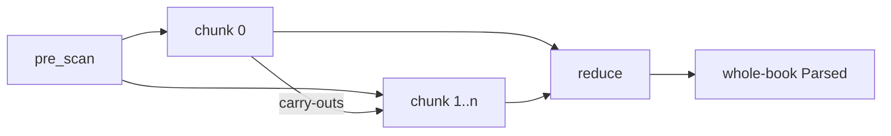

## Show me

The pre-scan, from `onion/src/chunk.rs`:

```text
"\\id GEN\n\\c 1\n\\p a\n\\c 2\n\\p b\n"
   → starts [0, 8, 18]   lf 5   crlf 0
```

The fold, per chunk:

```text
chunk i bytes ─ lex ─ build_chunk ─ lint_chunk(ctx) ─→ (tokens, Cst, local LintReport, Carried)
                                                              │
all chunks, in order ─ cst::concat ─ carried::reduce ─ merge_reports ─→ the whole-book Parsed
```

Chunk 0's carry-outs, the two facts a later chunk cannot see in its own bytes:

```text
Carried::declared_version()     the \usfm line            gates deprecated-marker
Carried::book_is_scripture()    does \id name a book      gates the paragraph rule
```

## Why

- **Chapter is the rebuild unit.** An edit lands in one chapter; re-lexing the book per keystroke is the cost to remove (commit 5ee9d08, "the fold is bought as a plan").
- **Map observes, reduce judges.** Every cross-chunk fact (first and last chapter, once-per-book markers, the sid a later `-e` owes) is recorded in `Carried`. `reduce` is a left fold that needs no source, tokens or tree. Whole-book `lint` is the single-unit fold, so each judgment exists once.
- **Carry-outs belong in the key.** A chunk's product is a function of its bytes and chunk 0's context. The [[chunk-cache]] keys on both, so a `\usfm` change re-derives every later chunk.
- **Dirty boundaries fuse.** `build_chunk` simulates the next `\c`'s displacement. A frame it cannot close (a sidebar across the seam) sets `open_at_end`, and the chunk fuses with its successor.
- **Law:** on clean boundaries `concat(build_chunk each) == build(lex(whole))`, byte for byte (`fold_oracle.rs`).

## Composes with

Built from the [[scanner]], [[cst]] (`build_chunk`, `concat`) and [[lint]] (`lint_chunk`, `merge_reports`). Used by the [[chunk-cache]] inside the [[pantry]].



## Where

- `onion/src/chunk.rs` · `pre_scan`, `PreScan`
- `onion/src/lint/carried.rs` · `Carried`, `reduce`
- `onion/src/lint.rs` · `lint_chunk`, `ChunkContext`, `merge_reports`
- `onion/src/cst.rs` · `build_chunk`, `concat`
