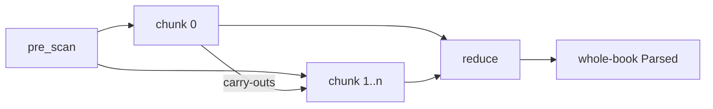

## The problem

To reparse one chapter per keystroke, a chapter has to be processable without its neighbours. A few facts are not local: the `\usfm` version and book kind come from the front matter, and chapter order and once-per-book markers span chapters.

## The solution

Cut before each line starting `\c`, and scan, build and lint each piece alone ([[invariants]] 5). Each piece emits a small [[code:onion/src/lint/carried.rs#Carried]] summary (first and last chapter, once-per-book markers, open ranges), and a final fold makes the book-level calls. The whole-book path is the one-chunk case of the same fold, so every rule is written once and `fold_oracle` holds the two equal.

## Trade-offs

- Editing chunk 0's version line or book kind re-derives every chunk.
- A construct open across a `\c` (a sidebar) fuses the two pieces.
- Cross-chapter rules must be written as carry plus fold.

## Show me

The pre-scan finds the cut points, from `onion/src/chunk.rs`:

```rust
let scan = pre_scan(b"\\id GEN\n\\c 1\n\\p a\n\\c 2\n\\p b\n");
// scan.starts == [0, 8, 18]   a cut before each line starting \c
// lf 5, crlf 0
```

Each chunk becomes products, then they fold:

```rust
// per chunk i, alone
let tokens = lex(chunk_bytes);
let cst = build_chunk(&tokens);
let (report, carried) = lint_chunk(&tokens, &cst, ctx); // local LintReport + Carried

// all chunks, in order → the whole-book Parsed
let cst = cst::concat(csts);
let book_facts = carried::reduce(carrieds);   // left fold: no source, tokens or tree
let lint = merge_reports(reports, book_facts);
```

Chunk 0's carry-outs, the two facts a later chunk cannot see in its own bytes:

```rust
carried.declared_version()   // the \usfm line: gates deprecated-marker
carried.book_is_scripture()  // does \id name a book: gates the paragraph rule
```

## How it works

- **Map observes, reduce judges.** Every cross-chunk fact (first and last chapter, once-per-book markers, the sid a later `-e` owes) is recorded in `Carried`. `reduce` is a left fold that needs no source, tokens or tree. Whole-book `lint` is the single-unit fold, so each judgment exists once.
- **Carry-outs belong in the key.** A chunk's product is a function of its bytes and chunk 0's context; the [[chunk-cache]] keys on both, so a `\usfm` change re-derives every later chunk.
- **Dirty boundaries fuse.** [[code:onion/src/cst.rs#build_chunk]] simulates the next `\c`'s displacement. A frame it cannot close sets `open_at_end`, and the chunk fuses with its successor.
- **Law:** on clean boundaries `concat(build_chunk each) == build(lex(whole))`, byte for byte (`fold_oracle.rs`).

## Composes with

Built from the [[scanner]], [[cst]] (`build_chunk`, `concat`) and [[lint]] (`lint_chunk`, `merge_reports`). Used by the [[chunk-cache]] inside the [[pantry]].



## Where

- [[code:onion/src/chunk.rs]] · [[code:onion/src/chunk.rs#pre_scan]], [[code:onion/src/chunk.rs#PreScan]]
- [[code:onion/src/lint/carried.rs]] · [[code:onion/src/lint/carried.rs#Carried]], [[code:onion/src/lint/carried.rs#reduce]]
- [[code:onion/src/lint.rs]] · [[code:onion/src/lint.rs#lint_chunk]], [[code:onion/src/lint.rs#ChunkContext]], [[code:onion/src/lint.rs#merge_reports]]
- [[code:onion/src/cst.rs]] · [[code:onion/src/cst.rs#build_chunk]], [[code:onion/src/cst.rs#concat]]
