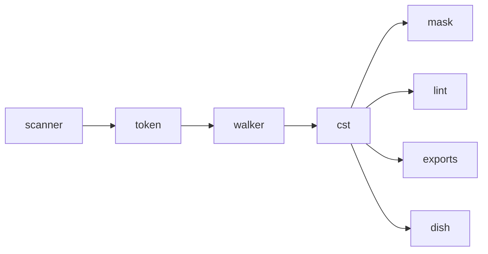

## The problem

Almost every feature needs to know what contains what. Is this word inside a footnote? Which paragraph does verse 4 sit in? Where did that unclosed `\f` footnote end? A flat list of markers cannot answer that without each feature re-tracking open and closed markers itself. And an editor needs to change a word and write the file back without disturbing anything else.

## The solution

Parse each book once into a tree, and keep every byte of the file in it: spaces, newlines, even broken markup. Walk the tree in order and you get the file back exactly. The usual alternative is an abstract tree that keeps only the meaning and drops formatting; that is fine for a compiler, but an editor that saves a file must not reformat a translator's work.

Chapters and verses are not containers in this tree. `\c 1` and `\v 4` are markers that sit beside the text, because in USFM a verse can start mid-paragraph and a paragraph can span verses. Finding "chapter 3, verse 16" is a separate index, the [[toc]].

Nearly everything else reads this one tree: [[mask]], [[lint]], the USJ/USX/HTML [[exports]], and the [[dish]] the editor receives.

## Trade-offs

- Onion ships one tree, not convenient views of it. A consumer wanting blocks, lines or note interiors builds them from the tree.
- Broken input still gets a tree. An unclosed footnote is closed by a recovery rule, and lint reports it; the tree never refuses a file.
- A whole tree costs about 6 ns per token, roughly 40% of the time to tokenize. The heaviest real book takes about 0.6 ms.

## Show me

The file below has a footnote, a character style, a heading and a poetry line. Look at which markers become containers (nodes) and which stay as plain siblings.

Input, 125 bytes (a scratch book run through `lex` then `cst::build`):

```text
\id MRK
\mt1 Mark
\c 1
\p
\v 1 Jesus wept.\f + \ft why\f* Then
\v 2-3 he \nd Lord\nd*   spoke.
\s1 A heading
\q1 \v 4 Bread.
```

Output: 37 tokens, 9 nodes, 45 child ids.

```text
node 0 <root>  children 37..45  Eof
node 1 \id     children  0..3   Implicit   ctx Scripture
node 2 \mt1    children  3..6   Implicit   ctx Section
node 3 \p      children 15..29  Implicit   ctx Para
node 4 \f      children  8..12  Explicit   ctx Footnote
node 5 \ft     children  6..8   Implicit   ctx Footnote
node 6 \nd     children 12..15  Explicit   ctx Para
node 7 \s1     children 29..32  Implicit   ctx Section
node 8 \q1     children 32..37  Eof        ctx Para

root's children: [node 1, node 2, tok 6 \c, tok 7 "1", tok 8 ⏎, node 3, node 7, node 8]
\p's children:   [tok 9 \p, tok 10 ⏎, tok 11 \v, tok 12 "1 ", tok 13 "Jesus wept.", node 4, tok 19 " Then", …]
```

Read it as a tree:

```text
<root>
├─ \id MRK
├─ \mt1 Mark
├─ \c 1                       ← a Point: a sibling of \p, not its parent
├─ \p
│  ├─ \v 1  Jesus wept.        ← \v is a Point inside \p
│  ├─ \f + ─ \ft why ─ \f*     ← Explicit: closed by its own \f*
│  ├─ Then  \v 2-3  he
│  ├─ \nd Lord \nd*
│  └─    spoke.
├─ \s1 A heading               ← \p closed Implicit: \s1 outranks it
└─ \q1 \v 4 Bread.             ← closed at Eof
```

Unclosed input closes by recovery, never by swallowing:

```text
\p
\v 1 Jesus wept.\f + \ft why     ← no \f*
\p                               ← this \p displaces the \f
\v 3 Then

node \f  reason Recovery         lint: unclosed-note
```

## How it works

- **Lossless, not abstract.** Every token id sits in exactly one child list, so an in-order walk of the tree gives back the [[scanner]]'s stream and the bytes concatenate to the [[source]]. `cst_oracle.rs` proves the partition over the 160-book test tier. An AST would have to choose what to drop; the [[exports]] make that choice later and say they are lossy.
- **Points are siblings.** `\c` and `\v` take no content (GLOSSARY, Q16, ruled 2026-08-12), so paragraphs are their siblings. Chapters and verses are an index over the tree, the [[toc]], not a nesting of it.
- **The walker records verdicts, lint reads them.** Each node stores a `CloseReason` (Explicit, Implicit, Recovery, Eof) and the stamped context. [[lint]] matches on those and never re-derives how a frame ended. Positional context (BookHeaders and the rest) is lint's, not the tree's.
- **Flat arrays, no pointers.** `nodes` plus one shared `child_ids` arena; a node id is tagged with bit 31 so tokens and nodes mix in document order. It crosses the wall as three sections of the [[dish]] without conversion (commit b781bb9: "ship the tree, not projections of it" — tree plus diagnostics was 0.64x the bytes and 0.62x the time of the curated planes it replaced).
- **Streaming build.** `Builder::feed` takes one token at a time and holds no slice (commit 2d1108a). That is what lets `build_chunk` build one chapter and simulate the next `\c`'s displacement, which is how the [[chunk-cache]] reuses trees.
- **Cost.** ~6 ns/token, about 40% of a lex; the heaviest aligned book takes ~0.6 ms (`cst.rs` doc). Over the corpus, `--cst-stats` shows Recovery only on three real unclosed `\f`.

## Composes with

Reads: [[token]] rows stamped by the [[scanner]] against the [[marker-table]]; the [[walker]] rules decide every push and pop.
Read by: [[mask]] (scope facts decide which text survives), [[lint]], [[exports]] (USJ, USX, HTML folds), [[format]] via lint, [[overlay]] skeletons, [[diff]] for intra-verse runs, and the [[dish]]'s `nodes` and `childIds` sections. Per chapter, through [[chunk]] and the [[chunk-cache]].



## Where

- `onion/src/cst.rs` · `build`, `build_chunk`, `ChunkCst::open_at_end`, `concat`, `Builder::feed`/`finish`, `Cst::in_order`, `Cst::extent`, `Cst::owners`, `Node`, `CloseReason`
- `onion/tests/fold_oracle.rs` · `concat(build_chunk each) == build(lex(whole))` on clean boundaries
- `onion/tests/cst_oracle.rs` · the partition oracle over `testData/exampleCorpora`
- `onion/src/bin/playground.rs` · `--cst-stats`
