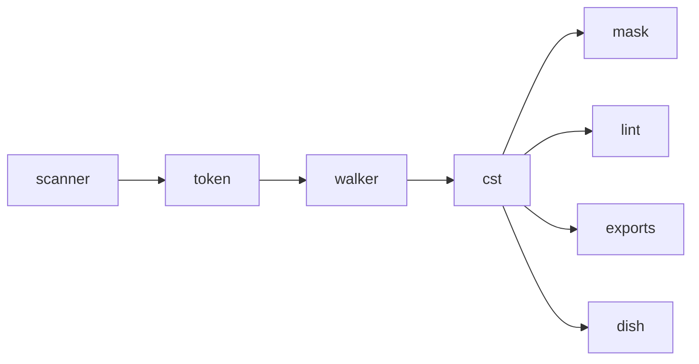

## The problem

Lint, mask, the exports and the dish all need containment: is this word inside a note, which paragraph holds verse 4. And load-then-save through the engine must reproduce the file exactly, or every save rewrites spacing and two collaborators conflict in git over bytes neither touched.

## The solution

A concrete tree over the token stream, not an AST ([[invariants]] 1). An AST applies the spec's whitespace reduction and normalises closers, so loading through it is lossy. Two things keep this one lossless. Whitespace past a marker's one delimiter byte is a `Pad` token: kept, flagged by lint, dropped only by text views. And a frame the file never closed is closed **implicitly**: the node records `Implicit`, `Recovery` or `Eof` in its `reason` byte, and no `\ft*` or `\f*` token is invented.

Chapters and verses are Points (siblings), not containers, because verse and paragraph boundaries cross; the [[toc]] addresses them.

## Trade-offs

- One tree, no views: blocks, lines and note interiors are each consumer's to build.
- Broken input still gets a tree. An unclosed `\f` closes by `Recovery`, and lint reports it.
- About 6 ns per token, roughly 40% of lex time; the heaviest real book builds in about 0.6 ms.

## Show me

The file below has a footnote, a character style, a heading and a poetry line. Look at which markers become containers (nodes) and which stay as plain siblings.

Input, 125 bytes (a scratch book run through `lex` then `cst::build`):

```text
\id MRK
\mt1 Mark
\c 1
\p
\v 1 Jesus wept.\f + \ft why\f* Then
\v 2-3 he \nd Lord\nd*   spoke.
\s1 A heading
\q1 \v 4 Bread.
```

Output: 37 tokens, 9 nodes, 45 child ids.

```text
node 0 <root>  children 37..45  Eof
node 1 \id     children  0..3   Implicit   ctx Scripture
node 2 \mt1    children  3..6   Implicit   ctx Section
node 3 \p      children 15..29  Implicit   ctx Para
node 4 \f      children  8..12  Explicit   ctx Footnote
node 5 \ft     children  6..8   Implicit   ctx Footnote
node 6 \nd     children 12..15  Explicit   ctx Para
node 7 \s1     children 29..32  Implicit   ctx Section
node 8 \q1     children 32..37  Eof        ctx Para

root's children: [node 1, node 2, tok 6 \c, tok 7 "1", tok 8 ⏎, node 3, node 7, node 8]
\p's children:   [tok 9 \p, tok 10 ⏎, tok 11 \v, tok 12 "1 ", tok 13 "Jesus wept.", node 4, tok 19 " Then", …]
```

Read it as a tree:

```text
<root>
├─ \id MRK
├─ \mt1 Mark
├─ \c 1                       ← a Point: a sibling of \p, not its parent
├─ \p
│  ├─ \v 1  Jesus wept.        ← \v is a Point inside \p
│  ├─ \f + ─ \ft why ─ \f*     ← Explicit: closed by its own \f*
│  ├─ Then  \v 2-3  he
│  ├─ \nd Lord \nd*
│  └─    spoke.
├─ \s1 A heading               ← \p closed Implicit: \s1 outranks it
└─ \q1 \v 4 Bread.             ← closed at Eof
```

Unclosed input closes by recovery, never by swallowing:

```text
\p
\v 1 Jesus wept.\f + \ft why     ← no \f*
\p                               ← this \p displaces the \f
\v 3 Then

node \f  reason Recovery         lint: unclosed-note
```

## How it works

- **Lossless, not abstract.** Every token id sits in exactly one child list, so an in-order walk of the tree gives back the [[scanner]]'s stream and the bytes concatenate to the [[source]]. `cst_oracle.rs` proves the partition over the 160-book test tier. An AST would have to choose what to drop; the [[exports]] make that choice later and say they are lossy.
- **Points are siblings.** `\c` and `\v` take no content (GLOSSARY, Q16, ruled 2026-08-12), so paragraphs are their siblings. Chapters and verses are an index over the tree, the [[toc]], not a nesting of it.
- **The walker records verdicts, lint reads them.** Each node stores a [[code:onion/src/cst.rs#CloseReason]] (Explicit, Implicit, Recovery, Eof) and the stamped context. [[lint]] matches on those and never re-derives how a frame ended. Positional context (BookHeaders and the rest) is lint's, not the tree's.
- **Flat arrays, no pointers.** `nodes` plus one shared `child_ids` arena; a node id is tagged with bit 31 so tokens and nodes mix in document order. It crosses the wall as three sections of the [[dish]] without conversion (commit b781bb9: "ship the tree, not projections of it" — tree plus diagnostics was 0.64x the bytes and 0.62x the time of the curated planes it replaced).
- **Streaming build.** [[code:onion/src/cst.rs#Builder::feed]] takes one token at a time and holds no slice (commit 2d1108a). That is what lets [[code:onion/src/cst.rs#build_chunk]] build one chapter and simulate the next `\c`'s displacement, which is how the [[chunk-cache]] reuses trees.
- **Cost.** ~6 ns/token, about 40% of a lex; the heaviest aligned book takes ~0.6 ms (`cst.rs` doc). Over the corpus, `--cst-stats` shows Recovery only on three real unclosed `\f`.

## Composes with

Reads: [[token]] rows stamped by the [[scanner]] against the [[marker-table]]; the [[walker]] rules decide every push and pop.
Read by: [[mask]] (scope facts decide which text survives), [[lint]], [[exports]] (USJ, USX, HTML folds), [[format]] via lint, [[overlay]] skeletons, [[diff]] for intra-verse runs, and the [[dish]]'s `nodes` and `childIds` sections. Per chapter, through [[chunk]] and the [[chunk-cache]].



## Where

- [[code:onion/src/cst.rs]] · [[code:onion/src/cst.rs#build]], [[code:onion/src/cst.rs#build_chunk]], [[code:onion/src/cst.rs#ChunkCst::open_at_end]], [[code:onion/src/cst.rs#concat]], [[code:onion/src/cst.rs#Builder::feed]]/[[code:onion/src/cst.rs#Builder::finish|finish]], [[code:onion/src/cst.rs#Cst::in_order]], [[code:onion/src/cst.rs#Cst::extent]], [[code:onion/src/cst.rs#Cst::owners]], [[code:onion/src/cst.rs#Node]], [[code:onion/src/cst.rs#CloseReason]]
- [[code:onion/tests/fold_oracle.rs]] · `concat(build_chunk each) == build(lex(whole))` on clean boundaries
- [[code:onion/tests/cst_oracle.rs]] · the partition oracle over `testData/exampleCorpora`
- [[code:onion/src/bin/playground.rs]] · `--cst-stats`
