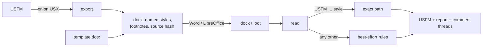

## The problem

Some translators will work in Word or LibreOffice, for tracked changes and comments, whatever else exists. A plain export loses the structure: when the text comes back, nobody knows which paragraph was `\q2` or where `\fr` ended. And not every document starts from one of ours.

## The solution

Every marker is a named style. Export writes `USFM p`, `USFM q1`, `USFM v`, `USFM wj+nd` and real footnotes, generated from the [[marker-table]]; import reads the style NAMES back as markers, with no guessing. A paragraph in any other style goes through best-effort rules ported from Sefer's `@sefer/document-import` (verse numbers by how the document writes them, poetry by indent, headings by look), and each guess is reported. One file may mix the two.

## Trade-offs

- **What Word cannot hold is reported, not carried:** attributes (`\w x|lemma="…"\w*`), milestones with attributes, figures, `\ca`/`\cp`/`\va`/`\vp`.
- **Normalised, not byte-exact.** Export folds onion's USX, so the round trip promises the same book as USJ, not the same bytes. The source's git blob id in the file's properties leads back to the original when bytes matter.
- **Google Docs is out of scope:** its named styles are a fixed set, so ours are flattened.
- **Only LibreOffice is proven by machine;** Word is not yet checked.

## Show me



```text
\q1 \v 3 He restores      <w:p "USFM q1"><w:r "USFM v">3</w:r><w:r>He restores</w:r>
\wj I am \+nd Lord\+nd*   <w:r "USFM wj">I am </w:r><w:r "USFM wj+nd">Lord</w:r>
¹Paul, a servant  (a draft, superscript "1")  ->  \p ⏎ \v 1 Paul, a servant
```

## How it works

- **The name is the contract.** LibreOffice rewrites style ids when it saves; names survive.
- **One pass, two paths.** Both write into one state (book, chapter, verse, comment anchors), so a heading pasted between two of our paragraphs follows the verse before it.
- **Read once, render often.** `read(bytes)` parses; `render(&reading, &settings)` is cheap, for a host that reruns on every settings change.
- **Proved on the test tier.** 159 of 160 books round-trip as USJ, also after a LibreOffice save; document-import's fixtures and 159 drafts made from the test tier match its output exactly.
- **Its own wasm module**, beside bento and bttwriter, with `docx.ts` typing the JSON; [[galley]] does not re-export it.

## Composes with

Folds [[onion]]'s USX ([[exports]]); generates its styles from the [[marker-table]]; uses canon for versification. [[sefer]] imports drafts through it and exports books to Word.

## Where

- [[code:docx/src/export.rs]], [[code:docx/src/import.rs]], [[code:docx/src/strict.rs]], [[code:docx/src/guess.rs]], [[code:docx/src/verses.rs]], [[code:docx/src/styles.rs]]
- [[code:docx/src/reading.rs]] (Word), [[code:docx/src/odt.rs]] (Writer), [[code:docx/src/comments.rs]]
- [[code:docx/tests/round_trip.rs]], [[code:docx/tests/document_import.rs]], `docx/examples/libreoffice.rs`
- Plan: `planning/items/2026-11-05-docx-round-trip-usfm-in-word-and-libreoffice-throu.mdx`
