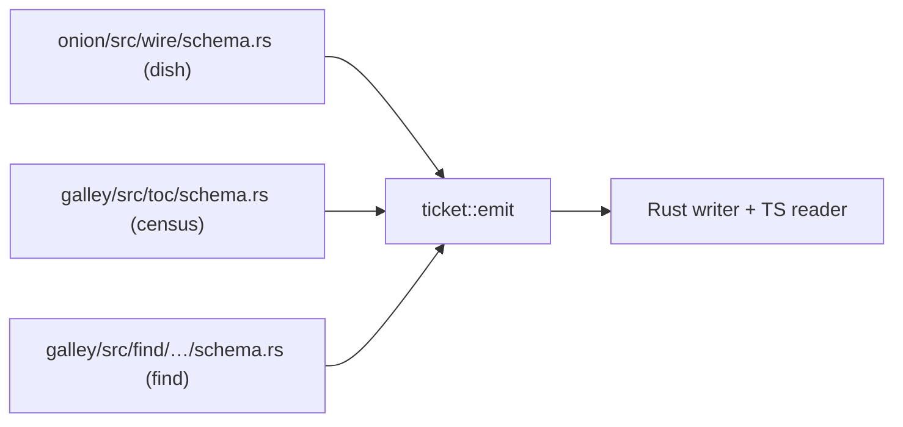

## The problem

Each binary wire needs a Rust writer and a TS reader that agree on every byte, and hand-kept pairs drift silently: a moved field reads garbage.

## The solution

A format declares its fields once in ticket's vocabulary ([[code:ticket/src/schema.rs#Width]], [[code:ticket/src/schema.rs#Space]], [[code:ticket/src/schema.rs#Field]], [[code:ticket/src/schema.rs#Record]], `Repeat`), and ticket emits both ends plus the staleness reporter ([[invariants]] 6). It is generator-only; nothing at runtime calls it. It is not in [[mise]], which excludes generators.

## Trade-offs

- Each format still writes its own envelope (header, magic, version); one grammar for all of them would save about fifty lines.
- Two formats are still partly read by hand: the [[findings-snapshot]] and the [[corpus]] envelope.

## Show me

Three formats, one emitter:

Vocabulary: `Width`, `Space` (`Offset` converts under UTF-16), `Field`, `Record`, and `Repeat` for a run of sub-rows a row carries the length of (a find hit's source pieces).

## How it works

- **No two formats can disagree** about how a field reaches the buffer or where a reader looks for it (`architecture.md`).
- **Formats keep their envelopes.** Declaration, magic, version, envelope, codegen bin and generated files stay with each format (`ticket/README.md`).
- **Generator-only.** No I/O: every function returns a `String`.

## Composes with

Depended on by [[onion]] and [[galley]]. Every [[wire]] except the [[findings-snapshot]] (sous-core's own emitter) and the [[corpus]] envelope is declared against it: [[dish]], [[census]], [[find-buffer]], [[mask-map]].

## Where

- [[code:ticket/src/schema.rs]], [[code:ticket/src/emit.rs]], [[code:ticket/src/stale.rs]]
