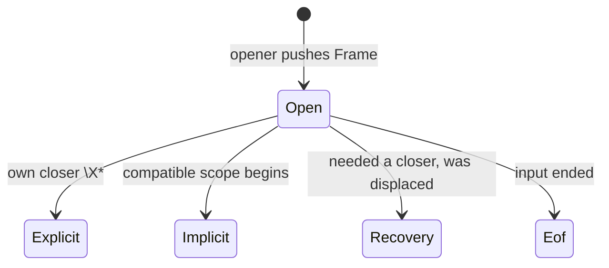

## Show me

```text
\p
\v 1 Jesus wept.\f + \ft why     stack: [root, \p, \f, \ft]
\p                               \p outranks \f: pop \ft (Implicit), pop \f (Recovery), pop \p (Implicit), push \p
\v 3 Then
\v 2 he \nd Lord.                end of input: \nd and \p close at Eof
```

Lint over the same 76 bytes (`playground --lint-stats`):

```text
unclosed-note        @32   the \f the walker closed by Recovery
unclosed-at-eof      @66   the \nd
verse-out-of-order   @61
verse-gap            @51
```

## Why

GLOSSARY.md separates the words so the code can keep them apart:

- A **Scope** is a kind that opens, takes content and closes. A **Frame** is one live occurrence on the stack, stamped with its **Context** at push time.
- **Context** answers "may this marker appear here?". **Precedence** answers "how many frames to pop?". Precedence cannot do Context's job: it is a total order and cannot say `\add` may nest in `\add`.
- **Displacement** closes a frame because an incoming marker outranks it. It is always a lint event, never silent (Will, 2026-08-12: "let them know we closed the footnote").
- A sidebar is a pop barrier: only `\esbe` ends it, so a `\c` inside `\esb` stays inside and lint flags it.

The name: "Walker", ruled 2026-08-12. "Driver" is a synonym to avoid; the glossary already uses driver for the engine host.

Trade-off: a `\p` can never be swallowed by an unclosed `\f`, at the cost of the tree disagreeing with an author who meant the note to run on.

## Composes with

Reads [[token]] rows and the [[marker-table]]'s columns (`opens_scope`, `closes_scope`, `allowed_contexts`, `precedence()`). Writes the [[cst]]'s `CloseReason` and `ctx` per node. [[lint]] reads those verdicts.



## Where

- `onion/src/cst.rs` · `Builder`, `Frame`, `FrameRole` (sidebar barrier, milestone point, U25003 container)
- `onion/src/tables/schema.rs` · `SpecContext`, `MarkerRow::precedence`
- `GLOSSARY.md` · "Scope", "Frame", "Precedence", "Displacement"
