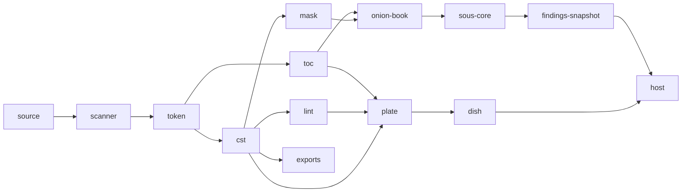

# scripture-kitchen

A Rust workspace for USFM editing and proofreading. **Onion** parses USFM losslessly and answers structural questions (tree, verse index, lint, format, diff, exports) fast enough for an editor to run per keystroke in WebAssembly. **Sous Chef** flags reviewable inconsistencies from a project's own counts, in any language, and **galley** holds the state between calls and ships the one JS package hosts vendor.

## Invariants

Seven rules drive most of the design; [[invariants]] gives each its reason and what it forces.

1. **Lossless.** Bytes in are bytes out: a CST, not an AST; surplus whitespace is a `Pad` token; closers are recorded, never inserted.
2. **Offsets over object graphs.** A token is 12 bytes of numbers; every per-call answer is a binary wire of ranges, enum kinds and string tables.
3. **Flag, never repair.** A corollary of 1: lint reports, and offers edits where a fix exists; nothing is guessed or silently normalised.
4. **Stateless engines.** Onion and sous-core keep nothing; galley's pantry holds all state, keyed by content.
5. **The chapter is the unit of rework.** Parse, lint and Sous counts are per chapter, folded per book.
6. **Author once, generate the rest.** Marker table, wire readers and writers, diagnostics and Unicode tables are generated and staleness-tested.
7. **Sous judges from counts, behind a neutral seam.** No rule lists and no dependency on onion.

## Why a kitchen?

Naming is hard, and hardest at the module level: there is no natural single word for a crate that holds a stateful cache and combines proofreading with parsing. Where it can, the kitchen picks names that have some logic to them rather than being merely cute. [[galley]] is a kind of kitchen, the one that holds the state. A [[sous-chef|sous chef]] works inside it, with an [[onion-engine|onion]], which peels USFM in layers: bytes, tokens, tree. The sous chef grabs [[mise|mise en place]], the prep both stations share, to prepare dishes: to [[plate]] is to lay one parse's products onto one buffer, and what crosses to JS is the [[dish]]. The [[pantry]] stores what is kept between calls, a [[ticket]] is the order slip both ends of a wire read, and the [[expediter]] passes finished work out to the host. It doesn't always work, but there is some sense to it.

## The pieces

One Rust workspace, two products, one JS package.

- **[[onion-engine|Onion]]** reads USFM losslessly: [[scanner]] to [[token]]s, tokens to the [[cst]], and everything else derived from those.
- **[[sous-chef|Sous Chef]]** finds reviewable inconsistencies from counts alone, and never depends on onion.
- **[[galley]]** is the one crate allowed to see both. It caches ([[pantry]]), publishes ([[expediter]]) and ships the [[galley-package]] that hosts run.

## Four zoom levels

| level | what | start with |
| --- | --- | --- |
| 0 | products and consumers | [[onion-engine]], [[sous-chef]], [[galley-package]], [[sefer]] (one host) |
| 1 | crates, and who may depend on whom | [[mise]], [[ticket]], [[onion]], [[galley]], [[sous-core]] |
| 2 | primitives and workflows | [[cst]], [[toc]], [[mask]], [[chunk]], [[pantry]] |
| 3 | wires: bytes that cross to JS | [[wire]], [[plate]], [[dish]] |

## Where to start

Read [[invariants]], then the [[cst]]. It is the base nearly everything reads: [[mask]], [[lint]], the [[exports]] and the [[dish]]. Then [[toc]] (where things are, no tree needed), then [[chunk]] and the [[chunk-cache]] (how a keystroke avoids re-reading a book).

