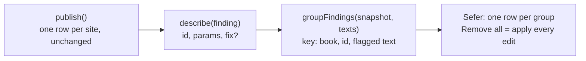

## What changes for a reviewer

Today one habit is thousands of rows: Even John has 8,157 no-break spaces
beside a space, fa_opv 235k zero-width non-joiners before a space, km_ulb
~10k stray zero-width spaces after the word-break fix. After:

```text
John · 8,157 × a no-break space (U+00A0) beside a space.   [Remove all]
  It does nothing a plain space does not. Removing it changes nothing on the page.
```

One row per (book, message, flagged text), the count, every site behind it,
and a fix that is certain. Hygiene only, to start.

<Mermaid id="flow">

</Mermaid>

## The pieces

- **The wire does not change.** `publish()` stays one row per site, and site
  identities and suppressions stay per site. Grouping is a read of the rows.
- **`hygieneFix(finding, text)`** in `galley/sous-messages.ts`, returned by
  `describe` as `fix`: a list of `{ from, to, insert }` edits, the same shape
  onion lint fixes carry, so Sefer applies both through one path. It reads
  the book text because two fixes depend on the neighbours (below).
- **`groupFindings(snapshot, texts, { scope })`** in galley: groups by
  `scope` (`"book"` or `"project"`), message id and flagged text; each group
  has the count, the sites, and the concatenated fix edits, ordered so they
  apply back to front.
- **Messages name the character**: `U+200C`, "zero width non-joiner", from the
  generated `sous-unicode-names.ts` the convention messages already use, plus
  where it is ("before a space") and what removing it does.

No "aggregable" flag. A finding with a `fix` is groupable; one without is
shown as it is today. Whether to group is Sefer's choice of call, not a galley
setting, because the rows underneath are the same either way.

## The fix table

| Class | Fix |
| --- | --- |
| control, delete, noncharacter, NUL run | remove |
| no-break space beside whitespace or at an edge | remove |
| no-break space run between two non-spaces | keep one |
| misplaced format (stray BOM, ZWNJ or ZWSP beside a space or punctuation) | remove |
| zero-width space run between two letters | keep one |
| U+FFFD | none: a character is already lost |
| C1 control | none: mis-decoded text; re-decoding is its own idea |
| stray CR, backslash, conflict line, free combining mark | none: removing or keeping is a judgment |

Why the Persian ZWNJ before a space is worth removing, though harmless on the
page: it is bytes nobody sees, an exact search for `word ` misses
`word‌ `, and anything that keys on a word's exact text (Sous's word counts,
pairing, a concordance) sees two spellings of one word.

## Proving a fix is certain

A test in the style of onion's `check_fixes`, over the committed tier and the
two sample repos: apply every hygiene fix, republish, and require that the
fixed classes report nothing and that the verse text changed only where a
character was removed. The same run reports how many rows the grouping
collapses (fa_opv's 235k should be a few dozen groups).

<Files id="files">
```text
~ galley/sous-messages.ts        -- hygieneFix, describe returns fix, params name the character
~ galley/sous-messages.en.json   -- hygiene headlines per placement, the fix sentence
~ galley/sous-messages.md        -- the fix table and grouping
+ galley/sous-group.ts           -- groupFindings
~ galley/tests/sous_conformance.mjs -- the fix-safety run
~ package.json                   -- files: galley/sous-group.ts
```
</Files>

<Question id="scope">Hygiene only to start, conventions later if Sefer wants "remove all" for them. Agreed?</Question>
<Question id="where">The placement ("before a space", "at the edge") is computed from the text in TS. Should the engine publish it instead, in a spare hygiene lane, so other languages get it without re-deriving?</Question>
<Question id="c1">C1 mojibake repair (re-encode as cp1252, decode as UTF-8, offer it only when that round-trips): its own idea item, later?</Question>
