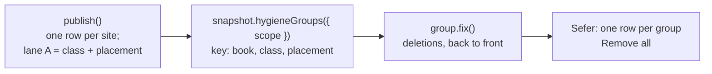

## What changes for a reviewer

Today one habit is thousands of rows: Even John has 8,157 no-break spaces
beside a space, fa_opv 235k zero-width non-joiners before a space, km_ulb
~10k stray zero-width spaces after the word-break fix. After:

```text
John · 8,157 × a no-break space (U+00A0) beside a space.   [Remove all]
  It does nothing a plain space does not. Removing it changes nothing on the page.
```

One row per (book, class, placement), the count, every site behind it, and a
fix that is certain. Hygiene only: a convention row (`,"` where the project
writes `."`) never gets a fix, because the counts cannot make a content
change certain.

<Mermaid id="flow">

</Mermaid>

## The pieces

- **Placement on the wire.** Lane A carries the class as a `u8` in an `i16`;
  its high byte becomes an append-only placement enum: `BesideSpace`,
  `AtEdge`, `BetweenLetters`, `BesidePunctuation`, `Alone`, `Other`, judged
  on the scalars just outside the exact run. The row layout is unchanged, but a reader built before
  misreads lane A, so this is one `FORMAT_VERSION` bump.
- **Where the run sits in its span.** A hygiene row's span is widened to atom
  edges (charter invariant 6), so a stray ZWNJ's span takes the letter before
  it: in fa_opv 235,436 of 235,437 rows end with the run but do not start
  with it. Deleting the span would delete the letter. The scan therefore
  also records the run's anchor in the span (`Exact`, `AtStart`, `AtEnd`,
  `Neither`) and whether every scalar of the run is one UTF-16 unit; both
  ride lane A's high byte beside placement. A `Neither` or mixed-width run,
  or a run whose raw mapping crosses a masked marker, has no fix.
- **Every fix is a deletion.** No inserted text, so no strings: in Rust an
  `onion::Edit { from, to, insert: FixStr::EMPTY }`, in TS `{ from, to }`.
  "Keep one" is "delete all but the first". Both are computed from the row:
  the anchor says which end of the span the run is at, and the width bit
  makes `run` a UTF-16 length.
- **Grouping is a reader method over the buffer**, lazy and copy-free like the
  rest of the reader: `snapshot.hygieneGroups({ scope: "book" | "project" })`
  → groups with `.key`, `.count`, the row indices, and `.fix()`. Same in Rust
  (`sous-core`, for the CLI, the hub and any future FFI) and in the reader
  template (`sous-chef/reader.ts.tmpl` → `reader.ts`, `galley/sous-reader.ts`).
  Codegen carries the enums and lanes; the grouping and fix logic is
  hand-written in both, about 30 lines each.
- **One case file holds the two equal**: `testData/hygiene/groups.json`, rows
  in, groups and deletions out, read by a Rust test and a node test.
- **Messages name the character and where it is**, from the placement lane
  and the site text: "A zero width non-joiner (U+200C) is here before a
  space." Plus what removing it does.
- No "aggregable" flag and no galley setting: a hygiene row with a fix is
  groupable, and whether to group is Sefer's choice of call.

## The fix table

| Class | Placement | Fix |
| --- | --- | --- |
| control, delete, noncharacter, NUL run | any | remove |
| no-break space | beside whitespace, at an edge | remove |
| no-break space run | between two non-spaces | keep one |
| misplaced format (BOM, ZWNJ, ZWSP) | beside a space or punctuation, at an edge | remove |
| zero-width space run | between two letters | keep one |
| U+FFFD | | none: a character is already lost |
| C1 control | | none: mis-decoded text (repair is a later idea) |
| stray CR, backslash, conflict line, free combining mark | | none: removing or keeping is a judgment |

Why the Persian ZWNJ before a space is worth removing, though harmless on the
page: it is bytes nobody sees, an exact search for `word ` misses
`word‌ `, and anything that keys on a word's exact text (Sous's word counts,
pairing, a concordance) sees two spellings of one word.

## Proving a fix is certain

A test in the style of onion's `check_fixes`, over the committed tier and the
two sample repos: apply every hygiene fix, republish, and require that the
fixed classes report nothing and that the verse text changed only where a
character was removed. The same run reports how many groups the rows
collapse into (fa_opv's 235k should be a few dozen).

<Files id="files">
```text
~ sous-chef/core/src/hygiene.rs        -- the scan records placement
~ sous-chef/core/src/codec/hygiene.rs  -- placement in lane A's high byte
+ sous-chef/core/src/hygiene/groups.rs -- hygiene_groups, fix
~ sous-chef/reader.ts.tmpl             -- hygieneGroups, fix (codegen to both readers)
~ galley/sous-messages.ts              -- character and placement in the hygiene message
~ galley/sous-messages.en.json
~ galley/sous-messages.md              -- the fix table and grouping
+ testData/hygiene/groups.json         -- rows → groups → deletions, both languages
~ galley/tests/sous_conformance.mjs    -- the case file, and the fix-safety run
```
</Files>

<Question id="scope" answer="Yes (Will, 2026-10-20): hygiene only. Convention content is never made easy to change; the counts cannot make it certain.">Hygiene only?</Question>
<Question id="where" answer="Engine (Will, 2026-10-20): placement is an enum on the wire.">Placement computed in TS or published by the engine?</Question>
<Question id="c1" answer="Postponed (Will, 2026-10-20). It works: re-encode the stretch as cp1252 bytes, C1 as its own byte, decode as UTF-8, offer only when valid and changed.">C1 mojibake repair?</Question>
