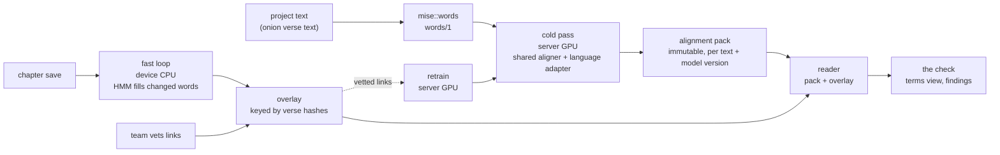
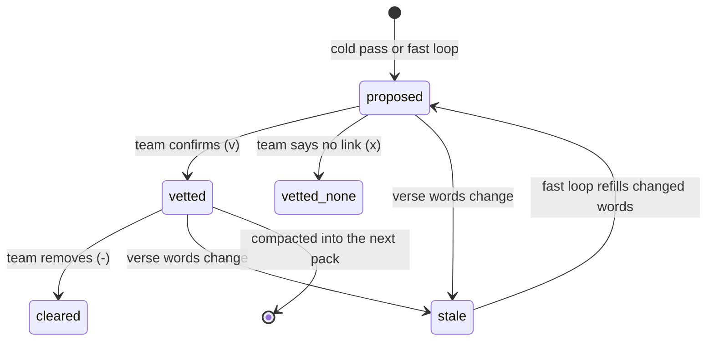
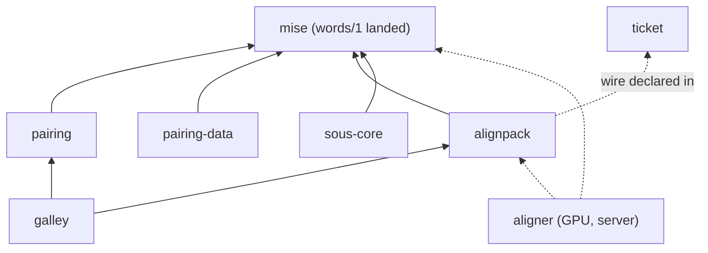

The one pairing plan, written 2026-10-21 from what the lab now knows. It replaces four items
(the 2026-10-14 Model 2 plan, the 2026-10-15 rebuild, the 2026-10-20 lab plan and the 2026-10-21
port plan); git history holds them. Will, 2026-10-21:

> we have 4 plans in discussing called 'pairing' and pairing port. Those, using that latest info from the ssh box, should just be one plan ideally.

On how much of it is approved:

> Yes on full port of that pairing work is separate, not sure full scope of it to bring it. Draft a plan for that too. Likely all but not sure or 100% approved. But words is one primitive for sure needed already is idea.

[words/1](/items/2026-10-20-words-one-splitter-in-mise-with-a-narrower-joiner-) has landed in
`mise::words` (`mise/src/words.rs`, `VERSION = "words/1"`), so the port has its splitter. `Galley.resolveOf(text, address, opts)` has landed too
(38399c1): it resolves any address, verses included, in text the host holds without
registering it, which is what a pack's BCV address needs to land on a page. Everything else
here is a draft.

Finding numbers are from the lab's `RESULTS.md`, which has no commit yet (see `commit-lab`).

## What a user gets

A translator reads, in the words of the text they translated from: "Where your source says
*grace*, you write *neema* in 236 of 241 verses. These five verses have none of your usual
words for it." The key behind that sentence is a Greek or Hebrew lemma; the user never sees
Greek.

- **Two lists per book:** likely **typos and names** (short: 20–160 per NT), and possible
  **missing renderings** (longer, lower priority). On six real heart-language drafts with full
  BTT-Writer history, a possible-typo flag on the first complete draft was later corrected by
  the team 17–42% of the time, against 8–10% for a random rare word, with no language model
  (finding 56). Missing renderings flagged with the trained aligner were later filled 2.6–4.9×
  chance.
- **The terms view is the product; findings are a view of it.** For every term the translator
  sees the renderings the project uses, with counts, and can mark each as approved. That is
  what Paratext's Biblical Terms tool is, and what consultants already trust. "Missing
  rendering" then means "none of the approved or usual renderings".
- **Names are their own lane** and sort first: every spelling aligned to one proper-name lemma,
  minority spellings flagged. 4,626 Greek tokens are proper names (MACULA `type=proper`); names
  were the best lane on Hebrew too (finding 61).
- **Gateway-language projects** get an alignment made once, offline, by our trained aligner:
  11.4 AER on the English ULB against eflomal's 26.0 and Model 2's 30.8 (findings 2, 14). Links
  it is 99% sure of are 97.6% right (finding 37).
- **Heart-language projects** get the same aligner cold, even untrained on the language, and a
  better one after their first vetted chapter: 32 verses recover 76–93% of the gain 2,000 give,
  for four GPU minutes (finding 57).
- **Any page that shows words can show alignments**, with or without an editor: the same
  splitter and the alignment files, read by BCV address.

> So not only Sefer, but anyone that can show words … So you don't have to have an editor. You can have the same tokenzier + the alignment files.

## What the lab overturned

- **Model 2 as the cold pass**: the trained aligner is 11.4 AER on the ULB against Model 2's
  30.8 (findings 2, 14). Model 2 stays only as the HMM's fallback start (finding 30).
- **"Model 2 only"**: the deterministic HMM is the fast loop; it beats Model 2 from the same
  start (finding 30) and fills edited words within 1.3–3.1 AER of re-running the head (36).
- **Senses as the check's key**: keying on Louw-Nida sense removed labelled variation but made
  new terms checkable that were also variation, and the total hardly moved (finding 54). The
  check keys on the lemma. Hebrew has no Louw-Nida in the lab's source, so this was Greek only.
- **The `ALGN` chapter-block buffer and its block-cache test**: alignments travel as an
  immutable pack plus an overlay keyed by verse hashes (findings 59, 62).
- **The gateway alignment computed on the device by Model 2**: it is the cold pass's output,
  or Door43's human alignment where one exists.
- **`sous_core::words::for_each_word` as the splitter, and the lab's UAX #29**: `mise::words`
  (`words/1`) is the one splitter.
- **"Measure on the Swahili NT first"**: the lab is that measurement, at much larger scope.
- **The affix gate** on near misses: on drafts it hid half the reachable typos (findings 56, 61).

Moot, so dropped: whether to align to Greek or to the gateway (findings 52, 56 settled it; see
"Feedback"), which aligner and link extraction (findings 14, 35, 37), the gold harness's home and
loaders (the lab is the harness), a real-error corpus (finding 56 built one from BTT-Writer
histories), eflomal as the ceiling (done; GPL, evaluation only), the gateway filter (it is
check change 3), on-device gateway packs, hot-or-cold `ALGN` caching, and the block-cache test.

## Three layers

<Mermaid id="layers" caption="Where each alignment comes from">

</Mermaid>

| layer | where | what | when |
|---|---|---|---|
| cold pass | server, GPU | the shared aligner (+ the language's adapter) aligns every unvetted verse | on import, and after each retrain |
| fast loop | device, CPU | the HMM fills only the words an edit changed; vetted and untouched cold links stay verbatim | every chapter save |
| retrain | server, GPU | train the language's adapter on its vetted links; re-run the cold pass on unvetted verses | every N vetted verses or nightly |

Re-deriving a strong cold pass through the HMM loses 4–11 points (finding 35), so the HMM never
replaces cold links; it fills gaps, and is only as good as its start (finding 51). Its update is
2.4–8.3 ms a save and a chapter re-link 3–5 ms (finding 30). The start rule: vetted links, else
the cold pass, else Model 2. The lab has not yet wired the HMM's incremental update into
`Tables` (its "Not done yet").

> Wait, so you're saying multiple models though instead of one? But that's a lot of models to keep around is the thing?

One shared model plus a small adapter per language; see "Models".

<Question id="retrain-trigger" answer="Ops policy (Will, 2026-10-20). Recommended default: retrain a language's adapter when 30+ verses were vetted since the last one, checked nightly; raise to ~200 once a language has 500+; a retrain-now button; the shared base every few months.">What triggers a retrain: every N newly vetted verses (N = 30 is where the curve pays), a nightly job over commits to main, or a button?</Question>

<Question id="cold-pass-host" answer="The lab's A6000 first, as a stateless queued job (text + vetted links in, adapter + pack out) that can move to a rented on-demand GPU later; no standing service (Will, 2026-10-20).">Where the GPU lives: the A6000 in the lab (an NT in ~4 min in f16), rented per run (an H100, estimated ~1 min, a few dollars an hour), or a standing service?</Question>

<Question id="cold-pass-job">The server job (text and vetted links in; adapter and pack out; on the A6000 first): who owns it, and is it in this plan at all or an ops item?</Question>

**The trained aligner is not always the right cold pass.** On Piaroa (Venezuela, Sáliban,
translated from the Spanish ULB; finding 61) the shared model zero-shot linked so little that its
missing-rendering flags were far worse than eflomal's (strict precision 6.0 against 34.6). The NT
heart drafts (finding 56) were the opposite. Rule for the server: per language, measure how much
of the text the trained aligner links; below a threshold, feed the check from a statistical pass
or the composition through the gateway until the team has vetted a chapter and an adapter exists.

<Question id="coverage-rule">The coverage threshold that switches a language from the trained aligner to the statistical cold pass, and whether that statistical pass must be our own deterministic HMM (eflomal is GPL and nondeterministic).</Question>

## Models

- **The aligner is ours.** BinaryAlign's method (Latouche et al., ACL 2024) on Microsoft's MIT
  mDeBERTa-v3 base; inference and training in Rust on candle, written from
  `docs/word-aligner-spec.md` only, because BinaryAlign's code and weights are CC BY-NC-ND
  (findings 46, 49). GPU f32 matches the PyTorch reference link for link; our trainer reproduces
  it (11.7 against 11.4).
- **One shared base:** currently `d43multi`, Clear's gold in seven languages, Hebrew, and
  Door43's aligned texts in 16 more (finding 50). Precision near 90 everywhere.
- **A small adapter per language** (LoRA): the base stays frozen and an adapter is 2–11 MB
  instead of a 1.1 GB copy, matching or beating it (finding 58).
- Retraining the shared base: every few months, with all gold, a few GPU-hours.

<Followup id="lora" done>Adapters: a shared base plus a 2.4–10.6 MB LoRA adapter matches or beats a full 1.1 GB per-language copy on Odia and Hausa at 32 and 200 verses, same training minutes and inference speed (lab finding 58). Recipe: rank 16, attention + FFN, lr 5e-4.</Followup>

<Tradeoff id="cc-by-sa" chose="train on Door43's CC BY-SA aligned texts" cost="if the organisation later says no, retrain without them">Will, 2026-10-19: "I think they'd be fine on training. It doesn't mean we have to adopt their wording … If I later find out no then we throw it out."</Tradeoff>

<Question id="aligner">Where the trained aligner's code lives. It is a server tool with GPU dependencies (candle, tokenizers with onig, cudarc), so in this workspace it would slow the gate. Options: (a) a member left out of `default-members` and out of the wasm build; (b) its own repo that depends on `alignpack` and `mise` by path or git; (c) stay in the lab until the cold-pass job exists. Recommended: (b).</Question>

## Keys, labels and licences

**Greek and Hebrew are the hidden key; the gateway's words are the face.** Will:

> the fact that greek and hebrew already come "stemmed or via lemma" is a MAJOR asset.
> otherwise ibm would be pairing all the believ* family in english, which might produce
> fragmentation no? But if I don't put the greek in front of user then.... I can't honestly
> say your source usually uses the word "x" unless i just fallback to the gloss, or on the fly
> 3 way align and just trust whatever the greek en_ulb side says

- **Labels come from the gateway's own words, per verse**: the gateway word linked to that Greek
  word in that verse, from the gateway's alignment (human where Door43 has one, else the cold
  pass). A term's label is its most common gateway word. Gateway errors become label errors,
  never findings.
- **The gloss is the fallback** when the gateway link is weak: the UBS dictionaries in the UI
  language, else MACULA's English gloss.
- **Greek key**: MACULA lemma (Strong's) over SBLGNT. **Hebrew key**: Strong's on Clear's WLCM
  morphemes, with Clear's letter suffixes (prefixes, the article and pronominal suffixes are
  their own tokens). The check carried over to Hebrew unchanged on that key (finding 61).
- **Content words**: MACULA part of speech noun, verb, adjective or adverb; names by
  `type=proper`. Every check judges only content words.

<Question id="english-text" answer="Passed in, and usually ULB, not ULT (Will, 2026-10-14). On the pivot path the gateway text is a pack we build, so the host passes nothing.">Which English text: whatever the host passes in, or a fixed one we ship?</Question>

<Question id="ult-zaln" answer="Assume no ULT (Will, 2026-10-14). ULT's and the GLTs' human alignments are still training and evaluation data.">Should a Translation Words list keyed by Strong's resolve to English words through ULT's `\zaln`?</Question>

**Licences, which constrain every pack:**

| material | licence | consequence |
|---|---|---|
| MACULA Greek and Hebrew | CC BY 4.0 | the lemma packs; attribution travels with the asset |
| UBS dictionaries (SDGNT, SDBH) | CC BY-SA 4.0 | gloss packs stay separate assets, out of wasm and out of `mise` |
| Door43 aligned texts, ULB, ULT, UGNT | CC BY-SA 4.0 | training data (the `cc-by-sa` trade-off); a pack of a ULB alignment carries the text's licence |
| unfoldingWord translationWords | CC BY-SA 4.0, with a trademark condition | a separate optional asset (`tw-license`) |
| Clear-Bible alignments | CC BY 4.0 (target texts vary) | training and evaluation gold |
| mDeBERTa-v3 base | MIT | the aligner's base |
| BinaryAlign code and Ubisoft weights | CC BY-NC-ND 4.0 | not used; our aligner is written from the spec |
| eflomal | GPL v3, and nondeterministic | evaluation only; never in a shipped package or the fast loop |
| RP2018 Byzantine text | public domain | the disputed-word mask |

<Followup id="sell-macula">Make the case to the PO and ops for shipping MACULA (CC BY 4.0) and the UBS dictionaries (CC BY-SA 4.0). Will: “PO and ops might object, but I really think this is good data and we should try to sell them on this.” The pivot path is the argument: better checks, with no Greek in front of users.</Followup>

<Question id="tw-license">translationWords is CC BY-SA 4.0 and carries a trademark condition. As a separate asset, like the UBS dictionaries, does that fit? If not, the terms pack is an optional host-supplied list in the same format.</Question>

### Senses: notes, not the key

> a language that retains those two senses into one may not be wrong. They may just use
> context to split out those senses. But it's also worth potentially flagging to them there
> are two senses of a word here.

The check keys on the lemma (finding 54). A sense note, one per polysemous lemma and never per
verse, may still say how the translator renders each sense, labelled with the gateway's words:
"Where ULB says *grace* and where it says *thanks*, you write *neema* for both." It is never a
finding. Hebrew grace isn't Greek grace: חֵן, חֶסֶד and χάρις are different lemmas, grouped only by
an explicit list, shown side by side.

<Question id="sense-note-default" answer="Its own channel and its own cadence, not in Findings (Will, 2026-10-14: scared of too much noise).">Should the sense note appear in Findings (as info) by default, or only on the Terms row?</Question>

<Question id="sense-bytes" answer="Fine for size (Will, 2026-10-14). Split by layer into packs (below) rather than one file.">Is a `u16` sense id per word acceptable?</Question>

### The gateway-only path

Used when MACULA can't ship: the gateway text is the source itself, checked by word, and the UI
says so. Will: "This is real and useful linguistically for bible purposes, but I can't force ops
[…] the fact that the original open source texts come pre-lemmatized is ideal imo." No
language-specific stemmers; every word is `content`; the check's floor and the host's filter on
terms handle function words; a NULL-link signal is in reserve if that proves noisy.

<Question id="zipf-head" answer="Dropped (Will, 2026-10-14: ok on zipf).">Drop the Zipf idea: on en_ulb *yahweh* is the 18th most frequent word, *god* 34th, *israel* 50th, so a frequency cut deletes the terms we want to check?</Question>

<Question id="english-senses" answer="Yes: the gateway-only path checks by word with no senses, and the UI says so. Will, 2026-10-14: real and useful, but ops can't be forced to adopt the original-language path.">The gateway-only path has no senses at all. Accept that as the price of not shipping MACULA?</Question>

## Verses: versification, pairing and addressing

- **Verse pairing is by key**, and what does not pair is printed, never dropped silently. The
  lab's rule: Romans 16 pairs 16:24 Greek-only and 16:25–27 English-only, and all four are left
  out; 2CO 13:14, 3JN 1:15 and REV 12:18 likewise where BSB's versification differs.
- **Mapping between versifications is its own layer**
  ([A versification layer](/items/2026-10-14-a-versification-layer-for-everything-that-pairs-ve)),
  shared by sous, galley and pairing. A pack keys verses in a named versification and never maps
  them itself. The lab's OT run shows the size of it: the English → Hebrew map from Clear's BSB OT
  renumbers 1,965 of 23,145 verses (987 in Psalms; Joel 2:28 = 3:1, Mal 4:5 = 3:23), leaves out 6
  split differently and 53 whose Hebrew verse also holds a psalm title (finding 61).
- **Duplicates pair as sous pairs them**: `sous_core::alignment::align` pairs duplicates in
  producer order when both sides have the same number, else emits `AmbiguousDuplicate` and pairs
  neither. An ambiguous duplicate never enters `Tables`. MACULA never has duplicates.
- **Addresses**: `MAT 1:3`, `MAT 1`, or `MAT 1:3 w4` (the fourth target word under `words/1`,
  counted from 1; links store 0-based). `Galley.resolveOf` turns a verse address into its place
  in text the host holds, so a reader can light up the words a link names.

<Question id="versification-home" answer="A layer of its own in the call stack, shared by sous, galley and pairing for anything paired (Will, 2026-10-14). Moved to its own item.">Is `org` mapping needed for v1?</Question>

<Question id="versification">Is the versification layer a prerequisite for the galley doors (port stage 5), or does stage 5 ship with one versification per pack and no mapping?</Question>

**Duplicate verses are scored, not paired.** Every copy is linked against the source verse with
its key and against those within two of it in the same chapter, and reported only where the
scores support it:

```text
one copy clearly matches its key, another matches a neighbour
  → DuplicateVerse  "the second MRK 2:17 aligns with 2:18 (0.79), not 2:17 (0.11)"
one copy matches its key, the other matches nothing well
  → DuplicateVerse  "the second MRK 2:17 aligns with no nearby verse (best 0.14)"
neither copy is clearly better (margin under ~0.2)
  → the AmbiguousDuplicate fact only; no finding
```

<Question id="duplicate-finding">Ship `DuplicateVerse` in v1 with the three cases above? Recommendation: yes. It's cheap, it only fires on text that's already wrong, and "aligns with 2:18, and 2:18 is missing" is very hard to argue with. Unique mistyped numbers wait.</Question>

**Disputed words.** Gateway Bibles and many targets follow Byzantine readings (Reina-Valera,
Louis Segond 1910, KJV lineage), so every SBLGNT word absent from the Byzantine text is a
systematic false missing rendering; the lab met one (REV 6:1, ἑπτά, under RV09). Read RP2018
beside SBLGNT, flag every SBLGNT word whose lemma is absent from the Byzantine verse, and sort
findings on flagged words last. Whole verses absent from the critical text are the
versification layer's and the Presence fact's business.

<Followup id="disputed-count">Count how many verses and term tokens the RP2018 flag touches. Under a few hundred tokens it is cheap; if thousands, measure the false-positive share it removes on Reina-Valera 1909 and Louis Segond 1910.</Followup>

## Words

`words/1` in `mise::words` is the one splitter for the pack, the check, sous-chef and the editor:
a maximal run of letters and glue, joined only across word-internal joiners, digits riding
letters, a simple fold, no UAX #29 tables in the wasm. The word list feeds the verse hashes, so the
splitter is part of the pack format; changing it is `words/2` and changes every hash. The aligner
works on subwords underneath and links whatever words it is given; joined words are unions of
UAX #29 words, so the lab's gold converts by uniting links.

> My only concern on uax 29 is just that's not work kitchen is counting things unfortunately, and I did that cause of speed. uax 29 is slower than what kitchen is doing … As a wasm dep, it pulls in a lot of data tables of cours.

<Question id="one-splitter" answer="Yes (Will, 2026-10-20): move the sous rule into mise as words/1 and narrow its joiner set; tracked in words: one splitter in mise. Landed.">Adopt the sous-chef word rule as the one splitter (`words/1`, in `mise`) for the pack, the check, sous-chef and the editor, in place of UAX #29 and the pairing crate's `tokens.rs`?</Question>

Still owed: the `lab-rescore` follow-up below (re-score the lab's head and gold with `words/1`; AER and
findings v2 should not move). It is the gate on port stage 2.

<Question id="units">Spaceless scripts (CJK, Tibetan, Myanmar, Thai/Lao, Khmer; ~9 of 561 NTs): `words/1` does no dictionary segmentation, so the aligner still works on subwords but the check's word counts are meaningless there. State an abstention like sous's ("no word lane may claim anything in them") for the check, or measure stems or BPE against Clear's Chinese and Burmese gold first? Recommendation: abstain, and measure later.</Question>

## The alignment pack

> Mostly the idea of indexing with and codegen to resolve in BCV addressing space I think

The pack is one resource kind in a BCV-indexed layer that helps, glosses, alignments and cached
findings can all share: rows sorted by key, a release-built index, and a schema per kind from
which Rust and TS readers are generated against one conformance folder.

<Question id="bcv-layer-home" answer="A crate in this workspace, independently consumable from day one, with the schema and validator in the crate and TS generated from it as the workspace already does (Will, 2026-10-20).">Where the BCV index layer and its codegen live: a crate in this workspace beside onion, or the shared scripture domain libraries the helps proposal points to?</Question>

<Question id="bcv-layer">Port `alignpack` as the alignment format now and generalise when a second kind exists, or build the shared BCV layer first? Recommended: port as is, keep its names neutral.</Question>

### Surface

```text
tokenize(text)            -> word spans of a verse or chapter under words/1
align(text_a, text_b)     -> links, from the fast statistical model (the cold pass arrives as a file)
open(pack, index)         -> a lazy reader over a pack: nothing read until asked
read(address)             -> links for MAT 1:3, MAT 1, or MAT 1:3 w4
validate(pack)            -> schema, index checksum, words version, hashes
overlay / compact / replace_chapter(pack, chapter, rows)
```

**Spans for the DOM.** `tokenize` returns where to slice, not strings: per verse a flat
`Uint16Array` of (gap since the previous word's end, word length) in UTF-16 code units, so a page
lays out words with `text.slice()` and never re-implements the splitter. Rust works in bytes; the
conversion is `mise`'s `Utf16Table`. JS never splits words.

### The format, as the spike built it

Lab finding 59, `~/projects/pairing-lab/alignpack/`: the ULB head alignment packs to 724 KB
(423 KB gzipped) against 2.3 MB of text; all 193,349 links round-trip, confidence within one
quantisation step. A remote reader opens with a 1.3 KB head and reads MAT 1 in 3.3 KB over HTTP
Range. Reads take microseconds. wasm is 110 KB (47 KB gzipped), of which UAX #29 and
`to_lowercase` are 37 KB: the size argument for `words/1`. Decisions to keep:

- a fixed 64-byte header carries the index length, so a remote open is two fetches; the index
  and the body each carry a checksum;
- the index: book → chapter → byte range, file checksum, model version, two words-version tags
  (source and target; the source hash is over the original-language surface words);
- per verse: a 16-hex hash of the source words and of the target words (words joined by U+001F,
  SHA-256), then links as varint word indices with a status (`v` vetted, `p` proposed, `x` vetted
  none, a link with no target) and a confidence byte `round(p × 255)`, so thresholds are codes
  (0.99 → `q ≥ 253`); absence is a flag bit;
- word positions, never byte offsets: words are re-derived from onion's verse text;
- the chapter is the smallest fetch; rows do not repeat book or chapter;
- async sources plan → fetch → decode; the Rust reader stays synchronous with no network code.

<Followup id="crate-spike" done>Spike the crate: `tokenize` with UTF-16 spans, the binary pack with its index, a lazy reader by BCV address, the validator, and generated TS; round-trip the lab's ULB alignment through it. Result: finding 59, above.</Followup>

### Writing back

> we will need a way to write back and regen the index somehow … That viewer will need to become a real boy, but really it should be composable from the primitives in that lab you wrote.

<Mermaid id="link-life" caption="A verse's links">

</Mermaid>

- **Overlay `ALOV`**: append-only, last record per verse wins, keyed by verse and the word
  hashes it was made against. Vetting all of Matthew is 75 KB against 362 KB as
  `pairing-align/0`, which round-trips exactly (finding 62).
- **Reading**: pack + overlay, overlay winning while its hashes match; a verse whose words
  changed shows its overlay links as stale. Stale is judged against the pack row's hashes; the
  caller still checks the row against its live text.
- **Compaction**: untouched chapters byte-identical, index and checksums regenerated, lineage
  recorded (generation in header bytes 6–7, parent pack id in the index): 13 ms for Matthew.
  `replace_chapter` 8–12 ms, because Sefer saves whole chapters. The device may compact locally;
  the server compacts vetted links into the next cold-pass pack, so a retrain never forgets them.
- With the writer the browser wasm is 206 KB (86 KB gzipped).

<Followup id="write-path" done>Build the write path in the lab's `alignpack`: overlay, read-with-overlay and stale detection, `compact`, `replace_chapter`, wasm/TS, and a demo in `viewer/pack.html` that edits, compacts and reloads in memory. Result: finding 62, above.</Followup>

### Determinism and durability

- A link is applied only while both verse hashes match; an edited verse drops its stale links and
  the fast loop refills its changed words. Vetted links are never replaced by a retrain.
- "Fetched equals computed" holds **per model version**: the same model and text give the same
  links (exactly in f32, near-exactly in f16). A retrain is a new version and may move unvetted
  links; the UI says so ("aligner updated: 214 links changed in Luke").
- The fast loop must be deterministic, which is why eflomal (6,000+ lines differ between two runs,
  finding 6) stays out of it. Our HMM in its place under the many-translations vote is 0.4–3.3
  points short (finding 51).
- Equality between a natively built and a device-built result is defined on links (the argmax and
  the quantised confidence), never on floats: `f64::exp` differs in the last ulp between glibc and
  wasm's libm. If bit-identity is wanted, the hot loop uses its own `exp` and a test compares
  native and wasm bytes.
- **The convergence test**: after any random edit sequence, incremental `Tables` and a cold
  rebuild agree on the checkable set and on findings. Where they diverge, `edits_since_build`
  triggers a background rebuild, and the test says how far drift goes before it matters.

## Feedback

| user action | meaning | goes to |
|---|---|---|
| ✓, ✕ or add a link (editor) | this word goes with that one | the overlay, then the language's adapter training set |
| approve renderings of a term | a team standard (*neema* and *rehema* are both fine for χάρις) | the check: approved renderings never flag |
| dismiss a finding | this verse is fine | a suppression keyed by verse hash + lemma: it returns if the verse changes |
| mark a spelling pair fine | *massih* / *messih* is a variant | a pair-level suppression for near misses and names |

**Heart-language labels are against the gateway, not Greek.** Teams read the gateway; they confirm
"my word matches that ULB word", and the system composes through the gateway's own links to key
the check on Greek and to train the adapter. Composition through a related gateway beat eflomal by
4.6–6.6 points (finding 52) and was confirmed on real drafts (finding 56); through an unrelated one
it loses (Hausa via English, 52; Piaroa's missing renderings, 61), so the trained aligner is the
default and the composition the CPU-only fallback.

> Yeah, I have to get a labelling surface. this is harder, but we built one here as an example. Ideally Sefer could maybe ship it, but not sure.

The lab's editor (`~/projects/pairing-lab/viewer/align.html`: chapter view, popover with the other
column's verse, shift-click linking, confidence slider) is the working example. Recommended:
gateway text beside theirs for heart-language teams, Greek with glosses for gateway-language
teams, one editor with a switch.

<Question id="label-surface">Does the editor let heart-language teams confirm links against the gateway text (a heart ↔ ULB view), or against Greek with glosses, or both?</Question>

<Followup id="editor-from-primitives">Rebuild the lab editor on the `alignpack` primitives instead of its own parsing and storage, as the reference for what Sefer would embed.</Followup>

## The check

`pairing` already takes opaque units: a key, source lemma ids with a `content` flag, and target
words. The trained aligner's links arrive as external links, read without their probabilities for
rendering counts (finding 53). One `Tables` per testament.

<Question id="testaments" answer="One per testament (Will, 2026-10-14).">One `Tables` per testament, or one across the Bible? Per testament, an NT-only project never loads Hebrew, a rebuild after OT edits leaves the NT alone, and the ~11 s NT build doesn't grow to ~45 s.</Question>

Findings v2, measured on six finished Bibles (findings 53–55) and six real drafts (56):

1. **Near miss gated on frequency**: the candidate occurs at most twice, the usual form at least
   3× as often. False possible typos 19 → 1.4 per 1,000 verses; *will*/*kill*, *nombre*/*hombre*
   gone.
2. **Near miss tested before the stem match**, so *jerubalen* no longer hides behind *jeru*:
   misspellings caught 44% → 67%. Stems stay target-side letter windows (3,5).
3. **Gateway prior**: drop a missing rendering where the gateway also lacks its rendering in that
   verse; halves findings for 1–5 points of deletions, and helps most on Hebrew (finding 61).
4. **Names lane**: every spelling aligned to one proper-name lemma; minority spellings flagged.
5. **Drift by book**: a lemma rendered one way in some books and another elsewhere; teams evened
   these out a third of the time, and in an unrevised text it is the one signal that still finds
   something (finding 61).
6. **No affix gate on drafts**: it hid half the reachable typos; without it, twice as many at the
   same precision (findings 56, 61).
7. **External links without their probabilities** for rendering counts (finding 53).

Not worth it: Damerau or weighted edit distances, Jaro-Winkler, whole words in place of stems,
senses as the key (finding 54). One known gap: the edit budget counts code points, so Piaroa's
U+0327 cedillas double a word's budget (finding 61).

<Question id="affix-gate" answer="Drop it everywhere for now; reintroduce later as alternations learned from approved renderings and vetted text (Will, 2026-10-20).">Drop the affix gate everywhere, or keep it for finished text and learn the project's real alternations from a vetted book?</Question>

Will, 2026-10-20: "Maybe, leave open."

<Question id="haiku-gl">For gateway languages only, run Haiku as a second look at possible typos? On 150 English and Spanish findings it accepted all five real typos and rejected all twelve false ones (finding 55). Heart languages get no LLM step.</Question>

<Question id="thresholds">`min_agree` 0.85, `min_conf` 0.7 and `min_form_share` 0.10 were set by eye and survived findings v2 untouched. Refit them on the draft histories (findings 56, 60, 61), per script bucket, and record the curve so a host's sensitivity control means something?</Question>

<Question id="precision-target">What share of flagged verses must a consultant call worth a look before this ships to translators? Paratext's missing-renderings list is the bar users know. The histories give a floor: 17–42% of v2 near misses were later fixed against 8–10% chance (finding 56). Recommendation: half, on a draft, in the worst script bucket we support, judged blind.</Question>

<Question id="one-stream" answer="Separate. Pairing findings are their own stream, because the subsystem has a slower feedback loop than sous (Will, 2026-10-14).">Do pairing findings join sous's findings snapshot, or ship their own buffer?</Question>

### Phrases

Will: "how do you calculate an aligned or stock phrase post hoc? This is me asking you to teach
me if this is actually possible or not?" It is, by the consistency rule of phrase-based MT (Koehn,
Och and Marcu, 2003): a source span and a target span pair when at least one link joins them and
no word inside either links outside the other. Candidates, cheapest first: translationWords'
multi-word entries (Son of Man, kingdom of God), recurring adjacent lemmas scored once from
MACULA, then syntax constituents. A phrase is a new kind of term, not a new check; a finding names
the longest term that judged it.

<Question id="multiword">Port the extraction as phrase terms, with candidates from translationWords' multi-word entries and recurring adjacent lemmas scored once in the lemma pack, a curated list allowed on top, and syntax constituents later? Measure on the draft histories how many reach checkable and whether they catch fixes the lemma terms miss.</Question>

<Question id="phrase-links" answer="Keep them, above a threshold (Will, 2026-10-14: surely we keep them all). All literally means every word pair in the verse, so keep links at confidence ≥ 0.2, at most 4 per source word. Measure the storage.">A phrase's span needs every target word it links, not one. Make links one-to-many?</Question>

## Data the host supplies

> if we ship https://github.com/ubsicap/ubs-open-license/tree/main/dictionaries, then. you
> don't even have to worry about a user passing this text […] BUT, probably need some sort of
> spllitting due to localizaiton […] should the rust crate just be responsible for tht fetch?
> But then, I usually dislike the idea of dependnecy doing network stuff. Like we have users
> who 100% want to work offline, so maybe that mapping should stay front end in r2 or something?

**Rust never fetches.** Galley takes bytes; the host chooses R2, an app bundle or a cache.

<Calls id="load" title="a host loads a pack">
```text
host: bytes = cache.get("lemmas.nt") ?? await fetch(url)   -- the host's choice: R2, app bundle, IndexedDB
  galley.loadPack(bytes)                                     -- copies into wasm memory once
    read magic + version                                     -- unknown or old → throws naming both
    pantry: keep it pinned, count its bytes in budget.rs     -- like any resident product
  galley.pairing… doors now have a source                    -- before this, they throw: no lemma pack loaded
```
</Calls>

| pack | per | holds | from | v1? |
|---|---|---|---|---|
| `lemmas.{nt,ot}` | testament | lemma, content flag, name flag, disputed flag per word; Strong's and gloss strings | MACULA, RP2018 | yes |
| alignment pack | text × model version | links per verse, by BCV | the cold pass, or Door43's human alignment | yes, for the gateway |
| overlay | project | vetted and fast-loop links | the device | yes |
| `terms.tw` | — | translationWords keyed by Strong's; ranks findings, seeds phrase candidates | unfoldingWord | optional |
| `glosses.{nt,ot}.{en,fr,es,zh}` | testament × UI language | a gloss per lemma | UBS dictionaries | later |
| `syntax.{nt,ot}` | testament | syntax trees | MACULA | later |

The lemma pack today is `PSRC0001` (`pairing-data/src/source.rs` on the lab machine), 658 kB for
the NT; v2 adds the flags. The project records its gateway's checksum, because a label is only
true for the text the translator actually read.

<Tradeoff id="data-file" chose="packs the host fetches or bundles and passes to galley; nothing embedded by default" cost="assets for a host to serve and cache, and a load call before the first check">
Embedding puts MACULA and the UBS data in every galley wasm build, including hosts that must not
ship them, and fixes the UI languages at build time. As packs, each licence travels with its
asset, an offline host bundles exactly what it needs, and new layers come later without touching
anything shipped.
</Tradeoff>

<Question id="pack-door" answer="One door (Will, 2026-10-14).">One `loadPack(bytes)` door that dispatches on the magic number, or one door per pack kind?</Question>

<Question id="ticket" answer="Nothing premature (Will, 2026-10-14). The lemma packs stay opaque bytes that only Rust reads. What JS reads is declared against ticket with a generated reader from day one: now the alignment pack, the overlay and the check's output.">Declare each pack against `ticket`?</Question>

## What exists, and where

None of it is committed. The pairing crates are untracked in a checkout of an old kitchen base
(`d01451b`) at `~/projects/scripture-kitchen-pairing`; the lab at `~/projects/pairing-lab` is a
git repo with no commits.

| piece | where on the lab machine | deps | port? |
|---|---|---|---|
| `pairing`: Model 2, tables, the check, stems, store, `tokens.rs` (~1.7k lines in `src/`) | `scripture-kitchen-pairing/pairing/` | rustc-hash, rayon (opt) | yes; `tokens.rs` goes for `words/1` |
| `pairing-data`: Greek NT source, similar-verse tables | `scripture-kitchen-pairing/pairing-data/` | mise, rustc-hash | yes, without similar verses |
| deterministic HMM and its incremental update | `pairing-lab/lab/src/aligners/hmm.rs`, `lab/src/hmm_incremental.rs` | none heavy | yes, into `pairing` |
| findings v2 | `pairing-lab/lab/src/bin/findings.rs`, `scripts/findings_v2.py` | | yes, into `pairing`'s check |
| `alignpack`: pack, index, reader, overlay, compact, validate, BCV address | `pairing-lab/alignpack/` | mise, sha2, unicode-segmentation | yes; UAX #29 goes for `words/1` |
| `aligner`: BinaryAlign on candle, LoRA, trainer | `pairing-lab/aligner/` | candle, tokenizers (onig), cudarc | **open** (`aligner`) |
| the lab: corpora, gold, AER, scripts, data and runs, tools | `pairing-lab/lab/`, `scripts/`, `data/`, `runs/`, `tools/` | eflomal (GPL) | no; it stays the evidence harness and points its path deps at kitchen crates |
| editor and pack viewer | `pairing-lab/viewer/` | | no; reference for Sefer |

Out of scope: similar verses (`similar.rs`, `similar_verses_{grc,hbo}.bin`; delete, don't
migrate), the parallel-passage check, [original languages in the UI](/items/2026-10-14-original-languages-in-the-ui), ULT in the product.

<Tradeoff id="lab-stays" chose="the lab stays outside the kitchen as its evidence harness" cost="its findings are cited by number from an uncommitted repo on one machine">The lab holds GPL tools (eflomal) used only for evaluation, ~70 GB of data and tools, and Python. None of it belongs in the workspace. Committing the lab, even privately, would make the numbers this plan cites reproducible.</Tradeoff>

<Followup id="lab-rescore">From the words item, 2026-10-22: Re-score the pairing lab's head and gold with `words/1` (AER and findings v2 should not move).</Followup>

<Followup id="commit-lab">Commit the lab (code, scripts, RESULTS.md; not data or tools) so findings have a sha to cite.</Followup>

## Shape after the port

<Mermaid id="crates" caption="Proposed crates; dashed is the open one">

</Mermaid>

<Files id="footprint">
```text
~ Cargo.toml                         -- members: pairing, pairing-data, alignpack
+ pairing/                           -- from scripture-kitchen-pairing; tokens.rs removed
  + src/hmm.rs                       -- the lab's HMM and its incremental update: the fast loop
  ~ src/findings.rs                  -- findings v2, names lane, approved renderings, gateway prior
  ~ src/tables.rs                    -- UnitInput.target: words + spans from mise::words; external links
  + src/phrases.rs                   -- phrase terms, if multiword is accepted
  + evidence.md                      -- before/after rows against the lab's figures
+ pairing-data/
  ~ src/source.rs                    -- PSRC0002: name and disputed flags; Hebrew from WLCM Strong's
  ~ src/bin/build_pairing_data.rs    -- lemmas.{nt,ot}, RP2018 diff, terms from tW; no similar()
  - src/similar.rs                   -- not migrated
+ alignpack/                         -- from the lab; words.rs (uax29-lab/0) removed for mise::words
~ galley/src/wasm.rs                 -- the alignpack and pairing doors
~ galley/src/pantry/budget.rs        -- resident Tables and pack bytes
+ galley/alignpack-reader.ts         -- generated, beside the other readers, + staleness test
~ galley/tests/sous_conformance.mjs  -- the new doors, as every galley door
~ agents/architecture.md             -- the new crates in the dependency picture
~ agents/testing.md                  -- the pairing tiers
? aligner/                           -- see the aligner question
```
</Files>

## Stages

Each stage ends with the workspace gate green and a measured comparison against the lab.

1. **`words/1` in mise.** Landed.
2. **`alignpack` onto `words/1`.** Port the crate; replace its UAX #29 `words.rs` with
   `mise::words`; declare the pack and overlay against `ticket` with a generated TS reader and a
   staleness test; run the `lab-rescore` follow-up below, where AER should not move.
3. **`pairing` and `pairing-data`.** Port both, delete `tokens.rs` and the similar-verse code,
   bring them to the newer rules (ignore reasons, example-led module docs), and add the lab's HMM
   and its incremental update as the fast loop, wired into `Tables` (the lab never did) and held
   by the convergence test.
4. **Findings v2.** The seven changes, each with the lab's before/after figure as the comparison;
   then the disputed flag, approved renderings and, if accepted, phrases.
5. **Galley doors.** `tokenize` (UTF-16 spans), `open`/`read` by BCV address, overlay, `compact`,
   `replace_chapter`, `validate`, `loadPack` and the check, with `resolveOf` placing addresses on
   the page. Doors land on galley ([doors land on galley](/items/2026-09-18-the-extensions-doors-on-galley-mirrored-by-linkage)): the lab's own `alignpack/wasm` is not shipped.
6. **The aligner and the cold-pass job,** if they come in at all (`aligner`, `cold-pass-job`).
7. **The precision study on a live draft** is the gate before any UI (`precision-target`).

<Question id="scope">Port stages 2–5 as drafted, or a subset first (say, `alignpack` and the fast loop, leaving the check on today's rules until findings v2 is re-measured here)?</Question>

## Lab work still open

<Followup id="malagasy">Run the real-error benchmark on the Swahili three and Yakut. The five Malagasy varieties (finding 60: histories end before checking; the gateway prior halves missing-rendering flags and keeps ~90% of hits) and the two Spanish-sourced OT histories (finding 61, the first Hebrew-keyed test) are done.</Followup>

<Followup id="ulb-gold">Rebuild the lab's ULB gold with the fixed `\zaln` parser (167 more verses); earlier ULB numbers stand until then.</Followup>
