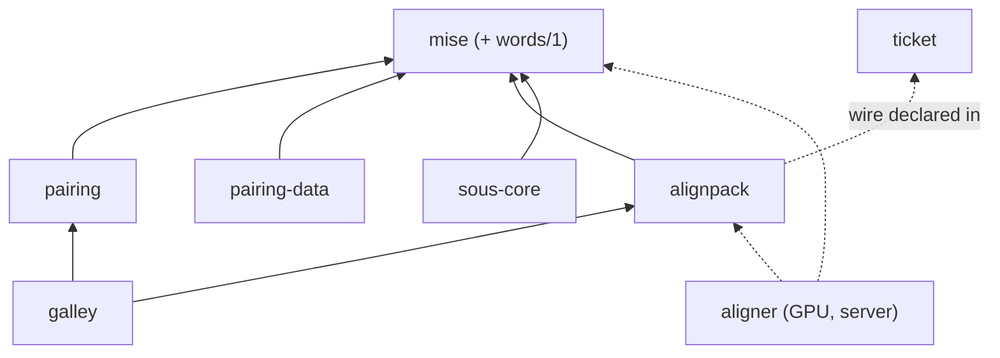

Will, 2026-10-21:

> Yes on full port of that pairing work is separate, not sure full scope of it to bring it. Draft a plan for that too. Likely all but not sure or 100% approved. But words is one primitive for sure needed already is idea.

What [pairing, from the lab](/items/2026-10-20-pairing-from-the-lab-a-trained-aligner-cold-pass-m) says to build, sorted by what is already written and where. Only [words/1](/items/2026-10-20-words-one-splitter-in-mise-with-a-narrower-joiner-) is approved; everything here is a draft.

## What exists, and where

None of it is committed. The pairing crates are untracked in a checkout of an old kitchen base (`d01451b`), and the lab is a git repo with no commits.

| piece | where on the lab machine | size | deps | port? |
|---|---|---|---|---|
| `pairing`: Model 2, tables, the check, stems, store, `tokens.rs` | `scripture-kitchen-pairing/pairing/` | 2.3k lines | rustc-hash, rayon (opt) | yes; `tokens.rs` goes for `words/1` |
| `pairing-data`: Greek NT source, similar-verse tables | `scripture-kitchen-pairing/pairing-data/` | 1.7 MB data | mise, rustc-hash | yes |
| deterministic HMM and its incremental update (the fast loop) | `pairing-lab/lab/src/aligners/hmm.rs`, `hmm_incremental.rs` | ~1k lines | none heavy | yes, into `pairing` |
| findings v2 (the seven check changes) | `pairing-lab/lab/src/bin/findings.rs`, `scripts/findings_v2.py` | 0.5k lines + Python | | yes, into `pairing`'s check |
| `alignpack`: pack, index, reader, overlay, compact, validate, BCV address | `pairing-lab/alignpack/` | 2.4k lines + 0.6k wasm | mise, sha2, unicode-segmentation | yes; UAX #29 goes for `words/1` |
| `aligner`: BinaryAlign on candle, LoRA, trainer | `pairing-lab/aligner/` | 3k lines | candle, tokenizers (onig), cudarc | **open**, see below |
| the lab: corpora, gold, AER, scripts, 33 GB of data and runs, 38 GB of tools | `pairing-lab/lab/`, `scripts/`, `data/`, `runs/`, `tools/` | | eflomal (GPL) | no; it stays the evidence harness and points its path deps at kitchen crates |
| editor and pack viewer | `pairing-lab/viewer/` | | | no; reference for Sefer |

## Shape after the port

<Mermaid id="crates" caption="Proposed crates; dashed is the open one">

</Mermaid>

<Files id="footprint">
```text
+ pairing/                 -- from scripture-kitchen-pairing, tokens.rs removed, HMM and findings v2 added
+ pairing-data/            -- verbatim
+ alignpack/               -- from the lab; words.rs removed, the wire declared against ticket
~ galley/src/wasm.rs       -- the alignpack and pairing doors
~ galley/                  -- generated alignpack reader beside the other readers
~ Cargo.toml               -- members
~ agents/architecture.md   -- the new crates in the dependency picture
? aligner/                 -- see the aligner question
```
</Files>

## Stages

Each stage ends with the workspace gate green and a measured comparison against the lab.

1. **`words/1` in mise.** Approved; it is its own item.
2. **`alignpack` onto `words/1`.** Port the crate; replace its UAX #29 `words.rs` (tagged `uax29-lab/0`) with `mise::words`; declare the pack and overlay against `ticket` with a generated TS reader and a staleness test, as every wire in the workspace is; re-score the lab's head and gold through it (the words item's `lab-rescore`), where AER should not move.
3. **`pairing` and `pairing-data`.** Port both, delete `tokens.rs`, and add the lab's HMM and its incremental update as the deterministic fast loop beside Model 2.
4. **Findings v2.** The seven changes in the lab plan's "The check" section, each with the lab's before/after figure as the comparison.
5. **Galley doors.** `tokenize` (UTF-16 spans), `open`/`read` by BCV address, overlay, `compact`, `replace_chapter`, `validate`, and the check. Doors land on galley ([doors land on galley](/items/2026-09-18-the-extensions-doors-on-galley-mirrored-by-linkage)): the lab's own `alignpack/wasm` is not shipped.
6. **The aligner,** if it comes in at all.

<Question id="scope">Port stages 2–5 as drafted, or a subset first (say, `alignpack` and the fast loop, leaving the check on Model 2 until findings v2 is re-measured here)?</Question>

## Open

<Question id="aligner">Where the trained aligner lives. It is a server tool with GPU dependencies (candle, tokenizers with onig, cudarc), so in this workspace it would slow the gate. Options: (a) a member left out of `default-members` and out of the wasm build; (b) its own repo that depends on `alignpack` and `mise` by path or git; (c) stay in the lab until the cold-pass job exists. Recommended: (b).</Question>

<Question id="bcv-layer">The lab plan wants one BCV-indexed file shape for helps, glosses, alignments and cached findings. Port `alignpack` as the alignment format now and generalise when a second kind exists, or build the shared layer first? Recommended: port as is, keep its names neutral.</Question>

<Question id="versification">The pack keys verses in a named versification and leaves mapping to the [versification layer](/items/2026-10-14-a-versification-layer-for-everything-that-pairs-ve). Is that layer a prerequisite for stage 5, or does stage 5 ship with one versification per pack and no mapping?</Question>

<Question id="cold-pass-job">The server job (text and vetted links in; adapter and pack out; on the A6000 first): who owns it, and is it in this plan at all or an ops item?</Question>

<Tradeoff id="lab-stays" chose="the lab stays outside the kitchen as its evidence harness" cost="its findings are cited by number from an uncommitted repo on one machine">The lab holds GPL tools (eflomal) used only for evaluation, 70 GB of data, and Python. None of it belongs in the workspace. Committing the lab, even privately, would make the numbers this plan cites reproducible.</Tradeoff>

<Followup id="commit-lab">Commit the lab (code, scripts, RESULTS.md; not data or tools) so findings have a sha to cite.</Followup>
