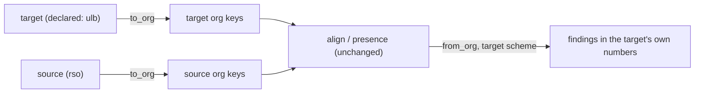

Will, 2026-11-04:

> we should start with canon and versification … Esp in terms of end user apis we'd expose
> and how/why we need those methods/apis for our domain?

> there is https://github.com/nida-institute/versification And it's pretty ready made I
> think, we could likely just port the sniffing here.

> The only idk what to do with is like, how to handle stuff with bad versification if we
> sniff: … where the bible is missing verses, out of order. etc;

This is step 1 of the Shared Scripture Domain Libraries doc, built Rust-first in this
workspace and released by the existing lockstep tag. There are no other language ports until
an app needs one. The data lives as plain files, so a polyglot repo can lift it later without
a rewrite. How it reaches TypeScript is in "How it reaches TypeScript" below: data is
generated as TS, and the logic goes through galley's wasm.

## What a user of the API gets

Two families of questions, which today's code answers by guessing or not at all:

- **canon:** "what is this book?" Its code, name in my language, order, file name and
  Matthew's two numbers.
- **versification:** "which verses should this book have, and where is this verse in that
  other text?" Today every pairing, progress bar and helps lookup assumes both sides number
  verses the same way.

Each method below exists because a named consumer needs it. Anything without a consumer is
left out.

### canon

| API | Returns | Who needs it, and why |
|---|---|---|
| `book(code)` | `BookInfo`: `code` (`MAT`), `slug` (`mat`), `canonical_index` (40), `usfm_number` (`41`), `division` (OT/NT/DC/peripheral) | Every book list in Sefer and the hub. It replaces the ~35 hand-kept tables, which already disagree on Matthew's number. |
| `parse_book(text, locales)` | `Option<BookCode>` | Accepts a code in any case, a slug, an English name, an alias, or a localized name. Users: citation parsing (go-to boxes), Writer project directories (`mat`), file names (`41-MAT.usfm`), and the lowercase `\id` codes merged-adn had. Sefer's `names.ts` is the spec, and its `citation.test.ts` is the fixture. |
| `name(code, locale, form)` | `Long` / `Short` / `Abbrev`, with a fallback chain of locale → its gateway language → English, and which one answered | Display in Sefer, the hub and findings. The fallback is reported so a UI can mark a name it didn't find in the asked language. A project's own `bookNames` (Sefer's `ProjectMetadata`) still go first; canon is what's behind them. |
| `books(canon)` | Book codes in order, for `Protestant66` and `WithDeuterocanon` | Book pickers, sorting and coverage tables. |
| `usfm_file_name(code)` | `41-MAT.usfm` | Writer stitching and hub consolidation, which each spell this themselves today. |

`BookKey`, `BOOK_CODES` and `canonical_rank` already exist in `mise`, and canon builds on
them rather than replacing them. Chapter counts are deliberately **not** on `BookInfo`.
They depend on the scheme (Malachi has 4 chapters in `eng` and 3 in `org`, and Joel has 3
and 4), so they belong to versification.

**Localized names come from our own corpus.** The `\toc1`/`\toc2`/`\toc3` lines in every
gateway-language USFM we hold are each translation's own book names. A generator built on
onion harvests them into `canon/data/names/<locale>.tsv`. A person reviews that file, and it
is committed. When a translation's `\toc` lines disagree across its copies, the rows say so
for that review. Only the reviewed file ships; the generator does not.

<Followup id="gateway-list" done>

The gateway list comes from the language API, not by hand. This is the query (BIEL GraphQL, `https://api.bibleineverylanguage.org/v1/graphql`):

```graphql
{ content(where: {
    language: { wa_language_metadata: { is_gateway: { _eq: true } } }
    wa_content_metadata: { show_on_biel: { _eq: true } } }) {
  resource_type
  language { ietf_code english_name national_name }
  git_repo { username repo_name }
  wa_content_metadata { status } } }
```

Run on 2026-11-04, it gives **35 gateway languages** with content shown on BIEL. For each one, the harvest source is its `Primary` text repo:

- **A `WA-Catalog` repo exists for 30:** am, arb (`arb_avd`), as, bn, ceb, en (`WycliffeAssociates/en_ulb`), es-419, fr, ha, hi, ilo, km, kn, lo, ml, mr, my (`my_juds`), ne, or, pa, plt, pt-br (`pt-br_ulb`), sw, ta, te, th, tl, tpi, ur-deva, vi.
- **Only per-book Writer repos are `Primary` for 2:** gu and ru. Harvest across them, and the review sees where they disagree.
- **No `Primary` text for 3:** fa, pmy and zh. These fall back to English until someone picks a source.

The generator re-runs the query, so `GATEWAYS.tsv` is refreshed rather than kept by hand.

</Followup>

### versification

The data is the Copenhagen Alliance mapping format, in the same shape as the nida repo's
`standard-mappings/*.json`: `maxVerses`, `mappedVerses`, `excludedVerses` and
`partialVerses`. Built-in schemes are `org` (the pivot: BHS/WLC and UBS/NA), `eng`, `lxx`,
`vul`, `rsc`, `rso`, and **`ulb`** as a scheme of its own. `ulb` is measured from our en_ulb
and reviewed by hand, so the "3 John 1 has 14 or 15 verses" disagreement becomes a named
choice instead of a bug.

| API | Returns | Who needs it, and why |
|---|---|---|
| `scheme(name)` / `Scheme::from_json(bytes)` | A `Scheme` (a plain struct; see "Handles" below) | Every call below. `from_json` takes a project's own declared mapping (one imported from Paratext's `.vrs`, for example). |
| `scheme.chapters(book)`, `scheme.last_verse(book, ch)` | Counts | "35 of 40 chapters drafted", "verses present over time, scaled to the source" (the hub's progress line), Writer chunk closing, and scaffolding a new book. |
| `scheme.excluded(point)` | `bool` | `MAT 17:21` and similar verses that a scheme omits on purpose. Without it, progress and lint call that verse missing. |
| `map(span, from, to)` | `Mapped` (below). It never guesses "nearest". | Three users: (1) **pairing and sous**, which put a target and its source on `org` keys before aligning; (2) **helps**, where a tn written against `eng` and a WLC scholar note both show beside the verse the reader is on; (3) **Macula and original texts**, which are already keyed in `org`. |
| `to_org(span, scheme)` / `from_org(span, scheme)` | Two halves of `map` | The fast path for pairing, which maps each side once at registration. |
| `scheme.moves()` | Only the spans that differ from `org`, with where each goes | Building a key remap table for a whole book in one pass. Most books return nothing. |
| `coverage(inventory, scheme)` | `Coverage`: `missing`, `beyond_scheme`, `excluded_present`, and `bridges` (which count as covering) | The answer to "bad versification": see below. |
| `sniff(inventory)` | `Sniff`: ranked schemes, their evidence, and a confidence | A suggested scheme when a text never declared one. See below. |

`inventory` is what a text **has**: each verse's chapter, number, segment, bridge, duplicate
count, and length in characters (the sniffing rules compare lengths). onion builds it from
the TOC it already keeps. canon never parses USFM, so it stays a data crate with no engine
in it.

### What `map` takes and returns

`map` works on **numbers, not designators**. A text writes `\v 1-2` or `\v 3a`. onion already
reads those into `mise::Point`s (chapter, verse, segment) and ranges of them, and `map` takes
a `Span` (a single point or a range, both ends in one book) in the `from` scheme. What comes
back is a span in the `to` scheme, or an honest statement that there isn't exactly one:

<Diff id="mapped" path="canon/src/map.rs">
```rust
pub struct Span {
    pub book: BookKey,
    pub from: Point,
    pub to: Point, // equal to `from` for one verse
}

pub enum Mapped {
    /// Numbered the same in both schemes. By far the common case, and costs nothing:
    /// the scheme files list only differences, so a verse they don't mention is `Same`.
    Same,
    /// Numbered differently: GEN 32:1 (eng) is GEN 32:2 (org).
    Moved(Span),
    /// One verse here is two or more there: the pieces, in order.
    Split(Vec<Span>),
    /// This verse is part of a longer one there, e.g. one half of a verse the other
    /// scheme merged. `part` is the segment letter the scheme files use.
    Part { of: Span, part: char },
    /// The other scheme has no such verse (`excludedVerses`, or a verse only one
    /// tradition numbers).
    Absent,
}
```
</Diff>

It's sparse because the data is sparse. A scheme file lists only where it differs from `org`
(`eng` has a few hundred rows against 31,000 verses), so `Same` is an absent row and costs
no allocation. `scheme.moves()` hands that same sparse list to pairing, which rewrites only
the keys that move.

### Overlap with sous's presence

Sous already reports "missing" and "extra" verses: `presence-shear` pairs target and source
keys (`sous_core::alignment::align`). Every source key with no target is a `Missing` row,
and every target key with no source is `Extra`. That compares the **target against its
source**, by the numbers each one writes. `coverage` compares a **text against a scheme**.
They answer different questions, and the plan keeps both:

- **With a source registered, the mapping happens before the pairing.** Each side's keys go
  through `to_org` before `align`, and presence and alignment run unchanged on `org` keys.
  A Russian source (`rso`) paired with a ULB-numbered target then reports a verse as
  missing only when it's actually missing, not because Psalm titles shifted every key by
  one. Findings map back with `from_org`, so a reader never sees an `org` number.
- **Without a source** (no reference registered), `coverage` against the declared scheme is
  the only check that can say a verse is missing.
- **With both,** presence owns "missing" and "extra" for a paired book, since the source is
  the more specific expectation. Coverage findings for that book are dropped so one gap
  isn't reported twice.

<Mermaid id="pairing" caption="With a source registered, each side maps to org once, sous pairs on org keys, and findings map back to the target's own numbers.">

</Mermaid>

### Declaring a text's scheme

A text declares its numbering once, at registration, as one of two things:

- **`Scheme("ulb")`:** "I follow the ULB numbering" (or any built-in or custom scheme).
- **`FollowSource`:** "I number like my source", so a translation from a Russian Bible checks
  against whatever the registered source declares, such as `rso`. This is the natural
  default for a WA translation that has a source registered.

With no declaration, the host uses the sniff result when it's `Decided`, and otherwise the
project default.

### Handles

"Handle" here means a plain Rust struct, not a wasm-bindgen class. Built-in schemes are
`&'static Scheme` values generated from the data files. A custom scheme is an owned `Scheme`
from `from_json`. Across the wasm boundary a scheme travels **by name**: built-ins by their
names (`"ulb"`), and a custom scheme registered once on the `Galley` handle
(`defineScheme("ru-synodal-custom", json)`) and named after that. Sefer never holds a
JS-side Scheme object, so there's nothing to `.free()` and nothing borrowed across the
boundary.

## How it reaches TypeScript

Split by shape, not all one way:

| Part | In TS by | Why |
|---|---|---|
| Data: the book table, names per locale, each scheme's chapter and verse counts | **Generated TS modules**, written from `canon/data` by the same generator that writes the Rust tables, with a freshness test (as `sous-reader.ts` has today) | It's static data. Plain TS needs no wasm `init()`, works synchronously inside Sefer's citation parser, and is tree-shaken. |
| Small lookups over that data: `parse_book`, `name`'s fallback chain, `last_verse` | **Hand-written TS**, a few dozen lines, run against the **same fixture files** as the Rust (`canon/fixtures/*.json`) | Idiomatic for each side, and the shared fixtures keep the two in agreement. Sefer's `names.ts` already is most of this. |
| Logic with edge cases: `map`, `coverage`, `sniff` | **galley's wasm**, through flat results the shim builds, as galley's other doors do | One implementation of the hard semantics. `coverage` and `sniff` need the inventory onion builds inside the wasm anyway. |

**No serde in canon.** The generator writes Rust `const` tables, and canon reads nothing at
runtime, so it has **no dependencies at all**. onion can depend on canon (for the coverage
lints) without gaining serde. serde stays where it already is: behind galley's and
onion-wasm's `wasm` feature, in the shims that turn results into JS values. A wasm-bindgen
class per canon type would bring back the borrowed-values problem onion-wasm already solves
by hand, for no benefit.

## Bad versification: three questions, kept apart

The screenshot's findings (`verse-gap` 27, `verse-out-of-order` 9, `missing-verse-one` 3)
are onion's ordering lints. They describe the **text**, not its numbering scheme, and the
plan keeps them separate:

1. **Inventory:** what verses does the text have? This is a fact, from onion.
2. **Scheme:** what numbering does the text mean to follow? Declared, or else sniffed.
3. **Coverage:** inventory against scheme. What's missing, and what goes past the scheme?
   These are defects, and they go to lint and progress.

The nida sniffer merges 2 and 3. It builds `maxVerses` from the text, then applies every
TVTMS rule whose tests pass and records each one as a custom mapping. On a clean published
Bible that's right. On a Writer draft with a skipped verse, it bakes the defect into a
"custom versification", and every later check sees no defect at all. So we port the rules
and the test grammar, but not that output:

- **Sniff votes for a named scheme; it doesn't build a custom one.** Each TVTMS rule (403
  of them, in `merged_rules.json`) names which column passes. Columns are named traditions
  (English, Hebrew, Latin, Greek), so each passing rule is a vote, and real scheme
  differences come in correlated clusters. Psalms' titles alone move dozens of verses
  together. One translator's missing final verse flips one rule and is outvoted.
- **Rules abstain when their evidence is contaminated.** `Last` and `NotExist` tests are
  the ones a missing verse fools (1,080 + 487 of the 1,914 tests). They count only when
  the chapter is clean in the inventory: no gap, duplicate or out-of-order verse there.
  Absent books and chapters abstain, as nida's do already. Out-of-order verses can't fool
  `Exist`, because the inventory is a set.
- **Rules that disagree with the winner are reported, not applied.** They come back as
  `Sniff.dissent` with their verses, and a host can show them beside lint's gaps.
- **Confidence is a value, not a guess.**
  - `Decided`: enough rules voted, and they agree.
  - `Leaning`: few rules voted.
  - `Undetermined`: nothing in the book discriminates between schemes, which is most of
    the NT, where `eng` and `org` agree.
  - When the answer is `Undetermined`, the host uses the project default. For WA texts
    that's the source's scheme: a text drafted from the ULB is `ulb` until shown otherwise.
- **A declaration beats a sniff, and a mismatch is a finding.** If a text is declared
  `ulb` and sniffs `Decided: org`, that's one finding (`scheme-mismatch`), not hundreds of
  gaps.

Once a scheme is known, coverage sharpens lint, and the finding names the scheme it checked
against. A `verse-gap` can say "13 is missing (ulb has 1–22)", or "(following your source:
rso has 1–22)". Two findings that are impossible today become possible:
`chapter-ends-early` (the last verse is missing, which the gap lint can't see because
nothing follows it) and `verse-beyond-scheme` (an 18th verse in a 17-verse chapter).

The two new lints fire everywhere, drafts included. onion's `lint()` takes no options today
(`lint(source, tokens, cst)`), and these two can't run without a scheme anyway. So they go
on a second entry point that takes `Option<&Scheme>`, and **passing no scheme is the off
switch**. Hiding them by rule code stays the host's job, the way Sefer's suppressions already
work for every other rule.

<Question id="custom-schemes" answer="No (Will, 2026-11-04). Only reviewed imports become schemes.">Should a custom scheme ever be built from a text automatically? The plan says no: only reviewed imports (a `.vrs`, or a project's declared mapping) become schemes. That means a published Bible with a numbering we don't ship shows up as `Undetermined` plus dissent until someone declares it.</Question>

<Question id="lint-severity" answer="Everywhere, with a way to turn them off (Will, 2026-11-04). The off switch is passing no scheme, plus the host's existing per-rule suppression.">`chapter-ends-early` and `verse-beyond-scheme` on drafts: warnings everywhere, or only when the book is marked complete (when Sefer has a "complete" state)?</Question>

## Where it lives

<Files id="footprint">
```text
+ canon/                          -- new crate; depends on mise only, no other deps
+ canon/data/books.tsv            -- code, slug, canonical_index, usfm_number, division, English names, aliases
+ canon/data/names/*.tsv          -- reviewed names per locale, harvested from \toc1-3
+ canon/data/names/GATEWAYS.tsv   -- the gateway-language list the harvester runs over
+ canon/data/schemes/*.json       -- org eng lxx vul rsc rso (nida, CC BY-SA 4.0) + ulb (ours)
+ canon/data/sniff/rules.json     -- nida merged_rules.json (TVTMS-derived, CC BY)
+ canon/fixtures/*.json           -- shared cases, run by cargo test and by the TS tests
+ canon/src/{books,names,scheme,map,coverage,sniff}.rs
+ canon/src/tables.rs             -- generated from data/; freshness-tested
+ canon/canon.ts                  -- generated TS data module, plus the hand-written lookups
+ canon/NOTICE                    -- attribution for the nida/TVTMS data
~ onion/src/                      -- VerseInventory from the Toc; lint entry point with a scheme
~ galley/src/wasm.rs              -- register(..., {versification}); defineScheme; map/coverage/sniff doors
~ sous-chef/core/src/alignment.rs -- pair on org keys when both sides declare
```
</Files>

canon is its own crate because it's its own domain. Book identity and numbering traditions
are a body of facts that USFM parsing doesn't own, and that the hub, helps and pairing will
reach for without wanting the engine. `mise` stays the small shared leaf it is now. Its
scope rule (no policy, no engine logic) would also have to bend to hold sniffing and
mapping, and keeping the domains separate is the better reason anyway.

<Question id="data-license" answer="CC BY-SA is fine to ship inside the packages (Will, 2026-11-04). canon/NOTICE carries the attribution.">The scheme files are CC BY-SA 4.0. Shipping them inside the npm and crates packages means those packages carry share-alike data (the code stays Apache/MIT). Is that fine, or do the scheme files go out as a separate data package, like pairing's data packs? This repeats the question in the versification-layer idea; answer it once here.</Question>

## What it replaces

Each replacement lands when the step that provides it ships, and each is a change in that
consumer's repo, pinned to the kitchen tag that has the step.

| Today | Where | Replaced by | Step |
|---|---|---|---|
| `CANON`: 66 books with English names and testament (112 lines) | Sefer `packages/text/src/location/canon.ts` | The generated book table and `name(…, "en", Long)` | 1 |
| The name catalogue and book matching: `nameCatalogue`, `booksMatching`, `matchBook`, `fold` (133 lines) | Sefer `packages/text/src/location/names.ts` | `parse_book` with locales. Its tests become `canon/fixtures/parse_book.json` | 1, then 6 |
| The book-name half of citation parsing | Sefer `packages/text/src/location/citation.ts` | Calls `parse_book`. The rest of the citation grammar stays in Sefer until the reference step | 1 |
| `lastVerseOf` over the text's own TOC | Sefer `src/app/kinds/context.ts` | Keeps working for "the last verse this text has". `scheme.last_verse` answers "the last verse it should have" | 2 |
| Its own 66-code table and `usfm_file_name` | hub `crates/stitch/src/lib.rs` | canon's `books` and `usfm_file_name`, through the kitchen git tag | 1 |
| Ad hoc uppercasing of `\id` codes | galley `overlay.rs` `book_code` | `parse_book` | 1 |
| Pairing on numbers as written | sous `alignment::align` callers | `to_org` before `align` and `from_org` on findings | 7 |
| The versification-layer idea | `planning/items/2026-10-14-a-versification-layer-…` | This plan (that item closes when step 7 ships) | 7 |

What stays: `mise`'s `BOOK_CODES`, `BookKey` and `canonical_rank` (lint's "is this a book
code" stays byte-exact), and a project's own `bookNames` in Sefer, which canon's names sit
behind.

## Order, each step usable on its own

1. **Book table.** `books.tsv` from usfm-tools' `usfm_verses.py` and our `BOOK_CODES`, plus
   `book`, `parse_book` (codes, slugs, English names), `books`, `usfm_file_name`, and
   fixtures for Matthew 40/41 and Song of Songs vs Song of Solomon. Sefer's and the hub's
   book tables move to it.
2. **Schemes and counts.** Import nida's seven schemes, plus `chapters`, `last_verse` and
   `excluded`. Measure `ulb` from en_ulb and review it, including the two known
   disagreements (3 John 1, Revelation 12).
3. **Map.** `to_org`/`from_org`/`map`/`moves`, with fixtures from the Kotlin hub's
   `fixtures/versification/cases.json` and a Psalm-superscription set.
4. **Inventory, coverage and the two lints.** This is where the screenshot's books get
   better messages.
5. **Sniff.** Port the test grammar (`Last`, `Exist`, `NotExist`, `<`/`>` with factors) and
   the voting and abstention above. Run it over every corpus in `testData`, and pin a
   golden of which scheme each book sniffs as.
6. **Names.** The `\toc` harvester over the gateway-language list, plus reviewed
   `names/<locale>.tsv`, plus `name(code, locale, form)` and localized `parse_book`.
7. **Galley.** A declared `versification` per registered book (`Scheme` or
   `FollowSource`), `defineScheme`, and sous pairing on `org` keys. This closes the
   versification-layer idea's question about which consumer goes first.

<Question id="order" answer="Not a concern (Will, 2026-11-04). Keep the order as written.">Is this order right? Names (6) could come right after the book table (1) if Sefer wants localized book names sooner than it wants mapping.</Question>

<Question id="ulb-scheme" answer="Yes (Will, 2026-11-04). There's no other canonical ULB verse count, so measure it from en_ulb.">Is en_ulb the right source for the `ulb` scheme, or does WA keep a canonical verse-count table for the ULB somewhere (the USFM checker's `usfm_verses.py`)?</Question>
