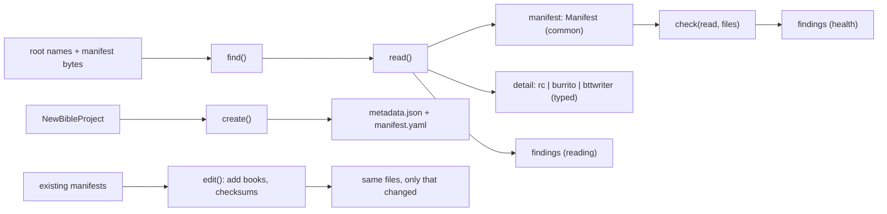
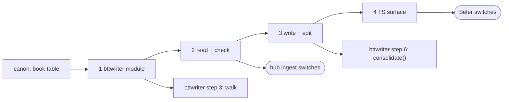

Will, 2026-11-05:

> Yeah, while canon keeps working, let's talk through the container plan

This is step 3 of the Shared Scripture Domain Libraries order. It sits between
[[code:planning/items/2026-11-04-canon-and-versification-the-book-table-schemes-map.mdx|canon]]
and bttwriter
([[code:planning/items/2026-11-05-writer-consolidation-saves-in-one-git-pack-out.mdx|the BTT Writer plan]]).
It uses canon's book table, and bttwriter uses it: the `bttwriter` module for reading
`manifest.json` during the walk, and the RC and Burrito writers for `consolidate()`.

A *container* is the manifest file at a repo's root that says what the repo is: its
language, what kind of resource, which books, translated from what. We meet three:

| File | Format | On WACS (hub scan, 1,441 repos) | Who writes them today |
|---|---|---|---|
| `manifest.json` | BTT Writer / translationStudio | **1,103** | BTT Writer. We only read it. |
| `manifest.yaml` | Resource Container (RC 0.2) | 291 | the catalog; Sefer (new projects, added books); the hub (consolidated repos) |
| `metadata.json` | Scripture Burrito 1.0 | 8 | Sefer (new projects, added books, checksums) |
| none | | 39 | |

## Two rules

**1. Reading never changes anything.**

> Invariant with all text editors, no mutation simply on parse/read.

`read` and `check` return what's there and what's wrong with it. They never "fix" a value
on the way through. A file changes only when a caller asks for a specific edit, and an edit
changes only what it was asked to: adding MAT touches MAT's entries and nothing else.

**2. What we create is right from the start.**

> New repos created from our tool though should be able to bascially compose something
> like new ScriptureBurrito.bibleProject(args:\{sortOrder: protestant) … But can't mutate
> the file just cause we loaded. Only we should get it correct when we create from here.

`create` takes book codes, not file names or sort numbers. Order, `sort`, paths and
categories come from canon, so a caller can't get them wrong. Everything we write passes
the Burrito schema we pin (see "Burrito").

## What a user of the API gets

Four jobs, and each has a named consumer:

| Job | Who | Today |
|---|---|---|
| **"What is this repo?"** Find the manifest and read it leniently into one common shape: language, resource, kind, books, sources | the hub's `ingest` and `synthetic` (every WACS repo); Sefer's `discovery`, `projectAdmin` and `import` (opening a project or resource) | hub `crates/manifest`; Sefer `projectMetadata.ts`, `burrito.ts`, `resourceContainer.ts`, `relationships.ts` |
| **"Is it healthy?"** Checks over the manifest and the files it names, as findings | the hub's health views; Sefer's project admin | split across the hub's ingest and Sefer's `checksum.ts`; Door43 has its own health check (below) |
| **"Write the manifests for a new project"** | Sefer `assemble` (writes *both* `metadata.json` and `manifest.yaml`); bttwriter `consolidate()` | Sefer `writeMetadata.ts`; the hub's `manifest_with_book` |
| **"Edit them":** add books, update checksums | Sefer `addBooks` and saves; the hub publishing a book into a consolidated repo | Sefer `withBooks` / `withProjects` and `refreshIngredientChecksums`; the hub's `manifest_with_book` |

What's *not* in it, because it's app state rather than a format: Sefer's resource library
(`library.ts`), its resource kinds and the tn pack (`kinds/`), import staging (`import.ts`
reads the filesystem), and "can Sefer open this?" (`kinds/content.ts`'s `recognize`).
Container answers "what is it?", and each app keeps "what do I do with it?". USFM validity
and alignment are onion's, and "a release was published" is the forge's.

In Sefer this retires about 750 lines (`burrito.ts` 103, `resourceContainer.ts` 53,
`projectMetadata.ts` 131, `writeMetadata.ts` 162, `checksum.ts` 131, roughly 100 of
`relationships.ts`, plus `withBooks`/`withProjects` and BTT Writer's schema in
`writerBook.ts`). That's not the 2,322 I first quoted for all of `src/core/resources`. In
the hub it's all of `crates/manifest` (1,327 lines) and `manifest_with_book`.

## Drift already found

| What | Catalog (`en_ulb`, `en_ult`, `bdf_reg`) | Sefer writes | hub writes |
|---|---|---|---|
| RC project `sort` for GEN, MAT | **1, 40** (canonical order, from 1) | 0, 39 (`CANON.findIndex`, from 0) | 1, 41 (the file number) |
| RC project `title` | the book's name in the language (`Matiu`) | the book's title from the text | the book code (`ROM`) |
| `dublin_core.publisher` | `Wycliffe Associates`, `unfoldingWord` | `Wycliffe Associates` | `Translation Hub` |
| What kind of resource | (declared `subject`, `type`, `identifier`) | `recognize`: `tn`/`tq`/`tw` by identifier | `canonical_subject` + `Domain` |
| `metadata.json` against WA's Burrito schema | n/a | **fails in four places** (see "Burrito") | doesn't write one |

The `sort` row is a third disagreement about Matthew's number, after the two the canon plan
names. Neither app matches the catalog. canon's `canonical_index` (MAT = 40) is exactly the
catalog's `sort`, so `create` writes that.

<Question id="fix-sort" answer="Don't touch existing values. read and check never mutate, and add_books writes canon's sort for the books it adds and leaves the others as they are. check reports a manifest whose sort disagrees with canon as a finding. create gets it right from the start. (Will, 2026-11-05.)">Should add_books rewrite every project's sort to canon's, so old manifests heal on their next edit?</Question>

One case needs care. In a Sefer-written manifest (GEN 0 … MAT 39), adding a book at canon's
1-based number can **tie** with an existing one: adding EXO (2) next to an existing LEV (2).
The tie doesn't lose data, and order by `sort` then by canon is still right, but a strict
reader could misorder it. `add_books` reports the tie as a finding with the edit, rather
than renumbering the neighbours.

<Question id="publisher" answer="Required arguments to create, no defaults in the library (Will, 2026-11-05).">Who decides publisher, creator, rights and the checking level?</Question>

## The API



### Reading: one common shape, plus the typed detail

<Question id="summary-shape" answer="Both: a common shape on top for what every format has, and the format's own typed document as a discriminated union beside it. finishedChunks moves into the bttwriter detail. (Will, 2026-11-05: 'having all the common properties up top is good … we drop finishedChunks'.)">One `Summary` type, or a discriminated union the reader branches on?</Question>

The common shape answers the questions every caller asks (language, books, sources), so most
callers never branch. A caller that needs something only one format has (BTT Writer's
finished chunks, an RC's `checking`, a Burrito's `copyright`) branches once on `detail.format`
and gets that format's own typed document, not a pile of optional fields on the common type.

```ts
bento.find(rootNames: string[]): { name: string; format: Format } | undefined;
type Format = "burrito" | "rc" | "bttwriter";

// Never throws. A file it can't make sense of comes back as findings with no manifest.
bento.read(name: string, bytes: Uint8Array): Read;

interface Read {
  manifest?: Manifest;                 // undefined only when nothing could be read
  detail?: Detail;
  findings: ManifestFinding[];                 // what reading had to forgive, or couldn't
}

type Detail =
  | { format: "rc"; document: RcManifest }
  | { format: "burrito"; document: BurritoMetadata }
  | { format: "bttwriter"; document: BttWriterManifest }; // finished_chunks, translators, … live here

// What every format has. Merges the hub's NormalizedManifest and Sefer's ProjectMetadata.
interface Manifest {
  format: Format;
  id?: string;                         // Burrito primary id; RC/BTT Writer: undefined
  name: LocalizedText;                 // "English Unlocked Literal Bible"
  abbreviation: LocalizedText;         // "ulb", "reg"
  language: { tag: string; name: LocalizedText; direction: "ltr" | "rtl" };
  kind: Kind;
  books: BookEntry[];                  // in the order the file lists them
  sources: Related[];                  // what it was translated from
  version?: string; issued?: string; modified?: string; rights?: string; publisher?: string;
}

interface Kind {
  domain?: "scripture" | "gloss" | "parascriptural" | "peripheral";
  subject?: string;                    // canonical: "Bible", "Translation Notes", …
  flavor?: string;                     // Burrito's flavor name, verbatim: "textTranslation"
  declared: { subject?: string; type?: string; format?: string; identifier?: string }; // as written
}

interface BookEntry {
  book: BookCode;                      // through canon's parse_book: "mat", "MAT" both land here
  path?: string;                       // "./41-MAT.usfm"
  title?: LocalizedText;               // the name the manifest gives it
  sort?: number;                       // as written; never corrected (rule 1)
}

interface Related { relation: "source"; language: string; resource: string; version?: string }
```

<Question id="manifest-name" answer="`Manifest` (Will, 2026-11-05: 'Manifest seems fine, either that or commonMetadata'). Kept `Manifest`: it reads naturally (`read(…).manifest.books`), and the typed documents keep their formats' own names, so it doesn't collide.">Is `Manifest` the right name for the common shape?</Question>

How the two apps read with it:

```ts
// Sefer, discovery.ts: replaces the Burrito-then-RC sequence and both schemas
const found = bento.find(await fs.readdir(root));
const read = found && bento.read(found.name, await fs.readFile(`${root}/${found.name}`));
project.metadata = read?.manifest;
```

```rust
// hub, ingest: replaces hub_manifest::{find_manifest, parse_as, normalize}
let (name, _) = bento::find(&root_names)?;
let read = bento::read(name, &bytes);
report.books = read.manifest.iter().flat_map(|m| &m.books).map(|b| b.book).collect();
report.findings.extend(read.findings);
```

### Health: findings, Door43-style

> For example of "leniency", I think d43 health check is likely good here … NOt 100% to
> copy, but yes, that's the idea.

Leniency and health are one thing: **findings**, typed `ManifestFinding` so the name
can't be confused with onion's diagnostics or sous's findings. Reading produces the findings it can see
from the manifest alone ("`sort` was the string `"40"`, read as 40"). `check` adds the ones
that need the repo's files. Each finding names its check, so a UI can list checks as
passed or failed, as Door43's page does:

```ts
interface ManifestFinding {
  check: CheckId;                      // stable id: "ingredient-checksum", "book-title-translated", …
  severity: "error" | "warning" | "info";
  at?: string;                         // JSON pointer into the manifest: "/ingredients/41-MAT.usfm/size"
  book?: BookCode;
  message: string;                     // a sentence a person can act on
}

// Checks that need more than the manifest. Pure: the caller hands over what it has.
bento.check(read: Read, repo: {
  files?: Map<string, Uint8Array>;     // for exist / non-empty / checksum checks
  name?: string;                       // for "repo name matches the language"
}): ManifestFinding[];
```

Door43's list, and where each one belongs:

| Door43 check | Here | Needs |
|---|---|---|
| Metadata found for the repository | `find` (`manifest-missing`) | root names |
| Valid metadata | `read`: shape, plus the pinned Burrito schema | manifest |
| Title has been properly changed | `title-set`: not empty, not a template default, not the resource code | manifest |
| Language has been set | `language-set` | manifest |
| Project titles have been translated | `book-title-translated`: a book's title isn't canon's English name (in a non-English project) | manifest + canon names |
| Project files exist / are not empty | `ingredient-exists`, `ingredient-empty` | `files` |
| Ingredient sizes and checksums match | `ingredient-checksum` | `files` |
| Repo name matches the metadata language | `repo-name-language` (`tpi_reg` vs `tpi`) | `name` |
| *(ours)* `sort` disagrees with canon; values read leniently | `sort-canon`, `lenient-value` | manifest |
| USFM files are valid / have alignment data | onion and galley, not container | the USFM |
| An error-free release has been published | the forge (Gitea/Forgejo), not container | |

<Question id="lenient-file" answer="Both: lenient.rs stays as an implementation file (the readers that accept a number for a string, one value for a list, a BOM, extra YAML documents), and what it forgives comes out as findings on the read, not as a separate warnings type.">Should leniency be its own file, or a warnings/health property on the read? (Will, 2026-11-05.)</Question>

### Writing: create from book codes

```ts
interface NewBibleProject {
  title: string;
  abbreviation: string;                // the resource: "reg", "ulb"
  language: { tag: string; name: string; direction: "ltr" | "rtl" };
  books: Array<{ book: BookCode; title: string; bytes: Uint8Array }>; // order, sort, paths: from canon
  canon?: "protestant66" | "withDeuterocanon"; // canon's book lists; default protestant66
  sources: Related[];
  contributors: string[];              // deduplicated inside (Sefer's dedupeContributors rule)
  // Required, no defaults (each app states its own policy):
  publisher: string; creator: string; rights: string; checkingLevel: string;
  copyright: string;                   // Burrito requires it
  generator: { name: string; version: string }; // Burrito meta.generator: "Sefer" "1.4.0"
  createdAt: string;                   // ISO date-time, the caller's clock (meta.dateCreated)
  repository: string;                  // "owner/repo" on WACS: identification.primary (see Burrito)
}

// The files to write, by name: metadata.json and manifest.yaml unless asked for fewer.
bento.createBible(project: NewBibleProject, formats?: Format[]): Map<string, Uint8Array>;
```

`createBible` rather than one generic `create`: it's the only kind we make today, and a
Bible project has a fixed answer for flavor, `sort`, file names and categories.

<Question id="other-kinds" answer="Read and check every kind now; create only Bibles until an app creates something else. Each new kind gets its own typed create beside createBible, sharing the same core.">Do we support other resource types to create or set, now or later? (Will, 2026-11-05.)</Question>

- **Reading and checking:** every kind, now. `read` already classifies tn, tq, tw, ta and OBS
  through `Manifest.kind`, and the hub's scan needs all of them.
- **Editing:** `edit` works on any manifest that lists files (RC `projects`, Burrito
  `ingredients`), so checksums and added entries work for a helps resource too.
- **Creating:** only Bibles, because that's all any app creates today. Sefer's tn pack is
  its own format, not a bento. When an app first creates a helps resource, it gets its own
  `createHelps(…)` with arguments typed for it: an RC `type: help`, or a Burrito
  `parascriptural` flavor. The first one is the moment to check the fork's schema for that
  flavor. Writing a generic `create(kind, …)` now would mean guessing at those arguments
  with no caller to check them against.

### Editing: one call, one commit

> Sefer would want to do this as one commit not two.

All edits go through one call that returns every changed file. The caller commits the books
and the manifests together.

```ts
bento.edit(existing: Map<string, Uint8Array>, change: {
  addBooks?: NewBibleProject["books"];      // refuses one already listed
  checksums?: Map<string, Uint8Array>;      // the ingredient files as they'll be committed
}): { files: Map<string, Uint8Array>; findings: ManifestFinding[] }; // only files that changed

// The primitive, for a caller that only needs the numbers.
bento.fingerprint(bytes: Uint8Array): { md5: string; size: number };
```

Sefer's save becomes "write the USFM, `edit(..., { checksums })`, commit both". Its
migration becomes "`createBible`, write, commit". Neither is a second commit.

**Editing keeps what it doesn't own.** `edit` works on the document as a tree, not as our
typed structs. A field we don't model survives, and so does key order (`serde_json` with
`preserve_order`, written as `JSON.stringify(v, null, 2)` + newline, as Sefer writes it now,
so the first edit of a Sefer project is a minimal diff).

<Question id="yaml-fidelity" answer="Preserve the formatting: if a file is going to be rewritten on every update, avoiding format churn is worth a dependency (Will, 2026-11-05). Evaluate `yaml-edit` (lossless, rowan-based) against the catalog's files first; fall back to re-emitting only if it can't handle them.">When we edit an existing `manifest.yaml`, how much of its formatting do we keep?</Question>

So an edit to a `manifest.yaml` changes only the lines it means to: adding MAT adds MAT's
project entry, and the catalog's quoting, flow lists and comments elsewhere stay as they
were. The JSON side already gets this by keeping key order and Sefer's indentation.

<Question id="both-formats" answer="Keep writing both for now, for legacy reasons; the Burrito is read first when both are there (Will, 2026-11-05).">Should Sefer keep writing both `metadata.json` and `manifest.yaml`?</Question>

### Burrito: hand-written, pinned to WA's schema

<Question id="burrito-version" answer="WA's fork, https://github.com/Bible-Translation-Tools/scripture-burrito, branch wycliffe-associates, pinned by commit (b8872ee, 2026-04-07). It is 15 commits ahead of upstream (WA's changes: mimeType on targets, timestamp required in identification) and 4 behind. Upstream has since moved further: its schema now references alignment schemas the fork doesn't have.">Which Burrito schema version do we pin to? (Will pointed at WA's fork.)</Question>

- **Hand-write the part we read and write** (what Sefer's `burrito.ts` and the hub's
  `burrito.rs` model, which agree closely).
- **Vendor the fork's `schema/` at the pinned commit** (MIT) and, in tests, validate every
  fixture and every file `createBible` and `edit` produce against it, with the `jsonschema`
  crate as a dev dependency. Nothing at runtime depends on it.

**Sefer's `metadata.json` doesn't pass that schema today.** I rebuilt one exactly as
`burritoText` writes it and ran it through the fork's own validator (ajv, all errors):

| Error | Why | Fix in `createBible` |
|---|---|---|
| `/` must have required property `copyright` | `burritoText` writes none | `copyright` is a required argument |
| `/meta/dateCreated` must match format `date-time` | Sefer passes `new Date().toISOString().slice(0, 10)`, a date only | `createdAt` is a full ISO date-time |
| `/meta/generator` must have required property `softwareVersion` | Sefer writes only `softwareName` | `generator.version` is required |
| `/identification` must have required property `primary` | WA's fork requires it, and Sefer writes none | written from the project's WACS repo (`repository` argument), as below |

So "what we create is right from the start" also fixes every project Sefer creates from then
on. Existing ones stay as they are (rule 1), and `check` reports them under `manifest-valid`.

<Question id="burrito-primary" answer="The project's WACS repo, under the `wacs` authority: `{ wacs: { 'Tech_Advance/cdi_reg': { revision: 'latest', timestamp: '2026-11-04' } } }` (Will, 2026-11-05). WA's fork enforces exactly this shape.">What goes in `identification.primary` for a new project?</Question>

Will's example turns out to be exactly what WA's fork enforces
(`schema/identification.schema.json`, `authorityRepositories`):

- **One authority, one repo.** `primary` holds exactly one authority label (lowercase,
  `^[a-z][a-z0-9-]*[a-z0-9]$`), and under it exactly one key, which must be an `owner/repo` path.
- **`revision` must be the string `"latest"`.** It's a `const` in the schema.
- **`timestamp` is a date, not a date-time:** `YYYY`, `YYYY-MM` or `YYYY-MM-DD`. Unlike
  `meta.dateCreated`, which must be a full date-time.
- **The fork's own example declares the authority:** `idAuthorities.wacs` =
  `https://content.bibletranslationtools.org`, "Wycliffe Associates Content Services". Its
  example omits `timestamp`, so it predates the commit that made `timestamp` required. Our
  schema test would catch exactly that.

So `createBible` takes a required `repository: "owner/repo"` and writes:

```json
"idAuthorities": {
  "wacs": { "id": "https://content.bibletranslationtools.org", "name": { "en": "Wycliffe Associates Content Services" } }
},
"identification": {
  "name": { "tpi": "…" },
  "abbreviation": { "tpi": "reg" },
  "primary": { "wacs": { "Tech_Advance/cdi_reg": { "revision": "latest", "timestamp": "2026-11-04" } } }
}
```

<Question id="repo-at-create" answer="Sefer passes the repo it will push to, so every file is valid from its first commit (Will, 2026-11-05).">Does Sefer know the repo when it creates a project? A migrated BTT Writer project has an upstream, but the consolidated project's own WACS repo may not exist until the first push. Options: Sefer passes the repo it *will* push to (`<user>/<lang>_<resource>`, as the hub names them), or `createBible` writes it once it's known, as an `edit(…, { primary })` before the first push. The first keeps every file valid from its first commit, which I'd prefer if Sefer can know the name up front.</Question>

<Question id="authority-label" answer="`wacs` everywhere new projects write it, in `primary` and in `relationships`, for consistency (Will, 2026-11-05). Reading still accepts `wycliffeassociates::language/resource`, since existing projects say that.">Sefer's current authority is `wycliffeassociates` (`https://www.wycliffeassociates.org`), and its relationships say `wycliffeassociates::en/ulb`. The fork's convention is `wacs` (`content.bibletranslationtools.org`). Should new projects use `wacs` everywhere, including in `relationships` (`wacs::WA-Catalog/en_ulb`, an `owner/repo` path, matching `primary`)? Reading would accept both, since existing projects say `wycliffeassociates::en/ulb`. Sefer's relationship parser expects `language/resource` after the `::`, so this changes what it reads.</Question>

### Kinds: one vocabulary for "what is this"

The hub's `canonical_subject` and `Domain` and Sefer's `recognize` answer different
questions. The hub asks "what is it?" (Bible, Translation Notes, Open Bible Stories). Sefer
asks "can I open it?" (USFM, tn as RC help markdown). The first moves into container as
`Manifest.kind`. The second stays in Sefer and reads `kind`.

## TypeScript: validate and assert at the boundary

> In ts I think of this as standard schema. We'll still be upholding validate and assert as
> boundaries for consumer here right?

Yes. And it's **wasm underneath, with a thin hand-written TS layer on top**, not a second
implementation in TS. Reading, leniency, checks and editing all run in the wasm, so the
rules exist once. The TS layer is what makes it feel native: the types (`Manifest`,
`ManifestFinding`, the format documents), `readOrThrow`, and the Standard Schema objects,
whose `validate` is synchronous because wasm calls are synchronous once the module is
initialized. The TS types are written by hand beside the shim. A conformance test (as
`sous_conformance.mjs` does for galley) reads every fixture through the built module and
checks the values against those types, so they can't drift from what the wasm returns.

The boundary is the same in both languages:

- **Validate:** `read` never throws. It returns what it could read plus findings, and a
  caller decides what's fatal. In Rust that's the same `Read` value; a hard parse failure
  is an error finding, not a panic.
- **Assert:** `bento.readOrThrow(name, bytes)` throws when any finding is an `error`,
  with every error in the message. Use it where a bad manifest should stop the operation.
- **Standard Schema:** each format is also exported as a
  [Standard Schema](https://standardschema.dev) v1 object (`bento.schemas.burrito`,
  `.rc`, `.bttwriter`). `validate(value)` takes an already-parsed value and returns the typed
  document, or `issues` built from the error findings (`path` from `at`). So Sefer can drop
  it into Effect Schema (`Schema.standardSchemaV1`) or any other Standard Schema consumer
  at its own boundaries, instead of keeping its own schemas.

## How it reaches TypeScript

Sefer reads a project's manifest when it opens the project, so unlike bttwriter this is
needed at startup.

| | Its own wasm module | Doors on galley's module | JS parses, wasm interprets |
|---|---|---|---|
| Cost at startup | a second module, with JSON and YAML parsers in it | JSON is already in galley; YAML is new weight | nothing new |
| galley stays about USFM | yes | no | yes |
| One implementation of leniency | yes | yes | **no**: two parsers |

Size isn't the deciding factor:

> This is kinda big, but it's for whole apps to handle a lot of stuff … in desktop, well
> it's nothing

So: **its own module**, loaded at startup beside galley. It's still worth measuring the YAML
parser's share, since it's most of what's new.

<Question id="wasm-home" answer="`bento` (Will, 2026-11-05): the crate, and `@wycliffeassociates/scripture-kitchen/bento`, with per-format namespaces (`burrito`, `rc`, `bttwriter`) over one wasm module rather than one module per format.">The module's name, and whether formats get their own subpaths.</Question>

Tupperware is a trademark, so we went with `bento`: a box with a compartment per format.

<Question id="yaml-crate" answer="`yaml-edit` 0.3.6, measured 2026-11-05: it passes checks 1 and 2, and it is the smallest of the YAML crates in wasm (about 52 KB gzipped over an empty module, with default features off). See the results below.">Which YAML crate? The fidelity answer makes `yaml-edit` (0.3.6, lossless parser and editor) the first candidate, for both reading and editing, so there's one parser. What to check before committing to it: (1) it reads every catalog and WACS-scan manifest, including the hub's leniency cases (multi-document files, a leading `---`, a BOM); (2) adding a project entry to `en_ulb`'s manifest gives a diff of only that entry; (3) its wasm size. If it fails (1) or (2), the fallback is a maintained serde fork (`serde_yaml_ng`, `serde_norway`) and re-emitting. `serde_yaml`, which the hub uses, has been unmaintained since 2024.</Question>

Measured on 2026-11-05 in a scratch crate (not committed):

| Check | Result |
|---|---|
| 1. Reads the catalog manifests and the leniency cases | **Pass.** `en_ulb`, `en_ult` and `bdf_reg` round-trip byte-identical (quotes, flow lists and all). So do a BOM, a leading `---`, three documents in one file, CRLF line ends and a trailing `...`. Not yet run over the 291 RC repos in the hub's WACS scan, which aren't on this machine. That's the bin step 2 adds. |
| 2. Adding a project changes only that entry | **Pass.** Adding MAT to `en_ulb` (and to `en_ult`) inserts seven lines between MAL and MRK and changes no other line. The new entry comes out in yaml-edit's own style (`- title: Matiu`, block list, no quotes), not `en_ulb`'s quoted, flow style. Matching a neighbour's style would be a follow-up, if it matters. |
| 3. wasm size | First run: 155 KB gzipped, but with default features on, unwinding panics and a weak profile. Like for like (below), it is **the smallest YAML crate we could use**. |

Like for like (each crate parsing and re-emitting one file; release, `opt-level = "s"`, LTO,
one codegen unit, `panic = "abort"`; no `wasm-opt` on the machine, so all slightly high):

| Crate | gzipped | Over an empty module |
|---|---|---|
| (empty module, `format!` only) | 12 KB | 0 |
| **`yaml-edit`**, no default features | **64 KB** | **+52 KB** |
| `yaml-rust2` | 77 KB | +65 KB |
| `saphyr` | 77 KB | +65 KB |
| `serde_yaml_ng` / `serde_norway` | 100 KB | +88 KB |

Any YAML support costs roughly 50–90 KB gzipped, and the format-preserving one is the cheapest.
Step 4 measures it again inside the real module, with `wasm-opt`.

## Where it lives

<Files id="footprint">
```text
+ bento/                         -- new crate; depends on canon and mise; serde, serde_json, a YAML crate
+ bento/src/lib.rs               -- find, read, check, Read, Manifest, Detail, Kind, ManifestFinding
+ bento/src/bttwriter.rs         -- BTT Writer manifest.json (first, at bttwriter's step 3): from hub ts_manifest.rs + Sefer writerBook.ts
+ bento/src/rc.rs                -- RC 0.2: typed read, create, edit
+ bento/src/burrito.rs           -- Burrito 1.0 (WA fork): typed read, create, edit
+ bento/src/check.rs             -- the checks in the Door43 table that are ours
+ bento/src/kind.rs              -- subject / domain vocabulary: from hub canonical_subject + Domain
+ bento/src/related.rs           -- sources from all three formats: from Sefer relationships.ts
+ bento/src/lenient.rs           -- number-or-string, one-or-many, BOM, multi-document YAML → findings
+ bento/src/md5.rs               -- Burrito's checksum (or the md-5 crate)
+ bento/schema/burrito/          -- WA fork's schema/ at b8872ee, for tests only
+ bento/fixtures/                -- real manifests: the catalog's, Sefer-written, hub-written, BTT Writer's, odd ones from the WACS scan
~ Cargo.toml                     -- member; serde_json, the YAML crate; jsonschema as a dev dependency
```
</Files>

## Tests

- **Every manifest in the repo reads.** `testData/exampleCorpora/*/manifest.yaml` and
  `stressCorpora/en_ult` plus the fixtures, each with its expected `Manifest` and findings.
- **Reading changes nothing.** Every fixture's bytes are untouched by `read` and `check`, and
  an `edit` that adds MAT changes only MAT's entries (byte-compared for JSON, value-compared
  for YAML, or byte-compared if the fidelity question lands on preserving).
- **What we write is valid.** Every `createBible` and `edit` output passes the pinned Burrito
  schema, and reads back to the same `Manifest` with no error findings. A Sefer-shaped
  fixture fails it in the four ways above, so the test proves it can fail.
- **The WACS scan as a bin, not a test.** The hub's golden reads every repo under
  `REPO_ROOT` and skips silently when it's unset, which `agents/testing.md` forbids. The
  1,441-repo sweep becomes a bin you run deliberately. Its odd cases (a BOM, multi-document
  YAML, `org-manifest.json`, numbers as strings) are copied into `fixtures/` as small files.
- **`sort`:** `createBible` writes GEN 1, MAT 40. `edit` leaves an old manifest's values alone,
  and `check` reports them.

## Order, each step usable on its own

1. **`bttwriter` module** (BTT Writer's `manifest.json`, read only). Built at bttwriter's
   step 3, because the walk needs it.
2. **Read and check**: RC and Burrito, `find`, `Manifest`, `kind`, `related`, findings and
   the manifest-only checks. The hub's `ingest` and `synthetic` switch, and `crates/manifest`
   goes.
   *Built 2026-11-05* (`tree.rs`, `lenient.rs`, `rc.rs`, `burrito.rs`, `kind.rs`,
   `related.rs`, `check.rs`; `tests/containers.rs` pins seven real manifests). What it
   settled is under "Step 2, as built" below.
3. **Write**: `createBible`, `edit`, `fingerprint`, the file checks, and the schema tests.
   bttwriter's `consolidate()` can now be built, and the hub's `manifest_with_book` goes.
   *Built 2026-11-05* (`write.rs`, `edit.rs`, `md5.rs`; `tests/write.rs` validates against
   `schema/burrito/`, the fork vendored at `b8872ee`). What it settled is under "Step 3, as
   built" below.
4. **The TS surface**: the module, `readOrThrow`, the Standard Schema exports, and the size
   measurement. Sefer switches `discovery`, `projectAdmin`, `import` and its save path, and
   `assemble` together with bttwriter's step 6.

### Step 2, as built

- **One reader for every format.** JSON and YAML both read into an order-keeping tree
  (`tree::Node`), and every value goes through `lenient::Reader`, which records what it
  forgave as a `lenient-value` finding pointing at the value. The typed documents are read
  by hand from that tree, not derived with serde. The Writer module moved onto it too, so
  a number in `translators` now reads as its text (with a finding) instead of being
  dropped silently.
- **Key order without `preserve_order`.** A Burrito's ingredients are its books, in file
  order, but turning on `serde_json`'s `preserve_order` would change key order for every
  crate in the build (onion's USJ included). The tree keeps order itself.
- **Severities.** `error` only when nothing could be read (`manifest-unreadable`,
  `manifest-missing`). A field the format requires is a `manifest-valid` *warning*, so a
  project Sefer already wrote (which fails the fork's schema) still opens through
  `readOrThrow`. `title-set` and `language-set` are warnings; `sort-canon` and
  `book-title-translated` are info.
- **Manifest-only checks run in `read`**; `check(&read, &Repo { name })` adds
  `repo-name-language`. The file checks (`ingredient-exists`, `-empty`, `-checksum`) come
  with step 3, when `Repo` gains `files`.
- **The fork's `primary` rules are checked by hand** (one authority, one `owner/repo`,
  `revision: "latest"`, `timestamp` a date), as are `dateCreated` as a date-time,
  `generator.softwareVersion` and `copyright`. A fixture written exactly as Sefer's
  `burritoText` writes fails in the four places this plan named. Full validation against
  the vendored schema is step 3's test.
- **As written, not normalized.** A Burrito's content format stays `text/x-usfm` (the hub
  normalized it to `text/usfm`; its `synthetic` compares against that, so it adapts when it
  switches). A source with no language isn't a `Related` (the hub kept opaque Burrito
  targets; Sefer dropped them). Older Burritos' `type`/`target` relationships read as
  `relationType`/`id`.

### Step 3, as built

- **`create_bible` passes the fork's schema**, checked by `jsonschema` (a dev dependency)
  over the vendored files, with no network. The test also proves it can fail: a Burrito
  written as Sefer writes it today fails in the four places named above.
- **Creating then adding is creating.** `create(MAT, ROM)` then `edit(add MRK)` gives the
  same `metadata.json` bytes as `create(MAT, MRK, ROM)`, and the same RC manifest.
- **Adding a book to a catalog RC adds only its lines.** Adding GEN to `bdf_reg` inserts its
  seven lines before MAT and changes nothing else. The new entry follows the file's own
  list style: the catalog writes a list flush with its key (`categories:` then
  `- bible-nt`), so the new entry does too.
- **A tie is said, not fixed.** Adding ACT (canon's 44) to a Sefer-written RC whose ROM is
  44 adds it and reports the tie; the neighbours keep their numbers.
- **Checksums** update only an ingredient's md5 and size lines, and return no file when
  nothing changed; a path with no ingredient is a finding.
- **What the Burrito says, decided here** (not settled earlier; say if any should change):
  - `meta.defaultLocale` is `en`, and every name (`identification.name`, `abbreviation`,
    the language's name, each book's `localizedNames` short name) is written under `en` and
    under the project's own tag. The fork requires an `en` name for a language (the schema
    test caught it), and upstream defines `defaultLocale` as the locale every name field
    carries. Will chose this over keying names by the project's tag alone (2026-11-05):
    every reader finds `en`, at the cost of the title being filed as English too.
  - `copyright` is one short statement with no `lang`.
  - `idAuthorities` and `primary` use `wacs`; relationships are `wacs::WA-Catalog/en_ulb`.
- **The RC**: `sort` is the book's place in the chosen canon's list (MAT 40; with the
  deuterocanon, TOB 67), `categories` is `bible-nt` or else `bible-ot` (the deuterocanon
  included), `issued` and `modified` are the date of `created_at`. `edit` doesn't touch
  `modified`: it changes only what it was asked to.
- **New ingredients sit at the root** under canon's file name (`42-MRK.usfm`), as
  `create_bible` puts them.
- **The file checks** (`ingredient-exists`, `-empty`, `-checksum`) are warnings, through
  `Repo { name, files }`.

- **Names are trimmed on the way in.** The fork's localized text can't start or end with
  space (`trimmedText`), so `create_bible` and `edit` trim titles and names.
- **Profiled** (callgrind, 2026-11-05): reading is linear in the file (about 13 µs per RC
  project entry; a 66-book RC reads in 1–3 ms). Most of it is yaml-edit's parse and its
  conversion to values (anchors, merge keys), which is about 1.4× the parse. Fine at
  manifest sizes; walking the syntax tree directly would roughly halve it if it ever matters.

<Followup id="wacs-scan-bin">The WACS-scan bin (read every repo under a folder, print a findings summary) wasn't built in step 2: the 1,441 repos aren't on this machine. Build it when they are, and copy any new odd case into `fixtures/`.</Followup>



<Question id="order">Is this order right? Steps 1–3 are native and pay off in the hub first, as with bttwriter. The one thing to settle early is the `yaml-edit` evaluation (the three checks under the YAML crate question), since step 2 reads with whichever crate wins.</Question>
