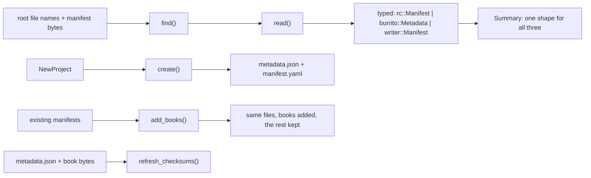
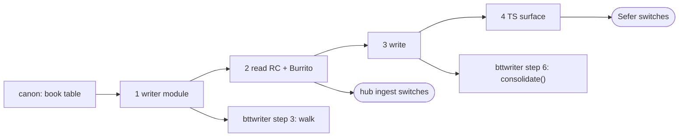

Will, 2026-11-05:

> Yeah, while canon keeps working, let's talk through the container plan

This is step 3 of the Shared Scripture Domain Libraries order. It sits between
[[code:planning/items/2026-11-04-canon-and-versification-the-book-table-schemes-map.mdx|canon]]
and bttwriter
([[code:planning/items/2026-11-05-writer-consolidation-saves-in-one-git-pack-out.mdx|the Writer plan]]).
It uses canon's book table, and bttwriter uses it: the `writer` module for reading
`manifest.json` during the walk, and the RC and Burrito writers for `consolidate()`.

A *container* is the manifest file at a repo's root that says what the repo is: its
language, what kind of resource, which books, translated from what. We meet three:

| File | Format | On WACS (hub scan, 1,441 repos) | Who writes them today |
|---|---|---|---|
| `manifest.json` | BTT Writer / translationStudio | **1,103** | Writer. We only read it. |
| `manifest.yaml` | Resource Container (RC 0.2) | 291 | the catalog; Sefer (new projects, added books); the hub (consolidated repos) |
| `metadata.json` | Scripture Burrito 1.0 | 8 | Sefer (new projects, added books, checksums on save) |
| none | | 39 | |

## What a user of the API gets

Four jobs, and each has a named consumer:

| Job | Who | Today |
|---|---|---|
| **"What is this repo?"** Find the manifest, read it leniently, and get one normalized answer: language, resource, kind, books, sources | the hub's `ingest` and `synthetic` (every WACS repo); Sefer's `discovery`, `projectAdmin` and `import` (opening a project or resource) | hub `crates/manifest` (`find_manifest`, `parse_as`, `normalize`); Sefer `projectMetadata.ts`, `burrito.ts`, `resourceContainer.ts`, `relationships.ts` |
| **"Write the manifests for a new project"** | Sefer `assemble` (writes *both* `metadata.json` and `manifest.yaml`); bttwriter `consolidate()` | Sefer `writeMetadata.ts`; the hub's `manifest_with_book` |
| **"Add these books"** to existing manifests, keeping everything else | Sefer `addBooks`; the hub publishing a book into a consolidated repo | Sefer `withBooks` / `withProjects` in `assemble.ts`; the hub's `manifest_with_book` |
| **"Refresh the checksums"** of Burrito ingredients after a save | Sefer `projectAdmin` | Sefer `checksum.ts`, with an MD5 written by hand because WebCrypto has none |

What's *not* in it, because it's app state rather than a format: Sefer's resource library
(`library.ts`: what's installed, under which role), its resource kinds and the tn pack
(`kinds/`), import staging (`import.ts` reads the filesystem), and "can Sefer open this?"
(`kinds/content.ts`'s `recognize`). Container answers "what is it?", and each app keeps
"what do I do with it?".

**Correction to the earlier estimate:** in Sefer this retires about 750 lines (`burrito.ts`
103, `resourceContainer.ts` 53, `projectMetadata.ts` 131, `writeMetadata.ts` 162,
`checksum.ts` 131, and roughly 100 of `relationships.ts`, plus `withBooks`/`withProjects`
and Writer's schema in `writerBook.ts`). That's not the 2,322 I quoted for all of
`src/core/resources`. In the hub it's all of `crates/manifest` (1,327 lines) and
`manifest_with_book`.

## Drift already found

Reading both copies and three real catalog manifests turned up these:

| What | Catalog (`en_ulb`, `en_ult`, `bdf_reg`) | Sefer writes | hub writes |
|---|---|---|---|
| RC project `sort` for GEN, MAT | **1, 40** (canonical order, from 1) | 0, 39 (`CANON.findIndex`, from 0) | 1, 41 (the file number) |
| RC project `title` | the book's name in the language (`Matiu`) | the book's title from the text | the book code (`ROM`) |
| `dublin_core.publisher` | `Wycliffe Associates`, `unfoldingWord` | `Wycliffe Associates` | `Translation Hub` |
| What kind of resource | (declared `subject`, `type`, `identifier`) | `recognize`: `tn`/`tq`/`tw` by identifier, `help`/`bundle` by type | `canonical_subject` + `Domain`: a lookup over subject, identifier and book id |
| Burrito shape | the official JSON Schema | an Effect schema of the parts it reads | serde structs of the parts it reads |

The `sort` row is a third disagreement about Matthew's number, after the two the canon plan
already names. **Neither app matches the catalog.** canon's `canonical_index` (MAT = 40) is
exactly the catalog's `sort`, so container writes that and nothing else.

<Question id="fix-sort">Sefer's existing projects have `sort` one lower than the catalog in every `manifest.yaml` it wrote, and hub-consolidated repos have NT books one higher. Should `add_books` rewrite every project's `sort` to canon's while it's editing, so old manifests heal on their next edit? I'd say yes: it's a one-line diff per book, and nobody sorts by the broken values on purpose.</Question>

<Question id="publisher">Who decides `publisher`, `creator`, `rights` and the checking level? Sefer and the hub disagree on `publisher` today. I'd make them required inputs to `create` with no defaults hidden in the library, so each app states its own policy. Or is there one right answer for anything WA writes (`Wycliffe Associates`)?</Question>

## The API



### Reading

```ts
// What's at the root, in precedence order: metadata.json, manifest.yaml / .yml, manifest.json.
// Matched case-insensitively on the whole name, so "org-manifest.json" is ignored (seen on WACS).
container.find(rootNames: string[]): { name: string; format: Format } | undefined;
type Format = "burrito" | "rc" | "writer";

// Lenient: a BOM, numbers where strings belong, one value where a list belongs, stray
// "---" documents. Each leniency used is reported, so the hub's health checks can show it.
container.read(name: string, bytes: Uint8Array): Read | ReadError;

interface Read {
  format: Format;
  summary: Summary;
  warnings: Warning[];          // e.g. { at: "projects[3].sort", said: "\"40\"", read: 40 }
  // The typed document, for a caller that needs a field the summary doesn't carry.
  rc?: RcManifest; burrito?: BurritoMetadata; writer?: WriterManifest;
}

// One shape for all three. Merges the hub's NormalizedManifest and Sefer's ProjectMetadata.
interface Summary {
  id?: string;                          // Burrito primary id; RC/Writer: undefined
  name: LocalizedText;                  // "English Unlocked Literal Bible"
  abbreviation: LocalizedText;          // "ulb", "reg": Burrito abbreviation, RC/Writer resource id
  language: { tag: string; name: LocalizedText; direction: "ltr" | "rtl" };
  kind: Kind;
  books: BookEntry[];                   // canonical order
  sources: Related[];                   // what it was translated from
  version?: string; issued?: string; modified?: string; rights?: string; publisher?: string;
  finishedChunks?: string[];            // Writer only: "01-05", "front-title"
}

interface Kind {
  domain?: "scripture" | "gloss" | "parascriptural" | "peripheral";
  subject?: string;                     // canonical: "Bible", "Translation Notes", …
  flavor?: string;                      // Burrito's flavor name, verbatim: "textTranslation"
  declared: { subject?: string; type?: string; format?: string; identifier?: string }; // as written
}

interface BookEntry {
  book: BookCode;                       // through canon's parse_book: "mat", "MAT", "41-MAT" all land here
  path?: string;                        // "./41-MAT.usfm"
  title?: LocalizedText;                // the name the manifest gives it: Sefer's bookNames
}

interface Related { relation: "source"; language: string; resource: string; version?: string }
```

How the two apps read with it:

```ts
// Sefer, discovery.ts: replaces the Burrito-then-RC sequence and both schemas
const found = container.find(await fs.readdir(root));
const read = found && container.read(found.name, await fs.readFile(`${root}/${found.name}`));
project.metadata = read?.summary;   // Sefer's ProjectMetadata becomes this
```

```rust
// hub, ingest: replaces hub_manifest::{find_manifest, parse_as, normalize}
let (name, _) = container::find(&root_names)?;
let read = container::read(name, &bytes)?;
report.books = read.summary.books.iter().map(|b| b.book).collect();
report.warnings.extend(read.warnings);
```

### Writing

```ts
interface NewProject {
  title: string;
  abbreviation: string;                 // the resource: "reg", "ulb"
  language: { tag: string; name: string; direction: "ltr" | "rtl" };
  books: Array<{ book: BookCode; title: string; bytes: Uint8Array }>; // bytes: Burrito's md5 and size
  sources: Related[];
  contributors: string[];               // deduplicated inside (Sefer's dedupeContributors rule)
  publisher: string; creator: string; rights: string; checkingLevel: string; // see the publisher question
  date: string;                         // the caller's clock, as everywhere
  generator: { name: string; version?: string }; // Burrito meta.generator: "Sefer", "Translation Hub"
}

// The files to write, by name. Both by default, as Sefer does today.
container.create(project: NewProject, formats?: Format[]): Map<string, Uint8Array>;

// Edits the manifests already there: adds the books (refusing one already listed),
// keeps every field it doesn't own, and puts `sort` and ingredient order in canon order.
container.addBooks(existing: Map<string, Uint8Array>, books: NewProject["books"]): Map<string, Uint8Array>;

// After a save: new md5 and size for the ingredients whose bytes changed.
container.refreshChecksums(metadataJson: Uint8Array, files: Map<string, Uint8Array>):
  { bytes: Uint8Array; changed: string[] };
```

The Rust side is the same four functions plus the typed documents (`rc::Manifest`,
`burrito::Metadata`, `writer::Manifest`) as public stage-1 types, as the hub has them now.

**Editing keeps what it doesn't own.** `addBooks` and `refreshChecksums` work on the
document as a tree, not as our typed structs, so a field we don't model survives the edit
(Sefer's `withBooks` spreads the raw JSON for the same reason). The typed structs are for
reading.

<Question id="yaml-fidelity">Editing a `manifest.yaml` re-emits it: the catalog's quoting style (`identifier: 'gen'`), flow lists (`[ 'bible-ot' ]`) and any comments are lost on the first edit. Both apps already do this today (Sefer's `yaml` stringify, the hub's `serde_yaml`). Keep it, with a deterministic emitter so the second edit is a minimal diff, or spend the effort on a format-preserving YAML editor? I'd keep it: these repos are edited by tools, not by hand.</Question>

<Question id="both-formats">Sefer writes both `metadata.json` and `manifest.yaml` for every new project, and both apps read the Burrito first when both are there. Should that stay the rule ("write both, the Burrito is authoritative, the RC is for the catalog and older tools"), or should one of them go? I'd keep both for now and write the rule down in the crate docs: WACS is RC-shaped (291 RC repos against 8 Burritos in the hub's scan), so dropping the RC would cut Sefer's projects off from it.</Question>

### Burrito: hand-written, checked against the official schema

Burrito's JSON Schema leans on `oneOf` and `$ref`, and generators turn that into awkward
types. So:

- **Hand-write the part we read and write** (what Sefer's `burrito.ts` and the hub's
  `burrito.rs` model, which agree closely).
- **Check in tests that we never drift from it:** vendor the official schema files, and
  validate every fixture *and every file `create`, `addBooks` and `refreshChecksums`
  produce* against them with the `jsonschema` crate as a dev dependency. Nothing at
  runtime depends on it.

<Question id="burrito-version">Which Burrito schema version do we pin to? Sefer writes `meta.version: "1.0.0"`. I'd vendor the 1.0 schema files and add a test that fails if a fixture declares a version we haven't vendored.</Question>

### Kinds: one vocabulary for "what is this"

The hub's `canonical_subject` and `Domain` and Sefer's `recognize` answer different
questions. The hub asks "what is it?" (Bible, Translation Notes, Open Bible Stories). Sefer
asks "can I open it?" (USFM, tn as RC help markdown). The first moves into container as
`Summary.kind`. The second stays in Sefer and reads `kind`. Sefer's `HELPS` table
(`tn`/`tq`/`tw`) is a subset of the hub's lookup, so nothing is lost.

## How it reaches TypeScript

Sefer reads a project's manifest when it opens the project, so unlike bttwriter this is
needed at startup, not on one rare screen. That changes the packaging answer:

| | Its own wasm module | Doors on galley's module | **JS parses, wasm interprets** |
|---|---|---|---|
| Cost at startup | a second module to fetch and init, with JSON and YAML parsers in it | JSON is already in galley (`serde_json`, behind `wasm`); a YAML parser is new weight | nothing new: Sefer already ships `yaml`, and `JSON.parse` is free |
| galley stays about USFM | yes | no | yes |
| One implementation of lenience | yes | yes | **no**: the BOM, multi-document and number-as-string rules run on two parsers |

For scale, galley's wasm is 1.34 MB (516 KB gzipped) today.

<Question id="wasm-home">Where does container's TS surface live? I lean toward its own module (`@wycliffeassociates/scripture-kitchen/container`), loaded at startup next to galley, with YAML support behind a cargo feature so we can see its size on its own. The third column is tempting for size, but it splits the lenience rules across two parsers, which is the kind of drift this step exists to remove. Worth measuring before deciding: the YAML parser's wasm size is the number that matters.</Question>

<Question id="yaml-crate">`serde_yaml` (what the hub uses) has been unmaintained since 2024. Options: a maintained fork (`serde_yaml_ng`, `serde_norway`), or `saphyr` (the `yaml-rust2` line) without serde. Since edits work on a tree anyway, a tree-first parser fits better than serde. I'd pick by wasm size and by how well each handles the hub's lenience cases (multi-document files, a leading `---`).</Question>

## Where it lives

<Files id="footprint">
```text
+ container/                       -- new crate; depends on canon and mise; serde, serde_json, a YAML crate
+ container/src/lib.rs             -- find, read, Read, Summary, Kind, Warning
+ container/src/writer.rs          -- Writer manifest.json (first, at bttwriter's step 3): from hub ts_manifest.rs + Sefer writerBook.ts
+ container/src/rc.rs              -- RC 0.2: typed read, create, add_books
+ container/src/burrito.rs         -- Burrito 1.0: typed read, create, add_books, refresh_checksums
+ container/src/kind.rs            -- subject / domain vocabulary: from hub canonical_subject + Domain
+ container/src/related.rs         -- sources from all three formats: from Sefer relationships.ts
+ container/src/md5.rs             -- Burrito's checksum (or the md-5 crate)
+ container/src/lenient.rs         -- number-or-string, one-or-many, BOM, multi-document YAML; each emits a Warning
+ container/schema/burrito-1.0/    -- vendored official JSON Schema, for tests only
+ container/fixtures/              -- real manifests: the catalog's, Sefer-written, hub-written, Writer's, odd ones from the WACS scan
~ Cargo.toml                       -- member; serde_json, the YAML crate; jsonschema as a dev dependency
```
</Files>

## Tests

- **Every manifest in the repo reads.** `testData/exampleCorpora/*/manifest.yaml` and
  `stressCorpora/en_ult` plus the fixtures, each with its expected `Summary` beside it.
- **The WACS scan as a bin, not a test.** The hub's golden reads every repo under
  `REPO_ROOT` and skips silently when it's unset, which `agents/testing.md` forbids. The
  1,441-repo sweep becomes a bin you run deliberately. Its odd cases (a BOM, multi-document
  YAML, `org-manifest.json`, numbers as strings) are copied into `fixtures/` as small files.
- **What we write is valid.** Every `create`/`addBooks`/`refreshChecksums` output passes the
  official Burrito schema, and reads back to the same `Summary`.
- **Edits keep unknown fields.** A fixture with fields we don't model survives `addBooks`
  byte-for-byte outside the parts we own (for JSON). For YAML it survives with the same
  values.
- **`sort` is canon's.** GEN 1, MAT 40, and an old Sefer- or hub-written manifest heals on
  `addBooks`.

## Order, each step usable on its own

1. **`writer` module** (Writer's `manifest.json`, read only). Built at bttwriter's step 3,
   because the walk needs it.
2. **Read RC and Burrito**, `find`, `Summary`, `kind`, `related` and lenience with warnings.
   The hub's `ingest` and `synthetic` switch, and `crates/manifest` goes.
3. **Write**: `create`, `addBooks`, `refreshChecksums`, with the schema tests. bttwriter's
   `consolidate()` can now be built, and the hub's `manifest_with_book` goes.
4. **The TS surface** (after the wasm-home question), and the size measurement. Sefer switches
   `discovery`, `projectAdmin`, `import` and `assemble` (the last one together with
   bttwriter's step 6).



<Question id="order">Is this order right? Steps 1–3 are native and pay off in the hub first, as with bttwriter. Step 4 waits on the packaging decision, which waits on measuring a YAML parser in wasm. That measurement is cheap and could be done now, before any of this is built.</Question>
