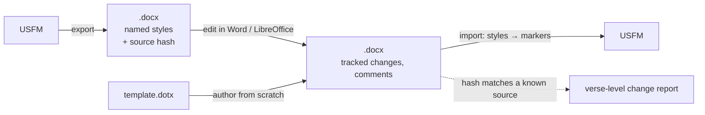

Will, on why:

> I hate promoting docx, but the truth is some folks are just going to use it

> You want something that works in either Google Docs or Microsoft Word, and you're just want to do it because it has revision tracking and it has comment functionality. […] At least let me produce documents that I know around Trippable so we can define as much of USFM with named styles as possible so taht if all you do is change the text, we know for sure we can keep your footnotes, m, p, etc

## What changes for a user

A book exports to a `.docx` in which every USFM marker is a **named Word
style**. They can edit it in Word or LibreOffice, use tracked changes and
comments, and import it again. If they only changed text, every `\p`, `\m`,
`\q1` and footnote comes back as it was. Someone who wants to "do USFM in
Word" from scratch starts from the template and picks styles from the
gallery. The file carries everything we need, so there is no "original" to
look up.

**Google Docs is out of scope.** Its named styles are a fixed set (Normal,
Title, Subtitle, Heading 1–6), so custom styles are flattened when a .docx
goes through it. Will: "we don't worry about google docs and say ok,
libreoffice or word".

**This is not a format for USFM with attributes.** `\w word|lemma="…"`,
milestones and `\fig` have nowhere sensible to live in Word. Will: "this
just wouldn't be doable in word in any sense." Export flags them and doesn't
hide them in invisible text.



## The styles

**Every marker gets a style, generated from the marker table.** It's one more
projection of `onion/src/tables/rows.rs`, done the same way as
`generated.rs`: a codegen step writes `styles.xml`, the output is checked in,
and a freshness test keeps it current. Each row × each legal spelling
(`q1`…`q4`) becomes one style named `USFM q1`. The style type comes from
`MarkerKind`:

| MarkerKind | Word style type |
|---|---|
| Paragraph, Chapter, Header | paragraph style |
| Character, Verse | character style |
| Note | a real Word footnote; its peer markers (`fr`, `ft`, `fq`, …) are character styles inside it |
| Milestone, Figure, Sidebar, Periph, table rows/cells | not carried in v1, flagged on export |

**About 12 get a curated look** and show in the quick style gallery, for
people authoring in Word. The rest get a plain generated style that is
present but hidden from the gallery.

- Paragraph: `c`, `p`, `m`, `q1`, `q2`, `s1`, `mt1`, `d`, `b`
- Character: `v`, `nd`, `add`, `wj`
- Footnotes: `fr`, `ft`, `fq`
- `mt1` is based on Title and `s1` on Heading 2, so Word's navigation pane
  works. The style names stay ours.

<Question id="curated-set" answer="Yes, this set (Will, 2026-11-05).">Is this the curated set? Candidates left out: `pi1`, `q3`, `s2`, `ms1`, `r`, `x`/`xt` (cross-references as footnotes).</Question>

## Import

- **Match styles by name (`w:name`), never by `styleId`.** Measured
  2026-11-05 with LibreOffice 24.2 headless: a style written with id `zzQ1`
  and name `USFM q1` came back with id `USFMq1` and the same name. The
  references in `document.xml` were rewritten to match.
- **A style we don't recognise is ignored and unwrapped.** For a character
  style, the text stays and the wrapper goes. For a paragraph style
  (including plain `Normal` and styles pasted in from elsewhere), the
  paragraph becomes `\p`. Each one is counted in the import report but
  doesn't block the import. Direct formatting such as bold without a style
  is dropped the same way.
- **Import takes the text as it stands.** A .docx is a zip of XML files.
  Pending tracked changes are ordinary elements in `word/document.xml`: an
  insertion is a `<w:ins>` around runs, and a deletion is a `<w:del>` around
  `<w:delText>`. Taking "whatever the text was" means keeping what's inside
  `w:ins` and skipping `w:del`. That is the text with every change accepted,
  which is what the document reads as. Comments (`word/comments.xml`) are
  an open question below (see `comments`). Neither needs Word installed;
  the same XML reader handles both.

<Question id="tracked-changes" answer="Import whatever the text is (Will, 2026-11-05): pending insertions kept, pending deletions dropped, as if every change were accepted. Comments not imported.">On import, are pending tracked changes accepted, rejected, or both kept (the accepted text as the book, the changes as review items)?</Question>

## The source hash

The export writes custom document properties (`docProps/custom.xml`), each
named after its algorithm:

```text
usfm.books                    GEN      -- the books in the document, in order
usfm.GEN.source.git-blob-sha1 9f2c…    -- the git object id of the exact USFM exported
usfm.GEN.source.xxh3-64       0x…      -- the same value every dish header carries
```

The hash is optional. If it is missing or matches nothing, the import works
from the styles alone. If it matches a known source, the import can also
report what changed, verse by verse, through onion's `diff`.

<Question id="hash" answer="Agreed (Will, 2026-11-05): git blob SHA-1 as the main hash, xxh3-64 written beside it.">Which hash? Recommendation: **git blob SHA-1** as the main one. It is an address and not just a fingerprint: you can look the exact source up in any git repo (Writer repos, DCS) with no index of our own, and `sha1_smol` is already a workspace dependency. Also write **xxh3-64**, because it costs nothing and matches the dish header, so galley can link a .docx to a parse it already holds.</Question>

<Question id="props-survive" answer="LibreOffice: yes. Measured 2026-11-05 with 24.2 headless: both `usfm.*` properties came back byte for byte after a load and save. Word: not tested yet, but Word is the format's own author for docProps/custom.xml.">Do custom document properties survive a save in Word and in LibreOffice? Test before relying on them; the plan already works without them.</Question>

## The test

USFM → docx → USFM equals the original after onion's whitespace
normalisation (`canonical` in `onion/src/export.rs`). The same corpus gate
as the USJ and USX exports applies, and it skips books that use the markers
v1 doesn't carry, listed by name. A second test opens the export in
LibreOffice headless, saves it, and runs the import again. That shows the
styles survive a real editor and not only our own writer.

LibreOffice runs offline from the command line, with no window:
`soffice --headless --convert-to docx --outdir out/ in.docx` loads the file
through its Word import filter and saves it through its Word export filter,
the same code as an Open and Save in the app. It needs the Writer module
(`libreoffice-writer`); `libreoffice-core` on its own can't load documents.
There's no equivalent for Word on Linux, so Word gets a manual check on a
few books.

<Tradeoff id="lo-ignored" chose="the LibreOffice sweep is an example run by hand (docx/examples/libreoffice.rs), not an #[ignore]d test" cost="CI doesn't prove the editor round trip on every push">
Writer is a few hundred MB to install in CI. Will: "Kinda hate that pattern
but also makes sense too". An `#[ignore]`d test would not have worked: CI
runs `--include-ignored`, and it has no LibreOffice. `agents/testing.md`
puts a sweep run deliberately in an example.
</Tradeoff>

<Followup id="lo-writer" done>Install `libreoffice-writer` on the dev box. Done 2026-11-05; the probe above ran on it.</Followup>

## Built, step 10 (2026-11-05, branch `docx`)

The strict half: export, import, comments, the wasm module and `docx.ts`.

- **Export folds onion's USX, not the CST or USJ.** USJ drops a space that
  sits alone between two spans (`\nd Lord\nd* \add God\add*`), which a
  reader of the document would see. The CST's useful helpers are
  `pub(crate)` in onion. USX is onion's own fold, tested against the
  committee's data. Measured on BSB Psalms (276 KB of USFM, release build):
  export 42 ms, of which the USX hop is about 10 and deflate 15; import
  40 ms. In wasm under Node, 48 and 44. Will agreed USX is fine; the
  writer can move into onion behind a feature later without touching the
  import or the tests.
- **Round trip, as USJ:** 159 of the 160 test-tier books export with
  nothing unsupported, and all 159 come back the same book
  (`docx/tests/round_trip.rs`). The 160th is en_ult's aligned Mark.
- **Through LibreOffice 24.2:** all 159, saved by `soffice --headless`, come
  back the same book, with an exact report and the source hash kept
  (`docx/examples/libreoffice.rs`, about 50 s).
- Shapes the corpus needed, each a style rather than a guess:
  - `USFM (no marker)`: verses after a heading with no paragraph marker
    (`\s5` then `\v 8 …`), all through the ULB.
  - `USFM raw`: text copied back verbatim. Used for `\ts\*`, `//`, a `\v`
    with no number, and an empty span (`\ft \fqa x`), since Word cannot
    hold an empty run.
  - Two touching spans of one style get a space between them, or Word's
    runs would read back as one span.
  - A footnote right after a styled word stays outside it, unless the span
    carries on after the note.
  - A note's own peers (`\fr`, `\ft`, `\fqa`, …) get a closer only when
    plain text follows (`\fqa a\fqa* or`).
- Comments come back in `@sefer/document-import`'s `CommentThread` shape,
  per book, tested with a comment and a resolved reply.
- The wasm module is 413 KB (158 KB gzipped), wired into `package.json`,
  the typecheck, `wasm-build.sh` and CI like bttwriter.

<Followup id="template" done>Generate `docx/template.dotx` (the styles in an empty document, for authoring in Word from scratch). Done 2026-11-05: written by the codegen bin with a freshness test, a starter book (`\id XXX`, `\h`, `\toc1-3`, `\mt1`, `\c 1`, `\s1`, `\p`, `\q1`, `\q2`) to type over, shipped at `./docx/template.dotx` and as `docx.template()`. LibreOffice opens it and saves it as .docx and .odt, and both import exactly. Authoring new text through LibreOffice's scripting API (UNO) hung in this sandbox, so that part was not proved by machine.</Followup>

## Built, step 11 (2026-11-05, branch `docx`)

The best-effort rules, ported from `@sefer/document-import`, behind the
same entry point. Will: "we can't expect everyone to have come through our
exporter importer path".

- **Per paragraph, one pass.** A paragraph in a `USFM …` style goes to the
  exact path (`strict.rs`); any other goes to the ported rules (`guess.rs`).
  Both write into one state (books, lines, chapter, verse, comment anchors),
  so a heading pasted between two of our paragraphs follows the verse
  before it.
- **One reading model for both** (`reading.rs`): a run keeps its character
  style's name for the exact path and its formatting for the rules. `.odt`
  is read too (`odt.rs`), including our styles after a Writer save, and the
  source hash from Writer's `meta.xml`.
- **Parity, measured.** document-import's own fixtures (Word, Word with a
  raised baseline, Writer) give byte-identical USFM, report and comment
  anchors (`docx/tests/document_import.rs`, the golden being
  document-import's output). All 159 test-tier books, exported and then
  stripped of our styles into wild drafts (superscript verse numbers,
  indented poetry, bold headings), give the same USFM, detected mode,
  skipped numbers and guesses from both implementations.
- **What changed from the TypeScript, on purpose:**
  - Versification is a canon scheme name (`"eng"`) and the book code, not a
    callback.
  - In a mixed document, our own `USFM v` runs count as superscript verse
    numbers when detecting how the document writes them. Without this, a
    verse pasted into one of our documents was left as text, because the
    guessed paragraphs alone held too few numbers to detect.
  - Italic or bold set by hand inside one of our paragraphs becomes
    `\it`/`\bd`, reported as a guess.
  - A non-breaking hyphen stays U+2011 rather than becoming `-`.
- `read(bytes)` once, `render(&reading, &settings)` per settings change;
  in JS, `readDocument(bytes).render(settings)`, with document-import's
  `Settings` and `Report` shapes plus `exact` and our own counts.
- The wasm module is now 673 KB (263 KB gzipped), up from 413 KB. Probably
  much of that is canon's versification tables; not measured.

<Question id="wasm-size" answer="Fine as it is (Will, 2026-11-05): the module loads once and a CDN caches it.">Is 263 KB gzipped acceptable, or should versification sit behind a feature so a host that never sets it doesn't carry canon's tables? I haven't measured what canon accounts for.</Question>

## Still open

<Question id="crate-name" answer="`docx` (Will, 2026-11-05).">The crate reads .odt as well as .docx once the best-effort rules come over. Is `docx` still the name? Alternatives: `office`, `documents`. Recommendation: `docx`, because export only writes .docx (LibreOffice opens it fine) and that's the format people ask for by name.</Question>

<Question id="rtl" answer="Yes, as recommended (Will, 2026-11-05).">Right-to-left scripts and fonts. The styles need `w:bidi` and `w:rtl` for Arabic or Hebrew script, and a sensible font for the language. bento's manifest already carries `language.direction`. Recommendation: export takes direction and an optional font as options, the host passes them from the manifest, and the import ignores both.</Question>

<Followup id="word-check" due="2026-12-01">Check in real Word what was only measured in LibreOffice: custom style names kept, style ids possibly rewritten, `usfm.*` custom properties kept. Will has no Word license; needs someone who does. The quickest check: export a book, open and save it in Word, then `cargo run -p docx --example roundtrip_file -- check <book.usfm> <saved.docx>`.</Followup>

## Where it lives

<Tradeoff id="own-crate" chose="its own crate, depending on onion" cost="one more crate in the workspace">
A plain `docx` feature like `usj`/`usx`/`html` was the first instinct. But
this format goes both ways: import needs an XML reader (quick-xml) and a zip
reader, and onion's dependencies are deliberately small. A crate of its own
keeps those out of onion and lets its wasm size be measured alone, the way
yaml-edit was for bento.

**Its own wasm module, the way bento and bttwriter are**, with its own
`pkg-web`, its own `.ts` door, and a line in the root `package.json`
`files`, so it ships in the kitchen package by default. galley does not
re-export it, and onion-wasm doesn't gain a feature. Will: "no galley
re-export for sure", and later rolling it in is a packaging change only.
</Tradeoff>

**Both directions live here, import included.** Sefer's
`packages/document-import` is TypeScript. Will asked whether its import
should move here and be bound with plain wasm-bindgen. Yes: the import reads
the same generated style names the export writes, so keeping both beside the
marker table means they can't drift. A TS importer would need its own copy
of the names. Plain wasm-bindgen is enough, in the shape onion-wasm already
uses for `format(text, opts) -> String`. Owned data goes in and owned data
comes out, so no handle has to outlive a call and there are no lifetime
wrappers:

```rust
#[wasm_bindgen] pub fn usfm_to_docx(usfm: &str) -> Vec<u8>          // Uint8Array
#[wasm_bindgen] pub fn docx_to_usfm(docx: &[u8]) -> Result<DocxImport, JsError>
// DocxImport: the USFM String, plus the report: unknown styles unwrapped,
// markers flagged, and the usfm.* properties if present
```

<Question id="document-import" answer="Read 2026-11-05 (sefer/packages/document-import): it is a different job. See below.">What does `packages/document-import` do today (docx only, or other formats too)? It isn't on this branch. Ask Sefer before deciding whether this crate replaces it or sits under it.</Question>

**`@sefer/document-import` is a best-effort importer.** Read 2026-11-05. It is about 2,100 lines of TypeScript, reads .docx
and .odt drafts written any old way, and *guesses*. It finds verse numbers
by convention (superscript, `v1`, line start), chapters from "Chapter 3",
poetry from indent and italics, and headings from short bold lines. Every
guess is listed in a report, with a setting to turn it off. It already
honours paragraph styles named after a marker (`q2`, `s1 - Heading`), but
only as one more guess. Sefer's `ImportDocumentDialog` uses it.

**We own both, in this crate.** Will:

> We can't expect all word files to come from our template. But where they do, great, use that, else.. we just do our best so to speak?

The strongest reason is that **strictness belongs to each paragraph, not to
each file.** A real document mixes the two. Someone starts from the template
and then pastes in a chapter from an old draft, and those paragraphs arrive
as `Normal` with bold and superscript. Two importers chosen per file can't
handle that; one importer can:

```text
for each paragraph:
  style is USFM-named  ─▶ exact: the style is the marker, no guess, nothing in the report
  anything else        ─▶ best effort: document-import's rules, each guess reported with its reason
```

A file from our template that nobody broke has nothing in its guess report.
A wild draft is all guesses. A mixed file has guesses exactly where they were
needed. This replaces "an unknown paragraph style becomes `\p`" above:
unknown paragraphs now get the best-effort rules.

What else owning it buys:

- **One report and one comments shape** for Sefer, galley and any other
  host, instead of two that have to agree.
- **The guesses get better inputs in Rust.** document-import asks its host
  for `versification(chapter)` to reject impossible verse numbers; here
  `canon` answers that directly. Its output can also go through onion's lint.
- **.odt is the same job:** a zip of XML. It needs no new dependencies.

What it costs: porting about 2,100 lines of rules. That's tolerable because
the TS was written to move ("no Sefer imports, so it can move out of this
repository unchanged"), and its fixtures (`master-titus.docx`, `titus.odt`,
`tit.usfm`) and `faithful.verify.ts` come with it.

The TS is the best starting point, not the truth. Will: "You don't have to
treat [it] As the 100% aboslutely blessed truth but it is probably the best
way to do stuff for now, but you can fix things if they look incorrect." So both run on the same fixtures, and each place they
differ is either a bug in the port (fix the port) or a fix to the rules
(recorded in the test as an intended difference, with its reason). Sefer
switches when every remaining difference is intended.

Its settings are rerun on every change without reading the file again
(`readDocument` once, `render` many times). That maps onto wasm-bindgen as
one owned handle: `read(bytes) -> Reading`, then `reading.render(settings)`.
The handle owns its data, so it still needs no lifetime wrappers.

<Question id="order" answer="Yes (Will, 2026-11-05).">Order: strict export and import first (it defines the style table and is small), then the best-effort port behind the same entry point? Recommendation: yes. Until the port lands, unknown paragraphs fall back to `\p`, as first written.</Question>

<Question id="who" answer="Will wrote document-import (with Claude) and agrees: the port is ours.">Who owns the port? document-import is fresh Sefer code, so its author should agree before it moves.</Question>

Two things to match with it:

- **Comments.** It imports them, anchored by verse and an offset into that
  verse's text, with replies and resolved state. This plan said comments
  stay in Word. For one import path in Sefer, the strict import should
  return comments in the same shape.
- **Tracked changes** are accepted as they stand there too, and counted
  (`report.found.trackedChanges`) so the host can warn. Same rule here,
  same count.

<Question id="comments" answer="Yes (Will, 2026-11-05).">Should the import return comments in document-import's shape (verse, offset, replies, resolved)? Recommendation: yes, so Sefer's dialog gets the same thing it gets today.</Question>

## One book or many

USFM is one book per file, and so is everything keyed on the source: the
git blob hash names one file, and document-import renders one book
(`render(reading, { book: "TIT" })`). Word and LibreOffice also get slow on
a whole Bible with thousands of footnotes, and reviewers are usually
assigned a book at a time.

But every book already opens with an `\id` paragraph in the `USFM id` style,
so a document holding several books splits itself without guessing.
Accepting many costs almost nothing on import, and changing the API's shape
later would cost more.

<Question id="books" answer="Yes (Will, 2026-11-05), with export of many books as below.">One book or many? Recommendation: **export writes one book per document in v1. Import accepts many, split at each `USFM id` paragraph, and returns a list from day one**, so a multi-book export can come later without breaking the API. Properties are keyed per book (`usfm.GEN.source.git-blob-sha1`) so they extend the same way.</Question>

**Exporting many books gives one .docx per book, not one Word file holding
them all.** The export returns a map of file name to bytes
(`GEN.docx` → …), the shape bento's `createBible` already returns. Zipping
them for a download is the host's job; Sefer already has `fflate`. One
document per book keeps the hash meaning one file, keeps Word fast, and lets
each book go to its own reviewer. A Word file holding several books still
imports, because someone may paste books together, but we don't produce one.

<Question id="many-export" answer="Yes (Will, 2026-11-05).">Export of many books: a map of one .docx per book, zipped by the host? Recommendation: yes. The crate already writes zips, so returning a zip instead is cheap if a host wants that.</Question>

USJ and USX import are still deferred (see the USJ import sketch). When USX
import comes, quick-xml is already here: the XML reader this crate brings is
the one USX would need.

<Files id="footprint">
```text
+ docx/                       -- the crate: export, import, styles
+ docx/src/styles.xml         -- generated from the marker table, checked in
+ docx/template.dotx          -- the curated template for authoring in Word
~ Cargo.toml                  -- workspace member
+ docx/docx.ts                -- thin typed door over docx/pkg-web: init, types, no rules
~ package.json                -- docx/pkg-web and docx/docx.ts in `files`
~ wasm-build.sh               -- docx as a fourth crate
```
</Files>

Prior art read, not ported: `WycliffeAssociates/USFMToolsSharp.Renderers.Docx`
renders for viewing, with two named styles (`Normal`, `BookHeading`) and
direct formatting for the rest, so nothing it writes can be read back.
`WycliffeAssociates/DOC` is a Python service that combines resources and
could call this later.

<Followup id="sefer" done>Tell Sefer how this relates to `packages/document-import` once the curated set is agreed.</Followup>

<Followup id="sefer-switch">In Sefer: `ImportDocumentDialog` reads through `docx.readDocument(bytes).render(settings)` instead of `@sefer/document-import`, offers an export to Word (`exportBook`, `exportBooks`, `template`), and `packages/document-import` is deleted. The types match by design, so the dialog's code should change little.</Followup>

<Followup id="template-by-hand">Will, in LibreOffice: open `docx/template.dotx`, type a few verses picking `USFM …` styles from the list, save, and import. The one path not proved by machine.</Followup>
