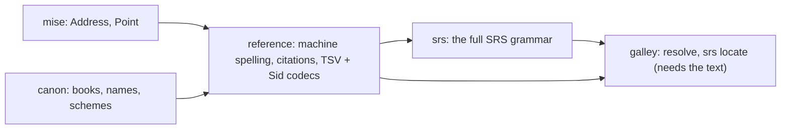

Will, 2026-11-05:

> I don't love SRS. I don't understand the use case for it to be honest … but like, if
> you're going to use pointers at words, defining your words as non whitespace.. I dont'
> get why not just offsets personally.

> But srs is it's own sort of addressing space. I think, and agree it should be it's own
> crate probably.

> Can you draft one more plan for tidying up referencing and how we do stuff like that
> potentially?

The Shared Scripture Domain Libraries doc lists **reference** as its second package, blocked
on two open questions: how an address is spelled for machines, and which offset unit
crosses language boundaries. This plan answers both, mostly from what the kitchen has
already built, and gives SRS its own place.

## What the kitchen already has

More than the doc assumed:

| Piece | Where | What it does |
|---|---|---|
| The model | [[code:mise/src/address.rs#Address]] | `Book`, `Intro`, `Chapters`, `Verses` of `Point` (chapter, verse, segment `a`). "Sefer's `Address`, minus its book." |
| Resolve | onion `Toc::resolve`, galley's door ([resolve plan](/items/2026-10-20-resolve-an-address-to-its-place-in-one-text-on-the), done) | "Where is JHN 3:16 in this text": found, missing or ambiguous, never nearest. 31 cases in `testData/resolve/cases.json` |
| Books | canon `parse_book`, `usfm_file_name` | Codes, slugs, English names. Localized names arrive in canon's step 6 |
| Versification | canon `Span`, `map`, `pairs` | Moving an address between schemes |
| Verse 0 | onion's TOC (canon thread, `fd4833f`) | A `\d` before a Psalm's first verse is verse 0 |
| Positions inside a verse | galley's projection and mask map (`galley/src/mask.md`) | The verse's reading text with markup removed, and a map from an offset in it back to the source. sous findings already use these coordinates |

What's missing is the **grammar**: text → address and back, in each spelling we meet.

## Three kinds of address, and when SRS is used

Will, 2026-11-06:

> Addresing could mean at least 3 things? 1. simple BCV 2. u32..u32 offsets, which I need.
> to yes actually point to whitesapce, unlike what srs allows 3. SRS.

> how do you know when to use SRS versus not use SRS?

Three layers, and SRS never shapes the other two:

| You're pointing at… | …and the reader has your exact USFM bytes | Use |
|---|---|---|
| a book, chapter or verse | either way | the **basic reference**: `MAT 1:20-2:3` (an `Address`, spelled the SRS way) |
| something inside a verse | yes: CodeMirror, onion, galley, sous, Sefer's storage | a **`u32..u32` source span** |
| something inside a verse | no: another tool, a USX file someone else made, `\ref loc`, `@vid`, a person reading it | **SRS** `!word+char` |

The basic reference needs no parser, no NFD and no word counting. NFD, SRS's whitespace
rules and word counting happen only at the moment a span is converted to SRS or back
(`galley.srs.at` / `locate`). Like a date: a timestamp inside, an ISO string at the
boundary. Nothing stores SRS, and nothing draws from it: an SRS reference is located to a
span first, every time.

## The spellings we meet

One `Address`, many spellings. Each spelling is a codec, never a second model:

| Spelling | Example | Who writes it | Today |
|---|---|---|---|
| **Machine** (stored, sent, logged) | `GEN 0`, `PSA 3:0`, `LUK 11:2b`, `MAT 1:20-2:3` | us | undecided: `mise` documents `GEN intro`, Sefer uses `GEN 0` |
| **Human citation** (typed, shown) | `Mateo 5:3-7; 6:1`, `1 Jn 3:16` | people, in a go-to box or a note | Sefer `citation.ts` + `names.ts` (~390 lines, `citation.test.ts` ~60 rows) |
| **uW TSV Reference cell** | `1:3`, `1:3-5`, `front:intro`, `1:intro` | tn/tq TSV files (book from the file) | each helps reader; the helps spike's parser accepts a backwards range Sefer rejects |
| **onion `Sid`** | `GEN 1:3-5` | onion's TOC | onion `toc.rs` |
| **SRS** | `MAT 2:1!3`, `en+niv.MRK 1:14!s`, `MRK 0!ip!w!1` | the USFM committee's standard; `\ref loc`; usfmtc | the Kotlin hub's `SrsParser` (private repo) |

Two words, kept apart. A **reference** is the strict machine string: one spelling, parsed
exactly, an error otherwise. A **citation** is what a person types or reads: localized
(`Mateo`, `1 Jn`), parsed leniently, and it says what it assumed. "Citation" never means
SRS.

### The machine spelling: SRS's basic reference

The USFM committee's
[Scripture Referencing Standard](https://github.com/usfm-bible/tcdocs/blob/main/docs/Scripture%20Referencing%20Standard.md)
(version 1.0, released: its changelog says "Initial release Feb 2026 · Released and moved
from proposals", committed 2026-08-31) already spells everything `Address` holds, and agrees with Sefer and canon where our own
code disagrees with itself:

- **The intro is chapter 0**: `MRK 0`. Sefer's `GEN 0` agrees; `mise`'s doc comment says `GEN intro`.
- **A Psalm title is verse 0**: `PSA 7:0`. canon's `pairs` and onion's new verse-0 titles agree.
- **A verse part is one lowercase letter**: `LUK 11:2b`, which is `Point.segment`.
- **Ranges and lists**: `MAT 1:20-2:3`, `PSA 68:25,28`, `GEN 1:1; 2:4`. A bridge is just a range.

<Question id="machine-spelling" answer="Yes (Will, 2026-11-06). The basic reference is a small text grammar over Address: no USFM parser and no NFD. Those belong to SRS words, characters and markers only, which is why srs is its own crate.">Do we adopt SRS's basic reference (book, chapter, verse, subverse, ranges, lists; no words, characters, markers or translation prefix) as *the* machine spelling of an `Address`? It answers the doc's first open question with a published standard instead of a house rule, it costs only renaming `GEN intro` to `GEN 0` in `mise`'s docs, and anything that reads SRS reads ours. I'd say yes.</Question>

**Its status.** The tcdocs [roadmap](https://github.com/usfm-bible/tcdocs/blob/main/docs/USFMTC%20Roadmap.md)
still lists the Google doc
[U23003 USFM References](https://docs.google.com/document/d/1U0CrIJkU4h4pPOhhifN1y-HJU5f5r6nGD6d2rLuMeeM/edit?tab=t.0)
as "in discussion", but the roadmap was last changed on 2026-03-09, before the release. The
Google doc is the proposal; the Markdown is the standard. USFM itself now leans on it: 3.1
gives `@vid` "extended reference syntax", 3.1.2 adds a `vid` milestone, and `\ref loc`
uses it.

The other spellings become codecs into and out of `Address`: the uW TSV cell (with its book
from the file name, and `front`/`intro` mapped to chapter 0 and `Intro`), `Sid`, and
human citations.

## Source spans inside, SRS at the edge

Will, 2026-11-06:

> the counting to me is wild since it doesn't survive edits and I don't find it terribly
> readable. It's why I persoanlly think the range should just be u32..u32, adn if you
> convert to another format, you should just map select and reanchor in the new document

> to do anything basic like we do with codemirror of just drawing on diagnostics, you still
> have to resolve back to a u32..u32

**The address of a place inside our tools is a source span**: `u32..u32` into the USFM
source, which can point at whitespace or a marker. onion's TOC, `resolve`, lints and the
editor's diagnostics already speak it. In Rust and on the wire it's UTF-8 bytes; at the JS
edge it's UTF-16, converted by `mise::utf16`, as galley does now.

**Projected offsets are galley's internal detail.** galley and sous count inside a verse's
reading text (markup removed, notes out), then map back through the mask
(`galley/src/mask.md`) before anything leaves galley. Nothing outside galley holds one.

**When we convert, we re-anchor by map, not by SRS.** onion writes USX and USJ itself, so the
converter can carry a source-span map, and a span re-anchors exactly with no counting. SRS
is for a USX or USJ file someone else made, where no such map exists.

**Why SRS counts words anyway:** it's written for that other job.

- **It must mean the same place in USFM, USX and USJ** made by tools that share no map. A
  byte offset into USFM doesn't: `\~` is two bytes in USFM and one character in the model.
- **It's meant for people.** "Third word of MAT 2:1" can be counted by eye.
- **Characters are counted in NFD**, so it can point at one diacritic.

Neither survives an edit to the verse: a new word moves every later word number just as it
moves every later offset.

<Question id="offsets" answer="Yes, revised (Will, 2026-11-06): source spans are the address, UTF-8 bytes on the wire and UTF-16 at the JS edge. Projected offsets stay inside galley. Our own conversions re-anchor by a span map; SRS is only for files and tools we share no map with.">What crosses a boundary: source spans or projected offsets? The first draft said projected offsets on the wire. Alignment (`../pairing-lab`) would store its word links as spans too, with SRS as an export spelling.</Question>

## Verse tiles: the heading and the opening paragraph go with the next verse

Will, 2026-11-06:

> there's times I want to say pull 13, but you should pull the paragraph in the subheading
> above it as well. So keep the test of title the whole document and move the boundaries is
> fine with me, Because there's times I've like been like show 13 and you didn't pull the P,
> so the text is not indented

Today a verse in onion's TOC ([[code:onion/src/toc.rs#VerseAnchor]]) runs from its `\v` to
the next `\v` or `\c`. So the `\s1`, the `\r` *and the `\p` that opens verse 14* all sit in
verse 13's tile, and a heading before a chapter's first verse belongs to no verse:

```text
\v 12 At once the Spirit … \v 13 where he stayed 40 days … angels came and helped him.
\s1 Jesus Calls Four Fishermen        today: 1:13        after: 1:14
\r (Mt 4.12-22; Lk 4.14-15; 5.1-11)   today: 1:13        after: 1:14
\p                                    today: 1:13        after: 1:14
\v 14 After John had been put in prison …
```

**The rule.** A verse's tile starts at the first paragraph or heading marker after the
previous verse's last text (plus the notes and milestones attached to that text). Everything
from there to its `\v` comes with it. A paragraph break inside a verse (`\q2` with no `\v`)
has no `\v` to belong to, so it stays with the verse it continues. This is SRS's own
association ("section headings are associated with the following paragraph").

- **The whole document is still tiled.** Only the boundary moves.
- **No second field.** `VerseAnchor.at` becomes where the tile begins; the `\v` itself is
  still reached through the row's `token`. The row stays 28 bytes.
- **Chapters stay hard breaks.** SRS never says whether a heading's association crosses a
  `\c` (its examples always put the heading after it), so a heading before `\c 2` stays in
  chapter 1.
- **A heading before verse 1 goes to verse 1**, as SRS addresses it (`MRK 1:1!s`). Not
  chapter 0: that is the book's introduction, before `\c 1`. In a Psalm,
  `\c 7 \s1 … \d … \v 1`, the heading's next paragraph is the `\d` title, so it goes with
  verse 0 (`PSA 7:0`).

<Tradeoff id="ms-before-c" chose="Chapters stay hard breaks" cost="A heading a text puts just before \c (a Psalms book division as \ms, say) stays with the previous chapter's last verse">Moving it into the next chapter would change chapter tiling too, and SRS doesn't ask for it.</Tradeoff>

**`resolve` and `locate` both stay.** `resolve` is the lookup ("where is JHN 3:16": bridges,
lists, `16a`, missing, twice); `locate` is its inverse ("which verse holds this byte"). After
the change both answer with the wider tile, so they agree with each other better.

What changes for callers:

- `resolve` returns the heading and the `\p` with the verse, so "show 13" renders indented.
  Its 31 cases (`testData/resolve/cases.json`) are updated.
- A finding inside a heading is reported against the next verse (sous, and anything built on
  `locate`).
- A heading before verse 1 reports verse 1, not the bare chapter.
- The TOC tests that pin verse extents are updated, and the JS readers of the row see a
  different `at`, not a different layout.

**For `srs.locate` later:** SRS treats headings as "both inside and outside the range".
`MRK 1:14!s` reaches the heading, but word 1 of `MRK 1:14` is still the first word after
`\v 14`. So locate skips the heading paragraphs at the head of a tile when it counts words.

## Two crates



### `reference`: an address and its everyday spellings

Pure grammar over `mise::Address` and canon's books. No text, no onion.

```ts
// A reference is a list of ranges, each in one book.
interface Reference { book: BookCode; address: Address }

// Machine spelling (SRS basic). Strict: anything else is an error, never a guess.
reference.parse("MAT 1:20-2:3; MRK 1:1"): Reference[] | ReferenceError;
reference.format(refs: Reference[]): string;              // "MAT 1:20-2:3; MRK 1:1"

// Human citations. Lenient, localized, and says what it assumed.
reference.cite(text: string, opts: { locales: string[]; book?: BookCode /* context */ }):
  { refs: Reference[]; assumed: Assumption[] } | ReferenceError;
// "Mateo 5:3-7; 6:1" → MAT 5:3-7, MAT 6:1 (book carried to the second), assumed: ["es name"]
reference.show(refs: Reference[], opts: { locale: string; style: "long" | "short" | "abbr" }): string;

// Codecs
reference.tsv.parse(cell: "1:3-5" | "front:intro", book: BookCode): Reference;
reference.tsv.format(ref: Reference): string;
reference.sid(sid: Sid): Reference;
```

- `parse` is the boundary (strict). `cite` is the go-to box (lenient, localized). Sefer's
  `citation.test.ts` is `cite`'s spec, and its rows become shared fixtures.
- `cite` uses canon's `parse_book` with locales, so localized names come with canon's
  step 6. Before that, it works with English names and codes.
- What it never does: decide whether a text *has* the verse. That's `galley.resolve`.

### `srs`: the full standard, as its own address space

Everything SRS adds beyond the basic reference: translation prefixes (`en+niv.`), word and
character references (`!3`, `!5+6`, `!end`), marker references (`!f`, `!s[2]`, `!ip!w`),
and named references (`NEH t:Israel/6/1`, `k:`, `a:`).

```ts
// Grammar only: a parsed SRS reference, and back. No text needed.
srs.parse(text: string): SrsRef[] | SrsError;
srs.format(refs: SrsRef[]): string;
srs.toReference(ref: SrsRef): Reference | undefined;      // drops word/char/marker parts; undefined for a NameRef

// Against one text: needs the projection, so it's a galley door.
galley.srs.locate(id, ref: SrsRef): { from: number; to: number } | Missing; // projected offsets
galley.srs.at(id, from: number, to: number): SrsRef;      // the SRS spelling of a range
```

It ports the released standard in full, grammar and `locate`, NFD included. There's no
config flag: spans are our default because spans are what we store, and SRS exists only
through `locate` and `at`.

> if it's a USFM standard we should just go and port it (Will, 2026-11-06)

**What usfmtc gives us**, read 2026-11-06:

- **The grammar, complete**, in `src/usfmtc/reference.py` (about 1,100 lines): prefixes,
  `!word+char`, `end`, markers with `[n]`, ranges, lists and localized book names. Where the
  standard's grammar and prose disagree (#125, #126) it accepts both.
- **Locating** in `src/usfmtc/usxcursor.py`, over USX rather than USFM. It splits words on a
  whitespace regex and **never normalizes to NFD**, so its character counts are in whatever
  form the file is in. Ours follows the standard there, and says so in the fixtures.

Its own crate because it's its own address space, as Will says: most callers never need
words, characters or markers, and `reference` stays small without them.

<Question id="srs-when" answer="Port it in full (Will, 2026-11-06): it is a released USFM standard, and @vid and \ref loc use it. The grammar comes after reference; locate follows the TOC tiling change, since it counts within those tiles.">When is `srs` built? The grammar half is cheap: usfmtc implements it (`src/usfmtc/reference.py`, MIT), with test cases (`tests/test_refs.py`) to port as fixtures. The `locate` half needs a consumer. The candidates are `\ref loc` (USFM 3.1 links, which the standard governs, and which onion could lint), alignment exporting to other tools, and helps anchored below the verse.</Question>

## What it replaces

| Today | Where | Replaced by |
|---|---|---|
| `address.ts` (types) | Sefer `packages/text/src/location` | `mise::Address`, through galley |
| `citation.ts`, `names.ts` (~390 lines) | Sefer `packages/text/src/location` | `reference.cite` / `show`, with canon's names |
| The cut-down citation parser | the helps spike | `reference.tsv` |
| Ad hoc `front:intro` handling | each helps reader | `reference.tsv` |
| `SrsParser` | the Kotlin hub (private) | `srs`, through its fixtures until a JVM app needs bindings |
| `GEN intro` in `mise`'s docs | `mise/src/address.rs` | `GEN 0` (doc only, done 2026-11-06) |

`locate.ts` already went to onion's `resolve`.

## Fixtures

- **Sefer `citation.test.ts`** (~60 rows): `reference/fixtures/cite.json`, run by the Rust
  tests and by Sefer's TS tests until Sefer switches.
- **usfmtc `tests/test_refs.py`** (96 test functions, MIT): the grammar cases go to
  `srs/fixtures/`. The ones that locate against `32JONBSB.usfm` (through `USXCursor`) become
  `locate` cases, except where a character count depends on NFD, which we mark.
- **The SRS document's own examples**, including the two places the grammar and the prose
  disagree (usfm-bible/tcdocs issues
  [#125](https://github.com/usfm-bible/tcdocs/issues/125) and
  [#126](https://github.com/usfm-bible/tcdocs/issues/126), both open). We follow usfmtc,
  which accepts both, and note it.
- **The Kotlin hub's `fixtures/srs/cases.json`**, if we can get it.

<Question id="kotlin-cases">The Kotlin translation-hub repo is private and isn't checked out here. Can someone share `fixtures/srs/cases.json` and `fixtures/versification/cases.json`? The versification cases are also owed to canon.</Question>

## Order

1. **The spelling decision** (done 2026-11-06): SRS basic as the machine spelling; `mise`'s
   docs now say `GEN 0`.
2. **`reference` with `parse`/`format`** (machine spelling) and the TSV and `Sid` codecs.
   Nothing here waits on canon.
3. **`cite`/`show`** with English names and Sefer's fixtures, then localized names when
   canon's step 6 lands.
4. **galley doors**, so Sefer switches `citation.ts` and `names.ts`. This goes with canon's
   step 7, which wires canon into galley anyway.
5. **TOC tiles**: headings and the opening paragraph go with the next verse, in onion's TOC,
   with `resolve`'s cases updated. Independent of 2–4, and it can go first.
6. **`srs` grammar**, from usfmtc's cases and the standard's examples.
7. **`galley.srs.locate` / `at`**, after 5, NFD and the heading skip included.

<Question id="order">Is this order right, and where does it sit against bttwriter and bento? It touches none of their crates, so steps 1–3 can run alongside them. Step 4 waits on canon's galley wiring.</Question>
