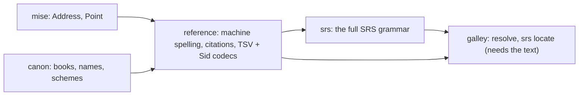

Will, 2026-11-05:

> I don't love SRS. I don't understand the use case for it to be honest … but like, if
> you're going to use pointers at words, defining your words as non whitespace.. I dont'
> get why not just offsets personally.

> But srs is it's own sort of addressing space. I think, and agree it should be it's own
> crate probably.

> Can you draft one more plan for tidying up referencing and how we do stuff like that
> potentially?

The Shared Scripture Domain Libraries doc lists **reference** as its second package, blocked
on two open questions: how an address is spelled for machines, and which offset unit
crosses language boundaries. This plan answers both, mostly from what the kitchen has
already built, and gives SRS its own place.

## What the kitchen already has

More than the doc assumed:

| Piece | Where | What it does |
|---|---|---|
| The model | [[code:mise/src/address.rs#Address]] | `Book`, `Intro`, `Chapters`, `Verses` of `Point` (chapter, verse, segment `a`). "Sefer's `Address`, minus its book." |
| Resolve | onion `Toc::resolve`, galley's door ([resolve plan](/items/2026-10-20-resolve-an-address-to-its-place-in-one-text-on-the), done) | "Where is JHN 3:16 in this text": found, missing or ambiguous, never nearest. 31 cases in `testData/resolve/cases.json` |
| Books | canon `parse_book`, `usfm_file_name` | Codes, slugs, English names. Localized names arrive in canon's step 6 |
| Versification | canon `Span`, `map`, `pairs` | Moving an address between schemes |
| Verse 0 | onion's TOC (canon thread, `fd4833f`) | A `\d` before a Psalm's first verse is verse 0 |
| Positions inside a verse | galley's projection and mask map (`galley/src/mask.md`) | The verse's reading text with markup removed, and a map from an offset in it back to the source. sous findings already use these coordinates |

What's missing is the **grammar**: text → address and back, in each spelling we meet.

## The spellings we meet

One `Address`, many spellings. Each spelling is a codec, never a second model:

| Spelling | Example | Who writes it | Today |
|---|---|---|---|
| **Machine** (stored, sent, logged) | `GEN 0`, `PSA 3:0`, `LUK 11:2b`, `MAT 1:20-2:3` | us | undecided: `mise` documents `GEN intro`, Sefer uses `GEN 0` |
| **Human citation** (typed, shown) | `Mateo 5:3-7; 6:1`, `1 Jn 3:16` | people, in a go-to box or a note | Sefer `citation.ts` + `names.ts` (~390 lines, `citation.test.ts` ~60 rows) |
| **uW TSV Reference cell** | `1:3`, `1:3-5`, `front:intro`, `1:intro` | tn/tq TSV files (book from the file) | each helps reader; the helps spike's parser accepts a backwards range Sefer rejects |
| **onion `Sid`** | `GEN 1:3-5` | onion's TOC | onion `toc.rs` |
| **SRS** | `MAT 2:1!3`, `en+niv.MRK 1:14!s`, `MRK 0!ip!w!1` | the USFM committee's standard; `\ref loc`; usfmtc | the Kotlin hub's `SrsParser` (private repo) |

### The machine spelling: SRS's basic reference

The USFM committee's
[Scripture Referencing Standard](https://github.com/usfm-bible/tcdocs/blob/main/docs/Scripture%20Referencing%20Standard.md)
already spells everything `Address` holds, and agrees with Sefer and canon where our own
code disagrees with itself:

- **The intro is chapter 0**: `MRK 0`. Sefer's `GEN 0` agrees; `mise`'s doc comment says `GEN intro`.
- **A Psalm title is verse 0**: `PSA 7:0`. canon's `pairs` and onion's new verse-0 titles agree.
- **A verse part is one lowercase letter**: `LUK 11:2b`, which is `Point.segment`.
- **Ranges and lists**: `MAT 1:20-2:3`, `PSA 68:25,28`, `GEN 1:1; 2:4`. A bridge is just a range.

<Question id="machine-spelling">Do we adopt SRS's basic reference (book, chapter, verse, subverse, ranges, lists; no words, characters, markers or translation prefix) as *the* machine spelling of an `Address`? It answers the doc's first open question with a published standard instead of a house rule, it costs only renaming `GEN intro` to `GEN 0` in `mise`'s docs, and anything that reads SRS reads ours. I'd say yes.</Question>

The other spellings become codecs into and out of `Address`: the uW TSV cell (with its book
from the file name, and `front`/`intro` mapped to chapter 0 and `Intro`), `Sid`, and
human citations.

## Why not just offsets? We do use offsets. SRS is for the edge.

Will's instinct is right for everything *we* store. The question is what crosses to someone
who doesn't have our exact bytes.

**Inside our tools, a position in a verse is an offset**: an offset into the verse's
projected reading text (markup removed, notes out), the same coordinate galley's mask map
and sous findings already use. On the wire it's UTF-8 bytes. At the JS edge it's UTF-16,
converted by `mise::utf16`, as galley does now. That's the doc's second open question,
answered by what's already built: **projected offsets, UTF-8 on the wire, each language's
own unit at its edge.**

**Why SRS counts words instead:** it's written for a different job.

- **It must survive serialization.** An SRS reference means the same place in a USFM, USX
  or USJ file. A byte offset into USFM doesn't: `\~` is two bytes in USFM and one character
  in the model. Offsets into *our projection* also survive serialization, but only if the
  other side computes the same projection. SRS defines one projection everyone can compute:
  whitespace-separated runs of the model's text, notes counted separately.
- **It's meant for people.** "Third word of MAT 2:1" can be counted by eye; "byte 17" can't.
  The standard says so: "The reason for character locations to be identified by word is
  that it makes indexing by humans easier."
- **Characters are counted in NFD**, so it can point at one diacritic. An offset into NFC
  text can't.

Neither survives an edit to the verse: inserting a word moves every later word number just
as it moves every later offset. So the rule is: **store and compute offsets; speak SRS
only when the other side is another tool or a person.** The conversion between them is
exact given the text: count non-space runs in the projection. It belongs to galley, which
has the projection.

<Question id="offsets">Is "projected offsets, UTF-8 bytes on the wire, UTF-16 at the JS edge" the answer to the doc's offset-unit question? It's what galley and sous already do, so adopting it changes no code. Alignment (`../pairing-lab`) would store its word links this way too, with SRS as an export spelling.</Question>

## Two crates



### `reference`: an address and its everyday spellings

Pure grammar over `mise::Address` and canon's books. No text, no onion.

```ts
// A reference is a list of ranges, each in one book.
interface Reference { book: BookCode; address: Address }

// Machine spelling (SRS basic). Strict: anything else is an error, never a guess.
reference.parse("MAT 1:20-2:3; MRK 1:1"): Reference[] | ReferenceError;
reference.format(refs: Reference[]): string;              // "MAT 1:20-2:3; MRK 1:1"

// Human citations. Lenient, localized, and says what it assumed.
reference.cite(text: string, opts: { locales: string[]; book?: BookCode /* context */ }):
  { refs: Reference[]; assumed: Assumption[] } | ReferenceError;
// "Mateo 5:3-7; 6:1" → MAT 5:3-7, MAT 6:1 (book carried to the second), assumed: ["es name"]
reference.show(refs: Reference[], opts: { locale: string; style: "long" | "short" | "abbr" }): string;

// Codecs
reference.tsv.parse(cell: "1:3-5" | "front:intro", book: BookCode): Reference;
reference.tsv.format(ref: Reference): string;
reference.sid(sid: Sid): Reference;
```

- `parse` is the boundary (strict). `cite` is the go-to box (lenient, localized). Sefer's
  `citation.test.ts` is `cite`'s spec, and its rows become shared fixtures.
- `cite` uses canon's `parse_book` with locales, so localized names come with canon's
  step 6. Before that, it works with English names and codes.
- What it never does: decide whether a text *has* the verse. That's `galley.resolve`.

### `srs`: the full standard, as its own address space

Everything SRS adds beyond the basic reference: translation prefixes (`en+niv.`), word and
character references (`!3`, `!5+6`, `!end`), marker references (`!f`, `!s[2]`, `!ip!w`),
and named references (`NEH t:Israel/6/1`, `k:`, `a:`).

```ts
// Grammar only: a parsed SRS reference, and back. No text needed.
srs.parse(text: string): SrsRef[] | SrsError;
srs.format(refs: SrsRef[]): string;
srs.toReference(ref: SrsRef): Reference | undefined;      // drops word/char/marker parts; undefined for a NameRef

// Against one text: needs the projection, so it's a galley door.
galley.srs.locate(id, ref: SrsRef): { from: number; to: number } | Missing; // projected offsets
galley.srs.at(id, from: number, to: number): SrsRef;      // the SRS spelling of a range
```

Its own crate because it's its own address space, as Will says: most callers never need
words, characters or markers, and `reference` stays small without them.

<Question id="srs-when">When is `srs` built? The grammar half is cheap: usfmtc implements it (`src/usfmtc/reference.py`, MIT) with about 250 test cases (`tests/test_refs.py`) to port as fixtures. The `locate` half needs a consumer. The candidates are `\ref loc` (USFM 3.1 links, which the standard governs, and which onion could lint), alignment exporting to other tools, and helps anchored below the verse. I'd build the grammar after `reference`, and `locate` only when one of those asks.</Question>

## What it replaces

| Today | Where | Replaced by |
|---|---|---|
| `address.ts` (types) | Sefer `packages/text/src/location` | `mise::Address`, through galley |
| `citation.ts`, `names.ts` (~390 lines) | Sefer `packages/text/src/location` | `reference.cite` / `show`, with canon's names |
| The cut-down citation parser | the helps spike | `reference.tsv` |
| Ad hoc `front:intro` handling | each helps reader | `reference.tsv` |
| `SrsParser` | the Kotlin hub (private) | `srs`, through its fixtures until a JVM app needs bindings |
| `GEN intro` in `mise`'s docs | `mise/src/address.rs` | `GEN 0` (doc only) |

`locate.ts` already went to onion's `resolve`.

## Fixtures

- **Sefer `citation.test.ts`** (~60 rows): `reference/fixtures/cite.json`, run by the Rust
  tests and by Sefer's TS tests until Sefer switches.
- **usfmtc `tests/test_refs.py`** (~250 cases, MIT): the grammar cases go to
  `srs/fixtures/`. The ones that resolve against `32JONBSB.usfm` become `locate` cases.
- **The SRS document's own examples**, including the two places the grammar and the prose
  disagree (usfm-bible/tcdocs issues
  [#125](https://github.com/usfm-bible/tcdocs/issues/125) and
  [#126](https://github.com/usfm-bible/tcdocs/issues/126), both open). We follow usfmtc,
  which accepts both, and note it.
- **The Kotlin hub's `fixtures/srs/cases.json`**, if we can get it.

<Question id="kotlin-cases">The Kotlin translation-hub repo is private and isn't checked out here. Can someone share `fixtures/srs/cases.json` and `fixtures/versification/cases.json`? The versification cases are also owed to canon.</Question>

## Order

1. **The spelling decision**: SRS basic as the machine spelling, `GEN intro` → `GEN 0` in
   `mise`'s docs.
2. **`reference` with `parse`/`format`** (machine spelling) and the TSV and `Sid` codecs.
   Nothing here waits on canon.
3. **`cite`/`show`** with English names and Sefer's fixtures, then localized names when
   canon's step 6 lands.
4. **galley doors**, so Sefer switches `citation.ts` and `names.ts`. This goes with canon's
   step 7, which wires canon into galley anyway.
5. **`srs` grammar**, from usfmtc's cases.
6. **`galley.srs.locate` / `at`**, when a consumer asks.

<Question id="order">Is this order right, and where does it sit against bttwriter and bento? It touches none of their crates, so steps 1–3 can run alongside them. Step 4 waits on canon's galley wiring.</Question>
