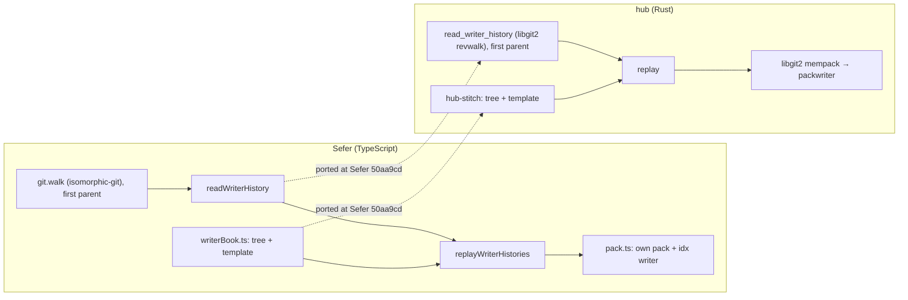
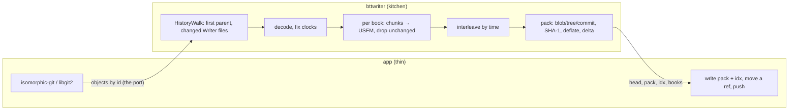
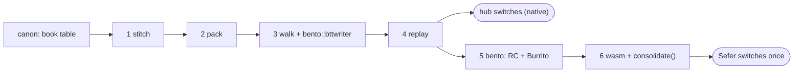

Will, 2026-11-05:

> Wanted to go ahead and get the second step of this work planned out which is the writer
> consolidation parts

This is step 2 of the Shared Scripture Domain Libraries order. Step 1 is canon
([[code:planning/items/2026-11-04-canon-and-versification-the-book-table-schemes-map.mdx|the canon plan]]),
and this step leans on it for the book table and `usfm_file_name`. The work is built
Rust-first here and reaches TypeScript as a wasm module of its own, inside the same npm package.

Will's goal for the split, from the review:

> keep the actual apps thin as possible and the libraries and useful. and thick as needed /
> modular. as needed.

So the library owns everything from "here are a Writer repo's git objects" to "here is the
consolidated pack". The apps own only storage, which is reading objects, writing the pack,
moving a ref and pushing.

## What changes for a user

Two places turn a pile of BTT Writer repos (one per book, a commit per autosave) into one
project repository whose log keeps every save:

- **Sefer**, when a translator migrates a Writer project in the browser (`assemble` and
  `addBooks` in `src/core/migrate/assemble.ts`).
- **The hub**, when someone publishes a consolidated repo for a language
  (`build_consolidated` in `crates/server/src/publish.rs`). It also draws each book's progress line
  from the same history (`crates/server/src/progress.rs`).

Each place has its own copy of the logic today, and the copies have already drifted. After
this step there is one implementation, and three things change:

1. **The same Writer saves give the same commits, wherever they're consolidated.** Today a
   project migrated in Sefer and the same project consolidated by the hub get different
   commit ids, because the hub fixes bad device clocks and Sefer doesn't. With one function,
   the replayed line is byte-identical in both, so a project migrated in Sefer can later
   meet the hub's consolidated repo as a fast-forward instead of an unrelated history.
2. **Sefer gets the hub's fixes.** Saves dated 1970 or 2000 by a reset battery (Tesaka, Ɓille) land
   between the good saves around them, and a `Writer-Clock:` trailer keeps what the device said.
3. **Both apps get thinner.** The hub replays without libgit2's in-memory store; it hands the
   kitchen its libgit2 object database and writes back the pack it gets. Sefer does the same
   with isomorphic-git's. Neither app walks a Writer repo itself any more.

Nothing changes for a translator except (2). The log reads the same: one commit per save
that changed the book's text, subject `ROM 5:1–11; titles`, trailers `Writer-Message`
and `Writer-Source`.

## Today: two copies



Where they agree and where they've drifted, from reading both at Sefer `326f02c8` and the
hub's current tree:

| | Sefer | hub | Same? |
|---|---|---|---|
| Which commits | HEAD's first-parent line, each against its first parent | The same (`simplify_first_parent`), after Bemba Leviticus lost 15:1–5 | yes |
| Which files | `isWriterTextPath` | `is_writer_text_path` | yes, by port |
| Bytes to text | `decode` from `sefer-text` | `decode_text`, a port that keeps JS whitespace semantics | yes, by port |
| Template | `writerBookToUsfm` | `writer_book_to_usfm` | yes, by port and by the 5-repo golden |
| Order across books | author time, never earlier than the book's previous save, then book, then save | the same | yes |
| Bad device clocks | kept as the device said | `estimate_bad_clocks`, plus a `Writer-Clock:` trailer | **no** |
| Pack | own writer: SHA-1, deflate and deltas (below). One NT: 2.7 MB in about 2 s | libgit2 mempack, dumped to one pack. Tawara: 3,959 commits in 2.1 s | different bytes, same objects |
| Progress per save | none | `progress()` (verses present after each save) | hub only |

**What this retires in Sefer:** about 670 lines (`writerHistory.ts` 157, `pack.ts` 308 and the
template half of `writerBook.ts` 202), plus `pack.test.ts` and the Writer use of `git.walk`.
That's less than the ~2,400 I first quoted for all of `migrate/` and `git/`.
`candidate.ts`, `writerWork.ts`, `local.ts`, `upstreams.ts` and the rest of `assemble.ts`
are app flow (probing upstreams, staging, the project manifest, the merge commit) and stay
in Sefer.

## How specific: BTT Writer, by name

<Question id="generic" answer="BTT Writer by name (Will, 2026-11-05: 'if we're not going to say that this is sort of generically taking any book[] and making a new repo, I'd go even more specific … bttwriter').">Is this "consolidate any per-book repos into one" or "consolidate BTT Writer projects"?</Question>

BTT Writer is the only per-book-repo, save-per-commit source we have, and most of the work
is Writer's shape: chunk paths, the template, decoding, Writer's timestamp messages, device
clocks and chunk-to-verse summaries. A generic "any book repos" API would have to invent a
second source to be generic against. So the public API is named `bttwriter` and says Writer
throughout.

What stays format-free *inside* the crate is the part that is: interleaving per-book file
versions by time (`interleave.rs`) and writing git objects (`pack.rs`). Neither imports
anything Writer-specific, so if a second per-book source ever shows up, those two modules
are what it would reuse, and they can move to their own crate then.

## The API

A port and two adapters in front, the replay in the middle, a pack out the back. It does no
I/O itself, and the clock is an argument, so the same input gives the same bytes in the
browser, in the hub and in a test.



### The port: "give me these git objects"

<Question id="ports" answer="Yes: a port, with an isomorphic-git adapter and a libgit2 adapter shipped by the kitchen. The port is a sans-IO 'wants / give' loop rather than a callback, so async isomorphic-git works across the wasm line. (Will, 2026-11-05, asked; this is the answer.)">Interface plus ports, with adapters for libgit2 and isomorphic-git?</Question>

Yes, and it makes the "who walks the repo" question cheap. The only thing the kitchen needs
from storage is *git objects by id*. Both libraries already do the hard part (finding an
object in a pack, inflating it, resolving its deltas), so the kitchen doesn't need a pack
reader of its own. Each adapter is about ten lines.

The catch is that isomorphic-git's `readObject` is async, and a wasm call can't stop
partway to wait for a JS promise. So the port isn't a callback. The walk is a small state
machine that **says what it wants** and is **given** it, and a short driver loop on each side
does the awaiting:

<Machine id="walk" machine={{
  id: "HistoryWalk",
  initial: "commits",
  states: {
    commits: { note: "wants: the next commit on HEAD's first-parent line (and its parent's, for the diff)", on: { give: "commits", "line ends": "trees" } },
    trees: { note: "wants: every tree the line's commits point at, batched; diffs each against its first parent", on: { give: "trees", "all diffed": "blobs" } },
    blobs: { note: "wants: the blobs of changed Writer text paths only, one batch", on: { give: "done" } },
    done: { note: "finish(meta) → WriterHistory", type: "final", tone: "good" }
  }
}} />

The walk asks in batches. Commits come one round each, because each one names the next. Then all trees in a few rounds by depth, then every changed blob in one round. Sefer already
batches blob reads (`git.blobs(repo, wanted)`), so a Writer NT is a few thousand cheap commit
reads plus a handful of large batches.

<Question id="generators" answer="Not in the public API. The walk already is a generator, written out by hand (Rust's own generators are unstable). In TS the driver is five private lines inside readHistory. An async generator would be worth exposing only to stream per-commit progress, and a spinner doesn't need it.">Is there a case for generator functions here? (Will, 2026-11-05.)</Question>

The want/give machine *is* a generator, unrolled by hand: `wants()` is what it yields, and
`give()` resumes it. There are three places a generator could appear:

- **Rust, for the walk itself.** `gen` blocks would read more naturally, but they're
  unstable, and the machine has only three states. Not worth a nightly feature.
- **TS, as the driver.** `readHistory` could be written as `for await` over an async
  generator that wraps the machine. It's the same five lines either way, and private.
- **TS, as the public API.** `for await (const step of bttwriter.readHistory(source))`
  yielding progress events. This is the only one that changes what a caller sees, and the
  migration screen shows a spinner, not a commit counter. If a progress bar is ever wanted,
  add `onProgress` to the options. A plain `Promise<WriterHistory>` stays easier to call.

### From TypeScript (Sefer)

```ts
// Imported lazily, on the migration screen only: nobody else pays for its wasm.
const bttwriter = await import("@wycliffeassociates/scripture-kitchen/bttwriter");
await bttwriter.init();

// --- The port -------------------------------------------------------------
interface ObjectSource {
  head(): Promise<string | undefined>;                    // HEAD's commit id
  shallow(): Promise<string[]>;                           // .git/shallow: treat these as roots
  read(ids: string[]): Promise<Map<string, GitObject>>;   // batched
}
interface GitObject { type: "commit" | "tree" | "blob"; bytes: Uint8Array }

// --- Adapters, shipped in the package -------------------------------------
// Structural: takes isomorphic-git's functions, doesn't import isomorphic-git.
bttwriter.isomorphicGitSource({ git, fs, dir }): ObjectSource;

// --- Reading one Writer repo ----------------------------------------------
// Drives the walk: while (want = walk.wants()) walk.give(await source.read(want)).
// Returns a handle: the decoded saves stay in wasm memory, so the text doesn't
// cross into JS and back again on its way to replay.
// Book, language, resource and translators come from the repo's own manifest.json
// at HEAD (read with bento's bttwriter module), so the caller says only
// where the repo came from.
const rom: WriterHistory = await bttwriter.readHistory(source, {
  source: "owner/repo",   // what Writer-Source names
});
rom.project;   // WriterProject: book "ROM", language { id, name, direction }, resource, translators, sources
rom.title;     // from front/title.txt at HEAD, else canon's name for the book
rom.saves;     // number, for the staging screen
rom.first;     // Signature of the first save (after clock fixes)
rom.last;
rom.progress(); // Array<[at: number, verses: number]>: raw verse-marker counts after each save
rom.usfm();     // the book at HEAD, as the template renders it (staging preview)

// --- Replay ---------------------------------------------------------------
interface Signature { name: string; email: string; at: number /* unix s */; offset: number /* minutes */ }

interface ReplayOptions {
  now: number;            // unix seconds; a device clock later than now + 1 day counts as wrong
  deltas?: boolean;       // default true; see "Deltas" below
}

interface Replayed {
  head: string;           // the last replayed commit. Nothing is committed on top of it.
  pack: Uint8Array;       // → .git/objects/pack/<name>.pack
  idx: Uint8Array;        // → .git/objects/pack/<name>.idx (v2)
  name: string;           // "pack-<sha of the pack>"
  books: Array<{ book: string; file: string; title: string }>; // what a manifest needs (see RC/Burrito)
  commits: number;
  unchanged: number;      // saves that changed no rendered text: no commit for them
  estimated: number;      // saves whose date was estimated (Writer-Clock trailer written)
  stats: { objects: number; deltas: number; packBytes: number };
}

bttwriter.replay(histories: WriterHistory[], options: ReplayOptions): Replayed | undefined;
```

How Sefer uses it. `readWriterHistory`, `replayWriterHistories` and `packWriter` go, and the
rest of `assemble` stays as it is:

```ts
// candidate.ts, staging: was readWriterHistory(repo, …) over git.walk
const source = bttwriter.isomorphicGitSource({ git, fs, dir: repo.root });
staged.history = await bttwriter.readHistory(source, { source: upstream });

// local.ts, a Writer folder on disk (not a repo): was recognizeWriter's own schema
const project = bento.read("manifest.json", await fs.readFile(`${root}/manifest.json`)); // the container plan

// assemble.ts: behind the existing spinner; no worker (see "Speed")
const replayed = bttwriter.replay(histories, { now: Date.now() / 1000 });
if (replayed) {
  await fs.writeFile(`${gitDir}/objects/pack/${replayed.name}.pack`, replayed.pack);
  await fs.writeFile(`${gitDir}/objects/pack/${replayed.name}.idx`, replayed.idx);
  await fs.writeFile(`${gitDir}/refs/heads/${DEFAULT_BRANCH}`, `${replayed.head}\n`);
}
// addBooks(): the same call, then the existing merge commit with alsoParents: [replayed.head].
```

### From Rust (the hub)

```rust
// bttwriter: no I/O, no serde. The libgit2 adapter is behind the `git2` feature, native only.
pub trait ObjectSource {                                   // the sync convenience over the walk
    fn read(&mut self, id: &ObjectId) -> Result<(Kind, Vec<u8>)>;
}
#[cfg(feature = "git2")]
pub struct Git2Source<'r> { /* wraps &git2::Odb */ }

pub struct HistoryWalk { /* the sans-IO machine above */ }
impl HistoryWalk {
    pub fn new(head: ObjectId, shallow: &[ObjectId]) -> Self;
    pub fn wants(&self) -> &[ObjectId];                    // empty: done
    pub fn give(&mut self, objects: impl IntoIterator<Item = (ObjectId, Kind, Vec<u8>)>) -> Result<()>;
    pub fn finish(self, meta: BookMeta) -> Result<WriterHistory>;
}
pub fn read_history(src: &mut impl ObjectSource, head: ObjectId, meta: BookMeta) -> Result<WriterHistory>;

impl WriterHistory {
    pub fn progress(&self) -> Vec<(i64, i64)>;
    pub fn usfm(&self) -> String;
}
pub fn replay(histories: &[WriterHistory], opts: &ReplayOptions) -> Option<Replayed>;

pub mod pack {                                             // public: for a commit on top
    pub struct PackWriter { /* … */ }
    impl PackWriter {
        pub fn new() -> Self;
        pub fn add(&mut self, kind: Kind, body: &[u8], lane: Option<&str>) -> ObjectId;
        pub fn finish(self) -> FinishedPack;               // pack, idx, name, stats
    }
    pub fn tree_body(entries: &BTreeMap<String, ObjectId>) -> Vec<u8>;
    pub fn commit_body(c: &CommitFields) -> Vec<u8>;
}
```

The hub's `crates/history` and `crates/stitch` go away, and `build_consolidated` becomes:

```rust
let histories = books.par_iter().map(|b| {
    let repo = git2::Repository::open_bare(scanner.repo_path(&b.owner, &b.name))?;
    let head = repo.head()?.peel_to_commit()?.id();
    bttwriter::read_history(&mut Git2Source::new(&repo.odb()?), head.into(), meta(b))
}).collect::<Result<Vec<_>, _>>()?;
let replayed = bttwriter::replay(&histories, &ReplayOptions { now, deltas: true }).ok_or("no save changed any book")?;
fs::write(objects.join(format!("pack/{}.pack", replayed.name)), &replayed.pack)?;
fs::write(objects.join(format!("pack/{}.idx", replayed.name)), &replayed.idx)?;
// then the manifest.yaml commit on top of replayed.head, with git2, as today
```

### Contract notes

- **No commit on top.** `head` is the last replayed save. A manifest, an assembly commit or a
  merge is the caller's, on top of `head` (the hub) or as a second parent (Sefer's
  `addBooks`). The crate's docs and the `Replayed.head` doc comment say so.
- **Always a new root.** There's no `parent` option: every caller today replays as a root
  and commits or merges on top.
- **Clock fixes are unconditional.** One behaviour in every app is the point of the step.
- **`progress` is raw counts.** Verse markers present after each save, with a bridge `1-3`
  counted as three. Scaling against a versification is the caller's.

### RC and Burrito: later, by composition

<Question id="container" answer="Not in replay. replay returns `books` (code, file name, title), which is everything a manifest needs. When the container step (step 3) lands, a `consolidate()` built on replay + container + PackWriter can return a pack whose closing commit holds a fresh manifest.yaml or metadata.json. Recorded as a followup.">Should this optionally return a new RC or Burrito? (Will: "I think so, but we haven't built those container formats in this repo/workspace yet.")</Question>

<Question id="container-first" answer="Not all of it first. The bento crate starts small at bttwriter's step 3, holding only Writer's manifest.json, so bttwriter can read it. RC and Burrito come after bttwriter's native steps, and bttwriter's wasm step (with consolidate()) comes after those, so Sefer switches once, manifest included. See 'Order'. (Order confirmed by Will, 2026-11-05.)">Should the container crate come first, so it's ready for consolidate()? (Will, 2026-11-05.)</Question>

Two things came out of looking at this:

- **bttwriter reads Writer's `manifest.json` itself, through bento.** It says which book,
  language and resource a repo is, which is exactly the `meta` callers were passing to
  `readHistory`. Read during the walk (at HEAD), it makes the caller thinner. The parser
  lives in bento's `bttwriter` module, not in bttwriter. The hub's ingest classifies every
  WACS repo through one "read whichever manifest this is" function, and most of those repos
  are Writer projects. So all three formats belong in one crate, and bttwriter depends on
  it. The module is small (the hub's `ts_manifest.rs` is 264 lines, Sefer's
  `recognizeWriter` and its schema about 80). The bento crate starts with only this
  module, at bttwriter's step 3. (This corrects an earlier draft that put it in bttwriter.)
- **`consolidate()` is the only thing that needs container, and only Sefer's switch
  needs `consolidate()`.** The hub can move to `replay` with its own manifest commit
  for now. Sefer's switch is the last bttwriter step anyway, so putting container just
  before it means Sefer moves once, straight to `consolidate()`, including `addBooks`
  (adding books to an existing manifest is a container operation too).

Building it into `replay` now would mean either writing a throwaway manifest writer or
waiting on step 3. Keeping `replay` manifest-free and returning `books` means step 3 can add
it without changing this API:

```ts
// After step 3 (container), roughly:
bttwriter.consolidate(histories, {
  now,
  container: { kind: "rc", language: "tpi", resource: "reg" }, // or { kind: "burrito", … }
}): Replayed & { manifest: { path: string; bytes: Uint8Array } }; // closing commit is in the pack
```

<Followup id="consolidate-manifest">In step 6, after container (step 5), add `consolidate()`: replay, then a closing commit (with `PackWriter`) holding the RC `manifest.yaml` or Burrito `metadata.json` for `books`. The hub's `manifest_with_book` and Sefer's `withProjects`/`withBooks` are what it replaces.</Followup>

## Git internals the pack needs

**What a pack is.** Git stores three kinds of object here: a *blob* (a file's bytes), a
*tree* (a folder: names → object ids) and a *commit* (a tree, parents, author, committer,
message). An object's id is the SHA-1 of `"<type> <length>\0"` plus its bytes, so any two
programs that build the same commit get the same id. A pack is all of those objects in one
file, each one zlib-compressed, plus an index (`.idx`) that says where each id is.

**Why SHA-1 and deflate (`sha1_smol`, `miniz_oxide`).** These are the two primitives git
itself uses: SHA-1 names every object, and zlib (deflate) compresses every object, in a pack
or loose. So any pack writer needs both, and that's all it needs. `miniz_oxide` is the
pure-Rust deflate behind `flate2`'s default backend, so it builds for wasm with nothing
extra. It's in our `Cargo.lock` today only by accident: galley's heap profiler (`dhat`, a
dev dependency) uses `backtrace`, which uses `miniz_oxide` to read compressed debug info.
That has nothing to do with this; it just means the crate is already vetted here.

**Deltas.** Without them, each of a New Testament's ~3,000 saves stores its whole book file
again: 35 MB. With them, a version is stored as "the previous version of this file, plus
these edits". The edits are a list of "copy bytes 0–8,000 from the base" and "insert these
40 new bytes" instructions. A typical save changes one chunk, so a version shrinks to a few
dozen bytes, and the NT becomes 2.7 MB. `ofs-delta` is the form whose base is named by its
byte offset earlier in the same pack. A delta changes how an object is *stored*, never its
id. The writer keeps a "lane" per book file (and one for the root tree), deltas each version
against the previous one in its lane, caps chains at 50, and keeps a delta only when it's
smaller.

**A pack, not a fast-import stream.**

<Question id="fast-import" answer="Not planned. Same ids, yes; but neither isomorphic-git nor libgit2 can read a stream, so only the git binary could use it. Cheap to add later as a debug dump.">Would a stream be byte identical? Could Rust produce one that libgit2 could use? Can isomorphic-git take one?</Question>

- **Same objects, yes.** A fast-import stream is a text script ("commit refs/heads/main",
  "author …", "M 100644 inline 46-ROM.usfm" plus data). `git fast-import` would build exactly
  the same commits from it, with the same ids. The pack it writes would differ in bytes,
  which never matters.
- **No library can read it.** fast-import is a feature of the `git` program. libgit2 has no
  fast-import, and neither does isomorphic-git. The hub could shell out to `git fast-import`,
  but Sefer can't, and the pack already works in both.
- **Producing one is trivial** (about 60 lines from the same replay steps), so it's a fine
  debug output if we ever want to inspect a replay with stock git. Not in this plan.

## Packaging: its own crate and its own wasm module

<Question id="wasm-home" answer="Its own crate, `bttwriter`, built to its own wasm module and shipped as a subpath of the existing npm package (`@wycliffeassociates/scripture-kitchen/bttwriter`). galley stays about USFM, Sefer imports this lazily on the migration screen, and there's no new release pipeline. (Will, 2026-11-05: 'galley should be mostly about usfm'.)">Door on galley's wasm, or its own crate and package?</Question>

The options, against what Will raised (migration is rare, galley is about USFM):

| | Door on galley | Own npm package | **Own wasm module, same npm package** |
|---|---|---|---|
| galley stays about USFM | no | yes | yes |
| Cost to a Sefer user who never migrates | SHA-1 + deflate in the module every page loads | none | none (dynamic `import()`) |
| Release work | none | second package, its own version and pin | one more crate in CI's wasm list (beside `onion-wasm` and `galley`) |
| Version skew with canon | none | possible | none: same tag |

The third is the one. The npm package already ships two wasm modules (`galley/pkg-*`,
`onion-wasm/pkg-*`) under one version. `bttwriter/pkg-web` and `bttwriter/pkg-bundler` become
the third, with a `./bttwriter` export. `bttwriter` depends on `canon`, `mise` and
`bento`, not on onion or galley, so it's small. I'd expect well under 150 KB of wasm, plus
whatever bento's `consolidate()` path pulls in (JSON and YAML writing); step 6 measures it.

<Question id="duplication" answer="Yes, each wasm module links its own copy of what it uses from mise and canon, but only what it uses. For bttwriter that's the book table and usfm_file_name, a few KB, fetched only on the migration screen. Accepted.">Doesn't a second module duplicate mise and canon, and mean installing galley to get it? (Will, 2026-11-05.)</Question>

- **Installing:** yes, the one npm package carries every module, but only Sefer installs it
  (the hub uses the crates). What matters is what the browser *fetches*, and a bundler
  fetches a module only when it's imported. Sefer already imports galley; the migration
  screen adds bttwriter on top.
- **Duplication:** yes, a wasm module can't share code with another one, so each links its
  own copy of the Rust it calls. But the linker and `wasm-opt` drop everything that isn't
  called. bttwriter calls canon's book table and `usfm_file_name`, not the per-locale name
  tables or versification. That's a few KB, and only on a screen most users never open.
  bento's code is duplicated the same way once `consolidate()` uses it. Step 6 measures it, so the number gets checked rather than assumed.
- **The alternative** is bttwriter taking file names from the caller (from canon's generated
  TS data) and depending on no canon at all. That saves those few KB, but every caller has
  to do the lookup, which works against keeping the apps thin. Not worth it.

<Question id="crate-name" answer="`bttwriter` (Will, 2026-11-05).">What's the crate called?</Question>

## Speed

<Question id="worker" answer="No worker. Migration is a one-time action behind a spinner, and 3–5 seconds is fine; the user has to wait for it to finish before they can work anyway (Will, 2026-11-05).">Does Sefer need a worker for this?</Question>

<Question id="speed" answer="No slower than today's TS writer is the goal, but it's a cold action: time it a few times, profile it once or twice for needless allocation, and parallelize per book natively (Will, 2026-11-05).">What's the bar?</Question>

What that means in practice:

- **Timing:** Tawara (3,959 commits) and one NT, three runs each, native and wasm under Node,
  recorded in the ledger beside today's TS numbers (about 2 s for an NT).
- **Profiling once:** `samply` natively, plus `dhat` (already a galley dev dependency) for
  allocations. The hub's port has known waste to check: it clones the whole held-chunk map
  per save to build the summary, and it re-renders the whole book per save. Plan to keep
  the previous rendering and render only from the changed chapter on.
- **Parallel per book, natively:** reading histories and rendering each book's versions
  are independent per book. Behind a `parallel` cargo feature (rayon, as galley's
  `parallel` is), on for the hub and off for wasm, which has no threads here. Interleaving
  and object writing stay one sequential line: each commit names the one before.

## Where it lives

<Files id="footprint">
```text
+ bttwriter/                          -- new crate; depends on canon, mise and bento (its bttwriter module). Features: git2, parallel, wasm
+ bttwriter/src/lib.rs                -- WriterHistory, BookMeta, Signature, replay, Replayed
+ bttwriter/src/walk.rs               -- HistoryWalk (sans-IO), ObjectSource, read_history; tree diff; first parent
+ bttwriter/src/git2.rs               -- Git2Source, behind `git2`
+ bttwriter/src/stitch.rs             -- from hub crates/stitch: decode, is_text_path, tree_from_files, the template
+ bttwriter/src/clock.rs              -- estimate_bad_clocks, day_of
+ bttwriter/src/summary.rs            -- verses_of, summary_of: the subject line; progress
+ bttwriter/src/interleave.rs         -- format-free: per-book versions merged by time
+ bttwriter/src/pack.rs               -- format-free: from Sefer src/core/git/pack.ts
+ bttwriter/src/wasm.rs               -- behind `wasm`: readHistory handle, replay
+ bttwriter/bttwriter.ts              -- the TS shim: the walk driver loop, isomorphicGitSource
+ bttwriter/build.sh                  -- as galley/build.sh
+ bttwriter/fixtures/*.bundle         -- the five golden repos, ~1.4 MB together (see Tests)
~ Cargo.toml                          -- member; sha1_smol, miniz_oxide
~ package.json                        -- files + exports for ./bttwriter
~ .github/workflows/ci.yml            -- bttwriter in the wasm build, byte check and test lists
```
</Files>

Then, each in its own repo and pinned to the kitchen tag that ships this:

<Files id="retired">
```text
- sefer/src/core/migrate/writerHistory.ts   -- all of it
- sefer/src/core/git/pack.ts                -- the pack writer
- sefer/src/platform/web/pack.test.ts       -- moves in as the git-accepts-it test
~ sefer/src/core/migrate/writerBook.ts      -- keeps recognizeWriter / readWriterTree (they read the FS); the template goes
~ sefer/src/core/migrate/candidate.ts       -- bttwriter.readHistory instead of readWriterHistory
~ sefer/src/core/migrate/assemble.ts        -- bttwriter.replay
- hub/crates/stitch/                        -- usfm_file_name comes from canon; the rest from bttwriter
- hub/crates/history/                       -- all of it: read_history (git2 feature), replay, progress
~ hub/crates/server/src/{publish,progress}.rs -- call bttwriter; write the returned pack + idx
```
</Files>

## Tests

- **Ids, not bytes.** For each golden repo, `replay` gives the same `head` as Sefer's TS
  `replayWriterHistories` at `326f02c8`, for books with no bad clocks, where the two agree
  today. That one 40-hex string pins the walk, the template, the decode, the order, the
  summaries, the trailers and the object encoding at once.
- **git accepts it.** Write `pack` + `idx`, run `git index-pack --verify` and `git fsck`, and
  check that our `idx` is byte-equal to the one `git index-pack` writes for the same pack
  (idx v2 is fully determined by the pack). `git` is on CI already.
- **Both adapters.** The Rust tests read the fixtures through `Git2Source`. The wasm wall
  reads one through `isomorphicGitSource` under Node, so the async driver loop is tested too.
- **The hub's unit tests come along:** bad clocks between good saves, summaries, and the
  merged side branch that must not lose chunks. The last now tests `HistoryWalk` directly,
  since the walk is ours.

<Question id="fixture-size" answer="Small enough: commit all five as git bundles, about 1.4 MB together (measured 2026-11-05). Tests clone each bundle into a temp dir with git and read it through Git2Source; a missing bundle or git fails the test, it doesn't skip.">Are the five histories small enough to commit?</Question>

Measured on 2026-11-05 by cloning each from WACS:

| Repo | First-parent commits | Bundle | Every save's changed files, raw |
|---|---|---|---|
| `kpass/tmf_3jn_text_reg` | 5 | 4 KB | 8 KB |
| `bahasatech.indotimur/kps-x-kaigar_3jn_text_reg` | 19 | 11 KB | 11 KB |
| `chunga_major/bem-x-ngumbo_2ch_text_reg` | 352 | 445 KB | 533 KB |
| `andriatiana_wa/msh_job_text_udb` | 1,188 | 435 KB | 1.46 MB |
| `bahasatech.indotimur/saw_isa_text_reg` | 148 | 502 KB | 1.48 MB |

The bundles are the right form. They're git's own packed format, a third of the size of
the plain-file extraction, and reading them exercises the real walk and the real adapter
instead of a pre-walked JSON. That also fixes the hub golden's silent skip (it passes
without `REPO_ROOT`), which `agents/testing.md` forbids here.

## Order, each step usable on its own

1. **Stitch** (`stitch.rs`: the template and decode) with the hub's goldens, using canon's
   `usfm_file_name`. The hub can switch `hub-stitch` to it immediately.
2. **Pack writer** (`pack.rs`) with the git-accepts-it tests. Nothing uses it yet.
3. **The walk** (`walk.rs`, `Git2Source`) and the bundle fixtures. The bento crate is
   created here with only its `bttwriter` module (Writer's `manifest.json`), so the walk can read it.
4. **Replay, clocks, summaries, progress**, plus the head-id goldens against Sefer's TS, and
   the timing and profiling pass. Then the hub deletes `history` and `stitch` (native, no
   wasm needed), and keeps its own manifest commit on top for now.
5. **bento: RC and Burrito, reading and writing** (its own plan item, step 3 of the
   shared-libraries order).
6. **The wasm module, TS shim and `consolidate()`** (`isomorphicGitSource`, `readHistory`,
   `replay`, `consolidate`), the CI wiring, and the size measurement. Then
   Sefer switches `local`/`candidate`/`assemble`/`addBooks` once, manifest included, and
   deletes `writerHistory.ts`, `pack.ts` and its Writer manifest schema. The hub moves its
   closing commit to `consolidate()` at the same time.



<Question id="order" answer="Yes (Will, 2026-11-05). Container's RC and Burrito work doesn't depend on bttwriter, so it can be built any time before step 6, in parallel if there are hands.">Is this order right? Steps 1–4 pay off in the hub before any wasm work. Container slots in before the wasm step, so Sefer switches once, straight to consolidate(), and the riskiest part (wasm speed and size) still comes last, with a working native version to compare against. Step 1 waits for canon's book table. If canon slips, stitch can carry the 66-code table for a release and drop it later.</Question>
