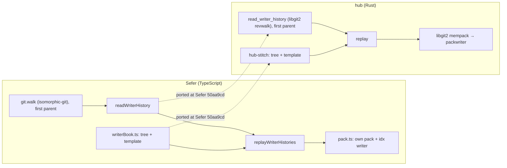
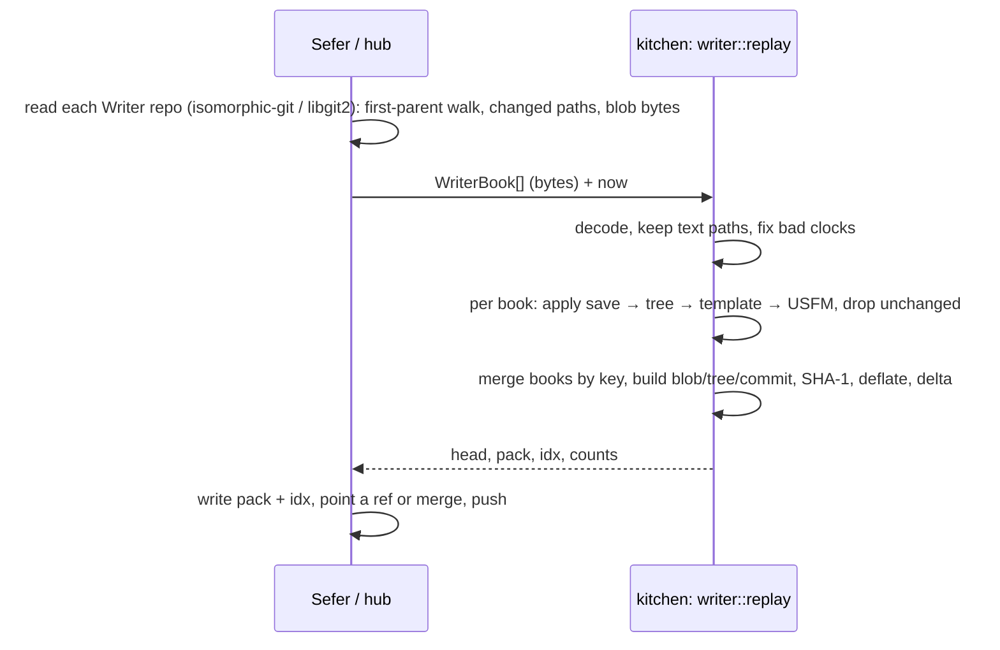

Will, 2026-11-05:

> Wanted to go ahead and get the second step of this work planned out which is the writer
> consolidation parts

This is step 2 of the Shared Scripture Domain Libraries order. Step 1 is canon
([[code:planning/items/2026-11-04-canon-and-versification-the-book-table-schemes-map.mdx|the canon plan]]),
and this step leans on it for the book table and `usfm_file_name`. The work is built
Rust-first here and reaches TypeScript through galley's wasm, the same way as canon.

## What changes for a user

Two places turn a pile of BTT Writer repos (one per book, a commit per autosave) into one
project repository whose log keeps every save:

- **Sefer**, when a translator migrates a Writer project in the browser (`assemble` and
  `addBooks` in `src/core/migrate/assemble.ts`).
- **The hub**, when someone publishes a consolidated repo for a language
  (`build_consolidated` in `crates/server/src/publish.rs`). It also draws each book's progress line
  from the same history (`crates/server/src/progress.rs`).

Each place has its own copy of the logic today, and the copies have already drifted. After
this step there is one implementation, and three things change:

1. **The same Writer saves give the same commits, wherever they're consolidated.** Today a
   project migrated in Sefer and the same project consolidated by the hub get different
   commit ids, because the hub fixes bad device clocks and Sefer doesn't. With one function,
   the replayed line is byte-identical in both, so a project migrated in Sefer can later
   meet the hub's consolidated repo as a fast-forward instead of an unrelated history.
2. **Sefer gets the hub's fixes.** Saves dated 1970 or 2000 by a reset battery (Tesaka, Ɓille) land
   between the good saves around them, and a `Writer-Clock:` trailer keeps what the device said.
3. **The hub drops libgit2 from this path.** It writes the pack and index that come back,
   the way Sefer does, instead of going through libgit2's in-memory object store. It still
   uses libgit2 to read Writer repos and to push.

Nothing changes for a translator except (2). The log reads the same: one commit per save
that changed the book's text, subject `ROM 5:1–11; titles`, trailers `Writer-Message`
and `Writer-Source`.

## Today: two copies



Where they agree and where they've drifted, from reading both at Sefer `326f02c8` and the
hub's current tree:

| | Sefer | hub | Same? |
|---|---|---|---|
| Which commits | HEAD's first-parent line, each against its first parent | The same (`simplify_first_parent`), after Bemba Leviticus lost 15:1–5 | yes |
| Which files | `isWriterTextPath` | `is_writer_text_path` | yes, by port |
| Bytes to text | `decode` from `sefer-text` | `decode_text`, a port that keeps JS whitespace semantics | yes, by port |
| Template | `writerBookToUsfm` | `writer_book_to_usfm` | yes, by port and by the 5-repo golden |
| Order across books | author time, never earlier than the book's previous save, then book, then save | the same | yes |
| Bad device clocks | kept as the device said | `estimate_bad_clocks`, plus a `Writer-Clock:` trailer | **no** |
| Pack | own writer: SHA-1, deflate and `ofs-delta` against the same file's previous version, idx v2. One NT: 2.7 MB in about 2 s | libgit2 mempack, dumped to one pack. Tawara: 3,959 commits in 2.1 s | different bytes, same objects |
| Progress per save | none | `progress()` (verses present after each save) | hub only |

Nothing in Sefer's `src/core/migrate` beyond these three files is pure. `candidate.ts`,
`writerWork.ts`, `local.ts`, `upstreams.ts` and the rest of `assemble.ts` are app flow
(probing upstreams, staging, the project manifest, the merge commit) and stay in Sefer.
**Correction to the earlier estimate:** what this retires in Sefer is about 670 lines
(`writerHistory.ts` 157, `pack.ts` 308 and the template half of `writerBook.ts` 202), plus
`pack.test.ts`, not the ~2,400 I quoted for all of `migrate/` and `git/`.

## The API

The core is one pure function: Writer saves go in, git objects come out as a pack. It reads
no files, runs no git, and takes the clock as an argument, so the same input gives the same
bytes in the browser, in the hub and in a test.

### From TypeScript (Sefer), through galley's wasm

```ts
// What a caller hands over: one book's Writer history, read however the caller reads git.
interface WriterBook {
  book: string;            // "ROM" (any case; canon's parse_book accepts the Writer slug "rom")
  title: string;           // the template's fallback title when front/title.txt is empty
  source: string;          // "owner/repo": what Writer-Source names
  saves: WriterSave[];     // oldest first, along HEAD's first-parent line
}

interface WriterSave {
  id: string;              // the Writer commit id, for the Writer-Source trailer
  author: Who;
  committer: Who;
  message: string;         // Writer's own message (a timestamp in practice)
  // Every file the save changed, as raw bytes: null means deleted.
  // Paths that aren't Writer text are ignored here, so the caller needn't filter.
  // Bytes, not strings: decoding is part of what must agree, so the kitchen does it.
  changes: Map<string, Uint8Array | null>;
}

interface Who { name: string; email: string; at: number /* unix s */; offset: number /* minutes */ }

interface ReplayOptions {
  now: number;             // unix seconds; a clock later than now + 1 day counts as wrong
  deltas?: boolean;        // ofs-delta each book file against its previous version (default true)
}

interface Replayed {
  head: string;            // the last commit; the caller points a branch at it, or merges it
  pack: Uint8Array;        // .git/objects/pack/<name>.pack
  idx: Uint8Array;         // .git/objects/pack/<name>.idx (v2)
  name: string;            // "pack-<sha of the pack>"
  commits: number;
  unchanged: number;       // saves that changed no rendered text: no commit for them
  estimated: number;       // saves whose date was estimated (Writer-Clock trailer written)
  stats: { objects: number; deltas: number; packBytes: number };
}

// The one call. undefined when no save changed any book's text.
galley.writer.replay(books: WriterBook[], options: ReplayOptions): Replayed | undefined;

// Small pure helpers the callers also need. Today each app has its own copy.
galley.writer.progress(book: WriterBook): Array<[at: number, verses: number]>; // hub progress line
galley.writer.stitch(files: Map<string, Uint8Array>, book: string, title: string): string; // one book at HEAD
galley.writer.isTextPath(path: string): boolean;
```

How Sefer uses it, replacing `replayWriterHistories` and `packWriter` and leaving the
rest of `assemble` as it is:

```ts
// src/core/migrate/assemble.ts, inside assemble()
const books = staged.flatMap((s) => (s.history ? [s.history] : [])); // readWriterHistory keeps the walk, minus decode
const replayed = galley.writer.replay(books, { now: Date.now() / 1000 });
if (replayed) {
  await fs.writeFile(`${git}/objects/pack/${replayed.name}.pack`, replayed.pack);
  await fs.writeFile(`${git}/objects/pack/${replayed.name}.idx`, replayed.idx);
  await fs.writeFile(`${git}/refs/heads/${DEFAULT_BRANCH}`, `${replayed.head}\n`);
}
// addBooks(): the same call, then the existing merge commit with alsoParents: [replayed.head].
```

### From Rust (the hub), natively

```rust
// The crate (name: see the question below). No libgit2, no serde, no I/O.
pub struct WriterBook { pub book: BookKey, pub title: String, pub source: String, pub saves: Vec<Save> }
pub struct Save { pub id: String, pub author: Sig, pub committer: Sig, pub message: String,
                  pub changes: Vec<(String, Option<Vec<u8>>)> }

pub fn replay(books: &[WriterBook], opts: &ReplayOptions) -> Option<Replayed>;
pub fn progress(book: &WriterBook) -> Vec<(i64, i64)>;
pub fn stitch<'a>(files: impl IntoIterator<Item = (&'a str, &'a [u8])>, book: BookKey, title: &str) -> String;

// Underneath, and public because the hub's closing manifest commit can use it too:
pub mod pack {
    pub struct PackWriter { /* … */ }
    impl PackWriter {
        pub fn new() -> Self;
        /// Returns the object id. `lane` names a chain to delta against ("46-ROM.usfm").
        pub fn add(&mut self, kind: Kind, body: &[u8], lane: Option<&str>) -> ObjectId;
        pub fn finish(self) -> FinishedPack; // pack, idx, name, stats
    }
    pub fn tree_body(entries: &BTreeMap<String, ObjectId>) -> Vec<u8>;
    pub fn commit_body(c: &CommitFields) -> Vec<u8>;
}
```

The hub keeps reading Writer repos with libgit2 (`read_writer_history` stays in the hub,
but stops decoding), and `build_consolidated` becomes:

```rust
let replayed = writer::replay(&books, &ReplayOptions { now, deltas: true }).ok_or("no save changed any book")?;
std::fs::write(objects.join(format!("pack/{}.pack", replayed.name)), &replayed.pack)?;
std::fs::write(objects.join(format!("pack/{}.idx", replayed.name)), &replayed.idx)?;
// then the manifest.yaml commit on top of replayed.head, with git2, as today
```

### Why the line is drawn there



- **Walking a Writer repo stays with the caller.** Both apps already have a git library
  open on those repos, and the walk is the part that touches storage. Moving it in would
  mean a pack *reader* (inflate, delta resolution, idx lookup) inside the kitchen. See the
  question below.
- **Decoding moves in.** It's part of what has to agree byte for byte, and it's the step
  most likely to drift (JS `trim` vs Rust `trim`, the BOM, U+0085).
- **Writing a ref, merging and pushing stay with the caller.** Those are each app's
  repository state: Sefer's lock and `Repositories` service, the hub's publish flow.
- **A pack, not a fast-import stream.** A stream needs a `git` binary, which the browser
  doesn't have. The stream can stay as a debug dump if it's ever wanted; it's not planned.

<Tradeoff id="sync" chose="A synchronous wasm call" cost="About 2 s of work on whatever thread calls it; Sefer's TS writer awaited crypto.subtle and CompressionStream, so it yielded between objects.">
Rust's SHA-1 and deflate run inside the call, so it doesn't yield. On the main thread that
blocks the UI for the length of a New Testament's replay.
</Tradeoff>

<Question id="worker">Does Sefer call galley from a worker already, or would `writer.replay` be the first thing that needs one? If galley lives on the main thread, the migration screen needs a worker or a chunked call (`replay` taking a budget and resuming). I'd rather not design resumption until we know it's needed.</Question>

## The pack writer

It's a port of Sefer's `pack.ts`, which already works and is tested against `git`:

- **Objects:** `blob`, `tree` (one level, every entry `100644`; a consolidated repo is
  flat book files), `commit`. Object ids are SHA-1 of `"<type> <len>\0" + body`, so they
  match what any git computes. This is what has to be identical across implementations.
- **Deltas:** `ofs-delta` only, against the previous object in the same lane (a book's
  file, the root tree), depth at most 50, kept only when smaller. This is what turns 35 MB
  of whole versions into 2.7 MB.
- **Pack bytes may differ** from today's TS (another deflate gives other bytes), and that's
  fine: what gets pinned is the ids and that `git` accepts the pack.
- **Dependencies:** `sha1_smol` (no dependencies) and `miniz_oxide` (pure Rust; in `Cargo.lock`
  today only as a dev dependency, through `dhat`, so this is its first runtime use). Both build for wasm32 with no feature games.

<Question id="speed">The gate I'd set: on Tawara (3,959 commits) and one NT, `replay` in galley's wasm under Node is no slower than today's TS writer, and the pack is within 10% of its size. Browser-native SHA-1 and deflate are fast, so this isn't a given. Is "no slower than today" the right bar, or is a bit slower fine for one-off migrations?</Question>

## Where it lives

<Files id="footprint">
```text
+ writer/                            -- new crate (name: see question); depends on canon and mise
+ writer/src/lib.rs                  -- WriterBook, Save, Sig, replay, progress
+ writer/src/stitch.rs               -- from hub crates/stitch: decode_text, is_text_path, tree_from_files, the template
+ writer/src/clock.rs                -- estimate_bad_clocks, day_of
+ writer/src/summary.rs              -- verses_of, summary_of: the subject line
+ writer/src/pack.rs                 -- from Sefer src/core/git/pack.ts: PackWriter, tree_body, commit_body
+ writer/fixtures/                   -- histories extracted once from the five golden repos (see Tests)
~ galley/src/wasm.rs                 -- the writer.replay / progress / stitch / isTextPath doors
~ galley/Cargo.toml                  -- depends on writer
~ Cargo.toml                         -- workspace member; sha1_smol, miniz_oxide
```
</Files>

Then, each in its own repo and pinned to the kitchen tag that ships this:

<Files id="retired">
```text
- sefer/src/core/migrate/writerHistory.ts   -- replay and summaries; readWriterHistory shrinks to the walk
- sefer/src/core/git/pack.ts                -- the pack writer
- sefer/src/platform/web/pack.test.ts       -- moves in as the git-accepts-it test
~ sefer/src/core/migrate/writerBook.ts      -- keeps recognizeWriter / readWriterTree (they read the FS); the template goes
~ sefer/src/core/migrate/assemble.ts        -- calls galley.writer.replay
- hub/crates/stitch/                        -- usfm_file_name comes from canon; the rest from the kitchen
~ hub/crates/history/                       -- keeps read_writer_history (libgit2); replay and progress go
~ hub/crates/server/src/publish.rs          -- writes the returned pack + idx
```
</Files>

<Question id="crate-name">What's the crate called? It holds the Writer format (stitch, template, history) and a small git pack writer. Options: `writer` (plain, says what it reads), `stock` (in the kitchen naming: many saves boiled down into one), or two crates, `writer` plus a generic `packfile`. I'd go with one crate named `writer` and a `pack` module, and split the pack out only when a second user appears.</Question>

<Question id="wasm-home">Door on galley's existing wasm module, or a separate small wasm package? galley is the one module Sefer already loads and inits, which argues for a door there. The cost is SHA-1 and deflate inside it for every Sefer user, though only migration uses them. I'd put it on galley and measure the size change. If it's more than a few tens of KB gzipped, put it behind a cargo feature first, and make it a separate package only if that isn't enough.</Question>

## The open questions about behaviour

<Question id="clocks-in-sefer">Bad-clock estimation comes to Sefer as part of this. Projects Sefer already migrated keep their commits; only new migrations change. From then on, a save with a 1970 or 2000 date gets an estimated date and a `Writer-Clock:` trailer in Sefer too. Is that wanted, or should `estimate` be an option that Sefer turns off? I'd make it unconditional: one behaviour is the point of the step.</Question>

<Question id="who-walks">Should the kitchen also read Writer repos (the walk), not only write the result? That would take raw object bytes through a callback (`(id) => Uint8Array`), so it's still I/O-free, but it means a pack reader (inflate, delta resolution, idx v2 lookup) in the kitchen. It would remove the last per-app difference (the first-parent walk is written twice today, and the Bemba bug was in that part). I'd leave it out of this step: both walks agree now, and a reader roughly doubles the work. Revisit if they drift.</Question>

<Question id="base">The hub's `replay` takes a `parent` to build on, but every caller passes `None`. Sefer's `addBooks` replays the new books as their own root and merges that with `alsoParents`. Do we drop `parent` and always replay as a new root? I'd drop it. A caller that wants a linear history can still commit on top of `head`.</Question>

<Question id="closing-commit">The hub ends with one more commit (`manifest.yaml`) via libgit2, and Sefer ends with an assembly commit via isomorphic-git. Should `replay` optionally take a closing commit (files and a message) so it lands in the same pack? It's convenient, but each app's closing commit is its own policy. I'd leave it out and make `pack::PackWriter` public for anyone who wants it.</Question>

<Question id="progress-unit">`progress` counts verse markers (a bridge `1-3` is three) per chunk after each save, and the hub scales that line against the source. Once canon's schemes land, should `progress` take a scheme and report against `last_verse`, or keep raw counts and leave the scaling to the hub? I'd keep raw counts here, because canon shouldn't be a reason to touch this.</Question>

## Tests

- **Ids, not bytes.** For each golden history, `replay` gives the same `head` as Sefer's TS
  `replayWriterHistories` at `326f02c8`, for books with no bad clocks, where the two agree
  today. That one 40-hex string pins the template, the decode, the order, the summaries,
  the trailers and the object encoding at once.
- **git accepts it.** Write `pack` + `idx`, run `git index-pack --verify` and `git fsck`,
  and check that the `idx` we wrote is byte-equal to the one `git index-pack` writes for
  the same pack (idx v2 is determined by the pack). `git` is on CI already.
- **The hub's existing unit tests come along:** bad clocks between good saves, summaries,
  and a merged side branch losing no chunks. The last one becomes a test of the input
  contract, since the walk stays with the caller.
- **Goldens without the silent-skip trap.** The hub's stitch golden passes and prints a
  note when `REPO_ROOT` is unset. `agents/testing.md` forbids that pattern here. Instead,
  extract the five repos' histories once (`kpass/tmf_3jn_text_reg`, `kps-x-kaigar_3jn`,
  `bem-x-ngumbo_2ch`, `msh_job_text_udb`, `saw_isa_text_reg`) into `writer/fixtures/` as
  plain files, and assert their paths. The extractor is a bin, not a test.

<Question id="fixture-size">The five histories as plain files: are they small enough to commit? 3JN and 2CH should be tiny; ISA and JOB could be a few MB. If they're too big, the big two go to the calibration bucket (R2) and become a deliberately-run bin. Then the in-repo tier is the three small ones plus a synthetic history covering bad clocks and deletes.</Question>

## Order, each step usable on its own

1. **Stitch** (`stitch.rs`, the template, decode) with the hub's goldens, using canon's
   `usfm_file_name`. The hub can switch `hub-stitch` to it immediately.
2. **Pack writer** (`pack.rs`) with the git-accepts-it tests. Nothing uses it yet.
3. **Replay, clocks, summaries, progress**, plus the head-id goldens against Sefer's TS.
   Then the hub switches `history::replay` and `progress` (native, no wasm needed).
4. **The galley doors** and the speed and size measurements. Then Sefer switches
   `assemble`/`addBooks` and deletes `writerHistory.ts`' replay and `pack.ts`.

<Question id="order">Is this order right? Steps 1–3 pay off in the hub before any wasm work, so the riskiest part (wasm speed and size) comes last, with a working native version to compare against. Step 1 waits for canon's book table. If canon slips, stitch can carry the 66-code table for a release and drop it later.</Question>
