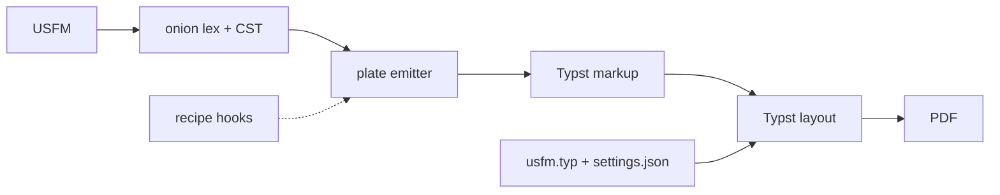

Exploratory work that lives on its own branch, not merged and not product. One
entry per experiment: where it is, what was tried, what it found. Add an entry
when an experiment is parked on a branch.

## plate — printing through Typst (branch `plate`, tip `baef007`, 2026-11-06)

> just to see what is possible … How fast to print a bible book? How readable?
> What controls can we do for example? native and browser speeds

Branched from master at `3551231`. Everything is in `plate/`, its own Cargo
workspace (excluded from the root workspace, so the gate never builds typst).
`plate/README.md` and `plate/recipes/README.md` on the branch have the commands
and numbers.

**What it is.** Onion's public CST folded into Typst markup (`plate/src/lib.rs`,
about 430 lines), one Typst template making every visual decision from a
settings JSON (`plate/typst/usfm.typ`, about 300 lines), Typst 0.15.1 as a
library. A CLI, a local studio (axum: settings form beside the PDF, compile on
the server or in the browser), and a wasm build of onion and Typst together.

<Mermaid id="pipeline" caption="plate's pipeline">

</Mermaid>

**Numbers** (BSB, A5, two columns, 24-core Linux):

| | plate native | plate wasm (V8, 1 thread) | PTXprint 3.1.6 (Docker) |
|---|---|---|---|
| Mark | 0.9 s, 27 pp | 1.8 s | 8.0 s, 31 pp |
| Psalms | 1.7 s, 101 pp | 3.4 s | 41 s, 112 pp |
| NT | 3.0 s (1.4 s one document per book in parallel) | 18 s | 89 s, 364 pp |
| Bible | 13 s, 1,408 pp (4.6 s per book in parallel) | | |

Onion's share is 1 ms for Mark, 63 ms for the Bible. The wasm module is 40 MB,
16 MB gzipped. Against PTXprint's 32,000 lines of TeX macros and 61,000 of
Python, plate's core is about 730 lines; settings are about 40 keys against
PTXprint's 427.

**Recipes** (examples, not product; `plate/recipes/`): links and contents (PDF
bookmarks, `\xt` references linked to their verse through canon), study notes
after each paragraph (unfoldingWord tN for Mark), a classic study Bible with
notes at the foot of each column (each note a caller-less footnote, so Typst
keeps it with its verse), a paragraph-paired diglot, a printable diff (side by
side or redline). Each is a few dozen to about a hundred lines of Rust plus
a Typst overlay.

**What it found.**

- Typst covers most of a Bible: columns, footnotes, running heads ("Mark
  1:25–2:7"), poetry, widow and orphan control, links, contents, bookmarks,
  and it runs in a browser.
- Not there: Graphite fonts (shaping is rustybuzz), run-in footnotes across the
  page, true drop caps, page-synced diglots, adjust lists.
- A full-width study-note band set in columns does not come from Typst alone.
  Three attempts are recorded in the recipes README: text in a `columns()`
  block (one column of notes, notes drift off their verses, 11x slower),
  page-wide floats placed by introspection (did not converge), and a Rust
  driver re-laying out the book (`pagenotes`: the bands draw right, the page
  assignment oscillates). A page-by-page builder that measures notes and
  verses and simulates pages is the route, and a project of its own.
- PTXprint 3.1.6 does not run headless from its own Dockerfile (it imports GTK
  even with no GUI); it ran from a Debian image with GTK bindings and a config
  borrowed from its test suite.

<Followup id="cst-public">Onion's CST as a public type: `NODE_ID_BIT` is
`pub(crate)`, so plate restates it; `Node` exposes raw `u8` fields. Tidy before
publishing (private fields, accessors, `#[non_exhaustive]`).</Followup>

<Followup id="licence">No LICENSE in the repo and `package.json` says
UNLICENSED. Will on 2026-11-06: MIT for code and CC BY-SA 4.0 for content is
fine for now.</Followup>
